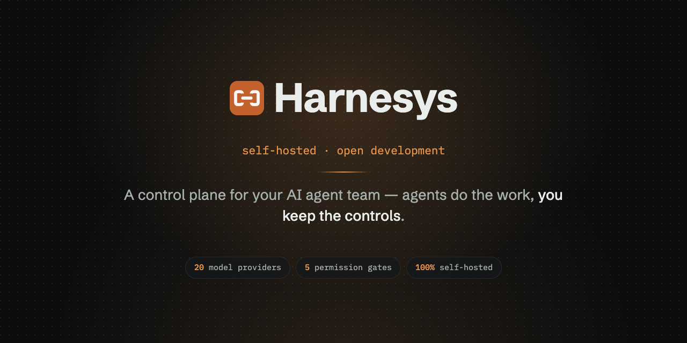
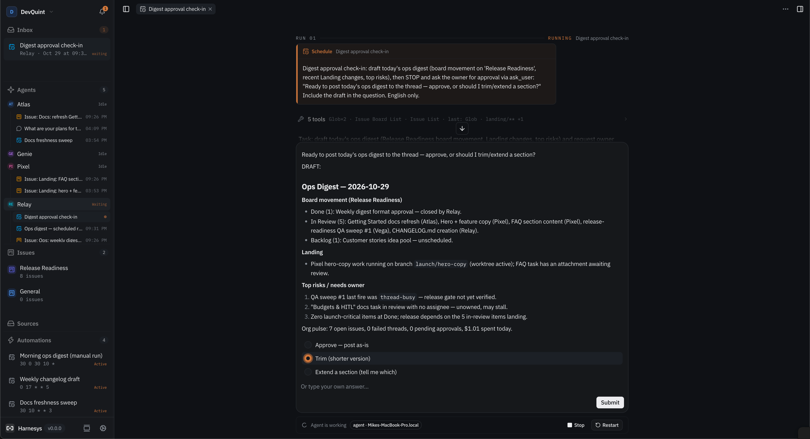
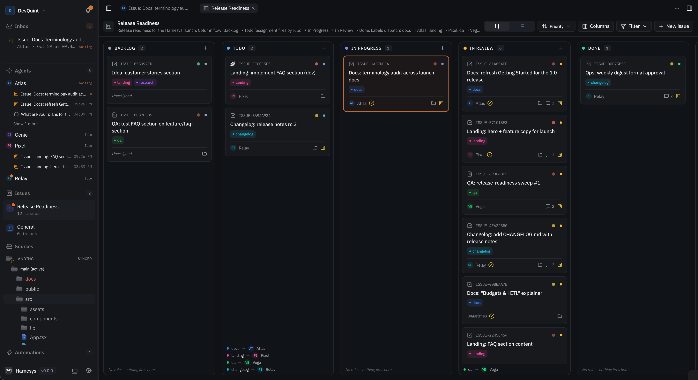
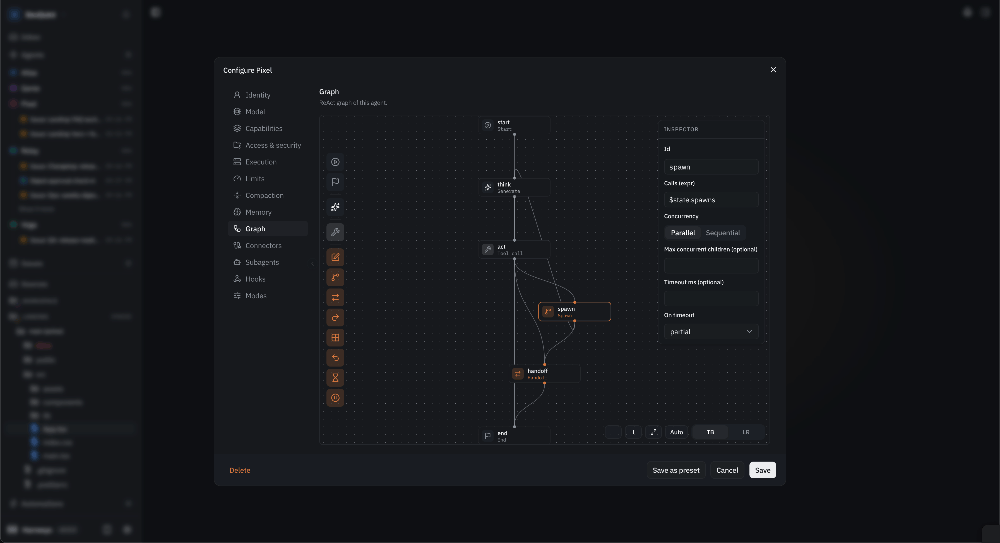
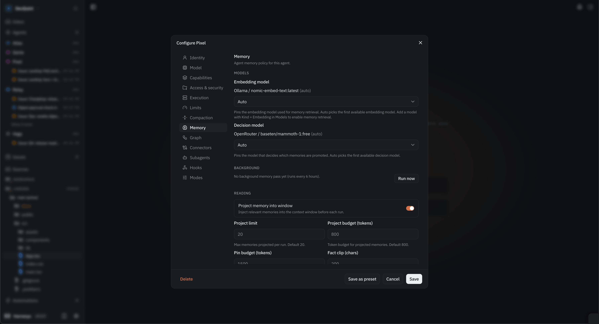

<p align="center">
  
</p>

<h1 align="center">Harnesys</h1>

<p align="center">
  <a href="https://github.com/harnesys/harnesys/actions/workflows/ci.yml"></a>
  <a href="https://github.com/harnesys/harnesys/releases"></a>
  
  <a href="LICENSE"></a>
</p>

<p align="center">
  <a href="https://harnesys.github.io/harnesys/">Landing</a> ·
  <a href="https://github.com/harnesys/harnesys/releases">Download</a> ·
  <a href="#quick-start">Quick start</a> ·
  <a href="#development">Development</a> ·
  <a href="LICENSE">License</a>
</p>

---

Harnesys is a self-hosted control plane for teams of AI agents. One host runs the API and the desk UI, worker machines pair into a fleet, and agents get threads, tools, skills, knowledge, schedules, and approvals — with every run visible and every sensitive step waiting for your decision.

Agents do the work. You keep the controls.

- **Audit everything** — every tool call with input and exit code in the transcript, per-turn token counts, question cards when an agent needs your call.
- **Shape every agent** — a visual graph editor (ReAct by default), spawn/handoff between agents, thirteen config categories, budgets on steps and tokens.
- **Automate the routine** — cron schedules, webhook triggers, label rules that route board issues to the right agent.
- **Stay in control** — permission gates (`allow / ask / deny`) on file writes, shell, network, MCP, and agents; org vault, audit log, file-access rules.
- **Keep your data** — per-org SQLite under your home directory, ~20 model providers or a local Ollama, no cloud account.

## Install

### Desktop app (recommended)

Downloads from [GitHub Releases](https://github.com/harnesys/harnesys/releases) — the host ships as a sidecar inside the app:

| Platform | Files |
|---|---|
| macOS (Apple silicon / Intel) | `Harnesys_aarch64.dmg` · `Harnesys_x64.dmg` |
| Windows (x64 / ARM64) | `Harnesys_x64-setup.exe` · `Harnesys_arm64-setup.exe` |
| Linux (x64) | `Harnesys_amd64.AppImage` · `Harnesys_amd64.deb` |

First launch on macOS: right-click the app and choose **Open** — the build is not notarized. The app auto-updates via signed releases.

### Docker (server + web UI)

```bash
docker compose -f deploy/docker-compose.yml up -d
```

Host and web UI in two containers over one volume; an optional SearXNG profile keeps `web_search` on your own infrastructure. Updates: `docker compose -f deploy/docker-compose.yml pull && docker compose -f deploy/docker-compose.yml up -d` — the desk shows a toast and a Settings → Updates entry when a newer release exists.

### Server binaries and CLI

`harnesys-host`, `harnesys-web`, and the `harnesys` CLI for Linux and macOS (x64, arm64) plus `client-dist.zip` are on the [Releases page](https://github.com/harnesys/harnesys/releases). Pair worker machines with the CLI:

```bash
harnesys login <relayUrl>
harnesys owner init
harnesys host invite --org <orgId> --name <nodeName>
harnesys host enroll <relayUrl> <code> --org <orgId> --name <nodeName>
harnesys host doctor          # diagnostics
harnesys host promote ...     # live relay-role transfer
harnesys update               # self-update host/web binaries from the latest release
```

## Quick start

1. **Install** the desktop app (or start `docker compose`).
2. **Open the desk** — the app starts a local host on `127.0.0.1:47474` and opens the UI. Data stays in `~/.harnesys`.
3. **Add a model** — pick a provider from the catalog (OpenAI, Anthropic, Google, OpenRouter, Groq, local Ollama, …) or point at any OpenAI-compatible endpoint.
4. **Give an agent a task** — pick a preset or draw a graph, write the task in chat, approve the steps you care about.
5. **Grow into a fleet** — pair machines with the CLI, add cron schedules and label rules; the inbox collects what needs you.

## What you get

| | |
|---|---|
| **Runs you can audit** | Full transcript per run, question cards with fixed options, stop/restart at any point. |
| **Agents you can shape** | Presets for agents and whole teams, graph editor with spawn/handoff/map/wait nodes, thirteen config categories. |
| **A workspace built in** | Files, Monaco editor with LSP, git panel, real PTY terminals — next to the chat, for when the work is code. |
| **Work while you sleep** | Cron schedules bind an agent + thread + permission mode; webhooks wake threads; label rules dispatch issues. |
| **Memory that persists** | Pins, promoted facts, episodic logs, knowledge roots with hybrid full-text + vector search (RAG). |
| **Extend everything** | Skills agents can author themselves, plugins from git/npm, `mcp.json` per org or project, hooks on 19 lifecycle events. |

<p align="center">
  
  
</p>
<p align="center">
  
  
</p>

## How it fits together

- Your main machine (or a VPS) runs the **relay** — the host API, SQLite, the desk.
- Worker machines **enroll** with an invite code and run agents on their own files.
- The desk opens in the desktop app or any **browser** pointed at the relay.
- Decisions come back to you as approval cards; the journal, gates, and inbox are fleet-wide.

## Documentation

| Path | Contents |
|---|---|
| [`apps/server`](apps/server) | Host API: architecture, endpoints, configuration |
| [`apps/webui`](apps/webui) | Desk SPA: layout, realtime, theming |
| [`apps/cli`](apps/cli) | CLI: commands, session files |
| [`apps/desktop`](apps/desktop) | Tauri shell: sidecar, updater, builds |
| [`deploy/`](deploy) | Docker compose, Dockerfiles, SearXNG |

## Development

Requirements: [Bun](https://bun.sh) 1.3+, Rust (desktop builds only).

```bash
bun install
bun run dev        # host API on :47474 + web UI on :5173

bun run lint       # biome check .
bun run test       # bun test (1500+ unit tests)
bun run typecheck  # tsc --noEmit across workspaces

bun run build:host     # build/harnesys-host
bun run build:web      # build/harnesys-web
bun run build:cli      # build/harnesys
bun run build:desktop  # Tauri bundles (dmg/nsis/appimage/deb)

bun run release <semver>  # bump versions, tag, push
```

Monorepo layout (Bun workspaces):

| Path | What it is |
|---|---|
| `apps/server` | Hono + Brix (DI) + Drizzle/SQLite + Zod; 77 REST controller groups, SSE/WS realtime |
| `apps/webui` | Vite 8, React 19 + React Compiler, Tailwind 4, TanStack Query, Monaco, xterm |
| `apps/cli` | Single-binary CLI via `bun build --compile` |
| `apps/desktop` | Tauri v2 shell, host sidecar, signed auto-updater |
| `packages/brix` | Nest-style DI/module framework on top of Hono |
| `packages/contracts` | Zod REST contracts shared by server and clients |
| `packages/harnesys` | Agent engine: run engine, tool packs, graphs, memory |
| `packages/studio-shared` | Shared types and pure helpers |

Architecture: clean architecture in a Nest-style layout — controllers are thin facades over use-cases, ports are abstract classes in `domain`, adapters implement them, modules wire everything via DI at boot. Errors follow one contract `{statusCode, errorCode, message, path, timestamp, traceId?}`; logs go through Pino. Realtime is push-only: SSE for runs and watches, WebSockets for fleet workers and terminals — no polling anywhere.

## License

[PolyForm Internal Use 1.0.0](LICENSE) — use and modify freely inside your organization, including for commercial purposes. Redistribution of the software or derivative works is not permitted.

Issues are welcome. Pull requests are not accepted and will be closed.
