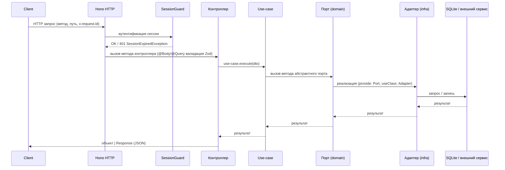

# 03. Архитектурный обзор

## Стиль архитектуры

Сервер следует чистой архитектуре в стиле Nest на базе Hono. Зависимости направляются внутрь: инфраструктура и адаптеры зависят от домена, домен не знает об инфраструктуре. Варианты использования (use-cases) orchestrируют домен через абстрактные порты. Точка входа: `apps/server/src/main.ts` — `apps/server/src/app/`.

## Слои сервера (`apps/server/src/app`)

| Слой | Назначение |
|------|------------|
| `api/` | REST API: контроллеры — тонкие фасады над use-cases, глобальный страж `SessionGuard` |
| `application/` | use-cases: один класс, метод `execute(dto)`, инъектируют доменные порты |
| `domain/` | сущности (интерфейсы/записи), абстрактные порты (`*-port.ts`), ошибки (`*.error.ts`) |
| `infra/` | адаптеры (`*.adapter.ts`), реализации портов, модули (`*.module.ts`) |
| `libs/` | общие библиотеки (`trace.ts`) |

## Суффиксы файлов (конвенция)

| Суффикс | Назначение |
|---------|------------|
| `*-port.ts` | абстрактный класс порта (DI-токен) |
| `*.use-case.ts` | один класс, метод `execute` |
| `*.use-case.module.ts` | модуль DI для группы use-cases |
| `*.controller.ts` | один контроллер ресурса |
| `*.adapter.ts` | реализация порта (адаптер) |
| `*.schema.ts` | Zod-схема DTO |
| `*.error.ts` | доменные ошибки |

## Регистрация модулей и DI

Точка входа `apps/server/src/main.ts`:

1. `import 'reflect-metadata'` — необходимо для `design:paramtypes` DI brix.
2. Путь конфига: `APP_CONFIG_DIR_PATH/application.yml` (`apps/server/src/const.ts`).
3. `Brix.create(AppModule.forRoot(), { config: ... })` — приложение brix: при наличии файла конфига загрузка по схеме `AppConfigSchema`; иначе встроенный YAML `EMBEDDED_APP_CONFIG_YML` с подстановкой `process.env` (`parseConfigYaml`).
4. `await app.init()` — инициализация DI графа: `container.resolveAll()` → `runModuleInit` (хуки `onModuleInit`).
5. Сеяние системных навыков `seedSystemSkills` (`apps/server/src/app/infra/skills/system-skills-seed.ts`) и системных пресетов `systemPresetsSeed` + `importLegacyUserPresets` (`apps/server/src/app/infra/presets/`).
6. Регистрация WebSocket: `registerFleetWorkerWs` (fleet worker WS) и `registerTerminalWs` (терминал) (`apps/server/src/app/infra/fleet-hub/fleet-worker.ws.ts`, `apps/server/src/app/infra/terminal/terminal.ws.ts`).
7. `await app.serve({ idleTimeout: 120, websocket: fleetWorkerWebsocket })` — Hono сервер, порт из `application.yml` `server.port` (по умолчанию 47474, `ServerBindingSchema`).
8. Фоново `RefreshAllSourceVcsUseCase.execute()` — обновление всех Git-источников при старте; ошибка логируется предупреждением (`pino`), не прерывает запуск.

`AppModule` (`apps/server/src/app/app.module.ts`): `forRoot()` → `imports: [ApiModule]`, `controllers: []`.

`ApiModule` (`apps/server/src/app/api/api.module.ts`): импортирует use-case и инфраструктурные модули, перечисляет контроллеры в массиве `controllers`, регистрирует глобальный страж `providers: [{ provide: APP_GUARD, useClass: SessionGuard }]`.

DI токены — это классы (порты `abstract class`, адаптеры `extends Port`, `@Injectable()` use-cases, контроллеры, Guard). Токен никогда не импортируется через `import type`; иначе контейнер видит `Object` вместо токена и падает при загрузке с ошибкой:

```
Cannot resolve dependency at index N of X: metadata erased the token to Object (type-only import)
```

Если файл экспортирует и класс-токен, и типы, импорты делятся:
```ts
import { LocalExecutorPort } from '...port.ts';          // значение (токен)
import type { CompactThreadResult } from '...port.ts';   // только тип
```

## Поток запроса

Клиент → HTTP (Hono:47474) → Middleware (`x-request-id`, лог запроса `method path statusCode durationMs traceId`, pino) → `SessionGuard` (аутентификация сессии, `Principal`) → Контроллер → `Use-case.execute(dto)` → Порт → Адаптер → БД / внешний сервис / `packages/harnesys` → ответ клиенту.

Ответы контроллеров: `object | Response`. Ошибки: единый контракт `ErrorResponse` `{ statusCode, errorCode, message, path, timestamp, traceId?, details? }` (`packages/brix/src/errors/error-filter.ts`). Домен выбрасывает `DomainException`, глобальный фильтр маппит в `HttpException`; неизвестные → `500 INTERNAL_ERROR` + `pino.error`.

## Среда выполнения агентов (`packages/harnesys`)

Ядро выполнения agent-графов изолировано в `packages/harnesys`. Сервер вызывает его через порты. Граф может быть приостановлен (`needs_input`), прерван (interrupt), продолжен (resume), скомпитирован — `packages/harnesys/src/application/`.

## Модель интеграций

Интеграции — аддоны (Telegram, GitHub, Google). Каждая интеграция владеет отдельным файлом SQLite: `orgDataDir(orgId)/integrations/<id>/data.db`, DDL пишет сама интеграция. В ядре нет таблиц под данные интеграций, нет `if (provider === 'x')` в ядре — `packages/integration-telegram/src/db/schema.ts`, AGENTS.md (integration-addon model).

Единственные ссылки ядра на интеграцию — два реестра:
- `apps/server/src/app/infra/integrations/installed-integrations.ts`
- `apps/webui/src/integrations/registry.ts`

Установка интеграции = добавление в оба реестра. Деинсталляция = удаление из обоих реестров + удаление каталога данных интеграции.

## Диаграмма: компоненты и слои

```mermaid
graph TD
    subgraph Client[Клиент]
    WUI[WebUI]
    CLI[CLI]
    DESK[Десктоп (Tauri)]
    EXT[Внешние сервисы: Telegram / GitHub / Google / LLM]
    end

    subgraph Server[Сервер apps/server :47474]
    Hono[Hono HTTP + middleware: trace/request-id/observability/CORS]
    Guard[SessionGuard APP_GUARD]
    API[Контроллеры api/rest/*.controller.ts]
    UC[Use-cases application/]
    DOM[Домен domain/: сущности, порты, ошибки]
    INFRA[Инфраструктура infra/: адаптеры, модули]
    end

    subgraph Brix[DI контейнер brix packages/brix]
    Container[Container: resolveToken, singleton кэш]
    MG[ModuleGraph: ownerOf, canSee, multi APP_GUARD/HEALTH_CHECK]
    end

    subgraph DB[(SQLite: org.sqlite + интеграции <id>/data.db)]
    end

    Client --> Hono
    Hono --> Guard
    Guard --> API
    API --> UC
    UC --> DOM
    DOM -.->|контракт порта| INFRA
    INFRA --> DB
    INFRA -.->|вызов через порты| HK[packages/harnesys]
    INFRA --> EXT
    Brix -->|создаёт и conectрует| API
    Brix -->|создаёт и conectрует| UC
    Hono -.-> WS[WebSocket: fleet worker, терминал]
```

## Диаграмма: поток запроса



## Связанные разделы

- [00-введение.md](./00-введение.md)
- [01-стек-технологий.md](./01-стек-технологий.md)
- [02-структура-репозитория.md](./02-структура-репозитория.md)
- [04-диаграммы-архитектуры.md](./04-диаграммы-архитектуры.md)
- [05-архитектура-сервера.md](./05-архитектура-сервера.md)
- [06-di-контейнер-brix.md](./06-di-контейнер-brix.md)
