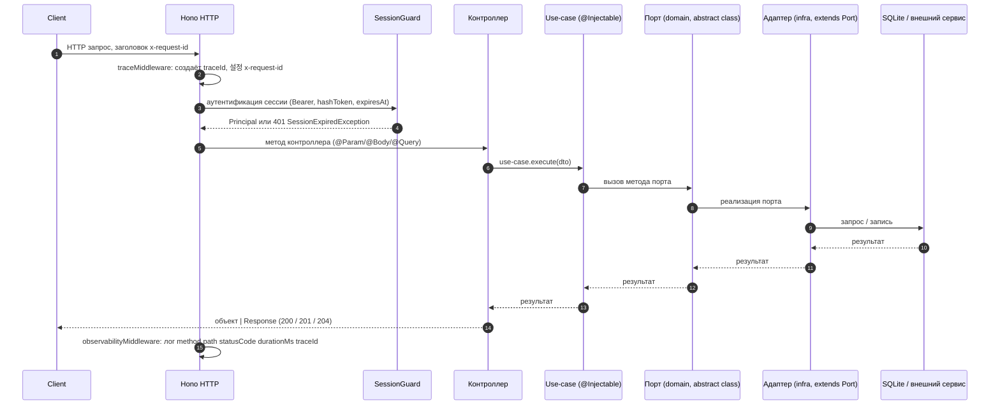
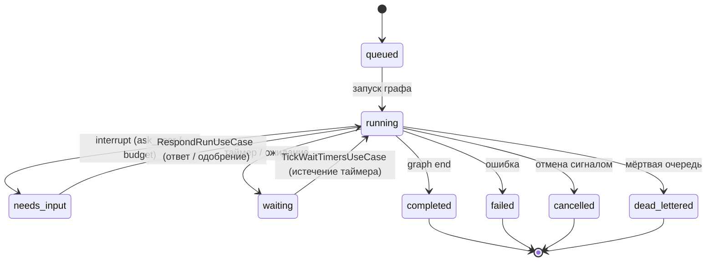
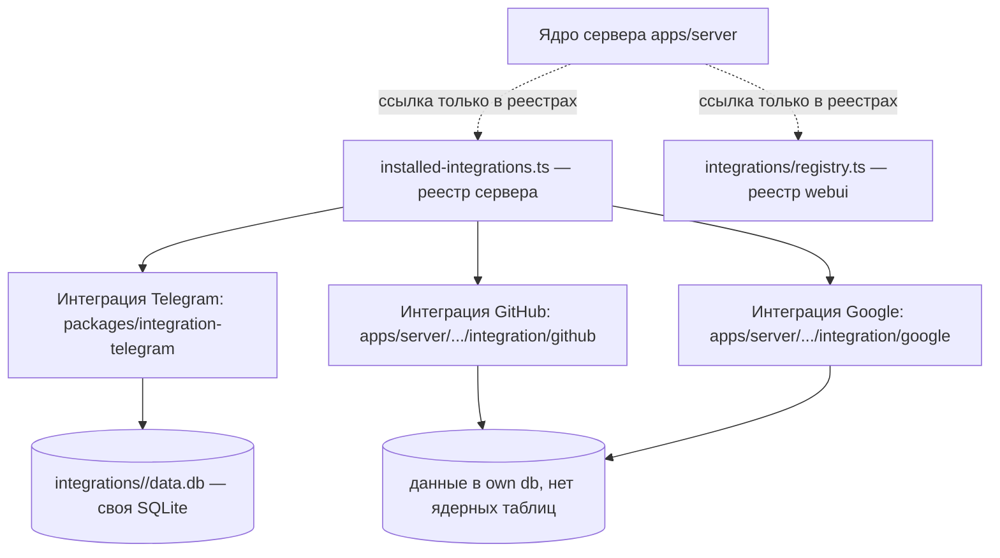

# 04. Диаграммы архитектуры (Mermaid)

Диаграммы приведены в формате Mermaid и отражают структуру кода текущей ветки.

## Диаграмма контейнеров высокого уровня

```mermaid
graph TD
    subgraph Client[Клиент]
    WUI[WebUI :5173]
    CLI[CLI]
    DESK[Десктоп Tauri]
    end

    subgraph Server[Сервер apps/server :47474]
    Hono[Hono HTTP: middleware trace/request-id/observability/CORS]
    Guard[SessionGuard APP_GUARD]
    API[Контроллеры api/rest (68 файлов *.controller.ts)]
    Brix[DI контейнер brix: Container + ModuleGraph]
    end

    subgraph App[Слои приложения]
    UC[Use-cases application/ (38 доменов)]
    DOM[Домен domain/ (41 домена): сущности, порты, ошибки]
    INFRA[Инфраструктура infra/: адаптеры, модули]
    end

    subgraph Data[Данные]
    ORG[(org.sqlite per orgId, Drizzle + bun:sqlite)]
    INT[(integrations/<id>/data.db, своя SQLite на интеграцию)]
    end

    subgraph External[Внешние сервисы]
    TG[Telegram]
    GH[GitHub]
    GG[Google]
    LLM[LLM провайдеры]
    end

    Client --> Hono
    Hono --> Guard
    Guard --> API
    API --> UC
    UC --> DOM
    DOM -.->|контракт порта| INFRA
    INFRA --> ORG
    INFRA --> INT
    INFRA --> External
    Hono -.-> WS[WebSocket: fleet worker, терминал]
    Brix -.->|создаёт компоненты| API
    Brix -.->|создаёт компоненты| UC
```

## Диаграмма слоев сервера

```mermaid
graph TD
    subgraph API["api/ — REST (Hono)"]
    C[Контроллеры *.controller.ts]
    G[SessionGuard APP_GUARD]
    end

    subgraph APP["application/ — Use-cases"]
    UC[Use-case: execute(dto)]
    end

    subgraph DOMAIN["domain/ — сущности, порты, ошибки"]
    E[Сущности / записи (interface)]
    P[Абстрактные порты *-port.ts = DI токены]
    Err[Ошибки *.error.ts]
    end

    subgraph INFRA["infra/ — адаптеры"]
    A[Адаптеры *.adapter.ts]
    M[Модули *.module.ts]
    end

    subgraph DB["БД SQLite (Drizzle, bun:sqlite)"]
    Org[(org.sqlite)]
    Int[(интеграции <id>/data.db)]
    end

    C --> UC
    UC --> E
    UC --> P
    P -.->|реализует| A
    A --> DB
    G -->|защита всех маршрутов| C
```

## Диаграмма модулей brix и DI графа

```mermaid
graph TD
    subgraph BrixApp[Brix.create(AppModule.forRoot())]
    CM[ConfigModule: global, CONFIG токен, ConfigService factory]
    LM[LoggingModule: Logger]
    EF[APP_FILTER = DefaultErrorFilter]
    MR[MetricsRegistry]
    end

    AppModule[AppModule] --> ApiModule[ApiModule]
    ApiModule --> UM1[UseCaseModule A]
    ApiModule --> UM2[UseCaseModule B]
    ApiModule --> IM1[InfraModule C]

    UM1 --> P1[Порт A = абстрактный класс, DI-токен]
    UM2 --> P2[Порт B = абстрактный класс, DI-токен]
    IM1 --> A1[Адаптер C extends Порт C]

    P1 -.->|provide: Port, useClass: Adapter| A1
    P2 -.->|provide: Port, useClass: Adapter| A1

    style CM fill:#e1f5fe
    style LM fill:#e1f5fe
    style EF fill:#ffe6e6
```

## Диаграмма потока запроса



## Диаграмма жизненного цикла run



## Диаграмма моделей интеграций



## Связанные разделы

- [03-архитектурный-обзор.md](./03-архитектурный-обзор.md)
- [05-архитектура-сервера.md](./05-архитектура-сервера.md)
- [06-di-контейнер-brix.md](./06-di-контейнер-brix.md)
- [22-интеграции-общая-модель.md](./22-интеграции-общая-модель.md)
