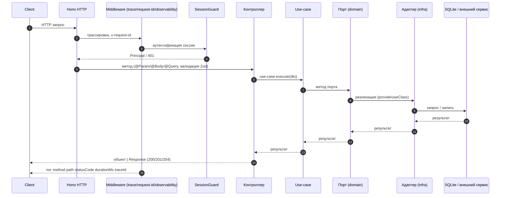

# 07. Слой API REST (apps/server/src/app/api/rest)

## Назначение и место в слоях

Транспортный слой сервера на базе Hono. Регистрирует маршруты в `ApiModule` (`apps/server/src/app/api/api.module.ts`), который импортирует все use-case и инфраструктурные модули и перечисляет 68 файлов `*.controller.ts` в массиве `controllers`. Глобальный страж `APP_GUARD` (`SessionGuard`) защищает все маршруты. Слой тонкий: контроллеры — фасады над use-case, не содержат бизнес-логики.

## Поток данных запроса

Клиент → HTTP (Hono:47474) → Middleware (`requestContextMiddleware`, `traceMiddleware` — `x-request-id`, `observabilityMiddleware` — лог запроса `method path statusCode durationMs traceId`, pino, CORS) → `SessionGuard` (аутентификация сессии, `Principal`) → Контроллер → `Use-case.execute(dto)` → Порт → Адаптер → БД/внешний сервис → ответ `object | Response`. Ошибки приводятся к контракту `ErrorResponse`.

## Декораторы HTTP (packages/brix/src/http/)

| Декоратор | Назначение |
|-----------|------------|
| `@Controller(prefix?)` | Класс контроллера, HTTP-префикс маршрута (`controllerPrefixKey`) |
| `@Get`, `@Post`, `@Patch`, `@Delete` | Метод маршрута (`routes.ts`, `getRouteTable`) |
| `@Param(name?)` | Параметр пути (`c.req.param`) |
| `@Body(schema?)` | Тело запроса, валидация Zod-схемы |
| `@Query(schema?)` | Query-параметры, валидация Zod-схемы (`collapseQueryParams`) |
| `@Ctx()` / `@Req()` | Контекст Hono |
| `@HttpCode(code)` | Статус ответа |
| `@Public()` | Маршрут без стража (`IS_PUBLIC_KEY`) |
| `@UseGuards(...)` | Стражи маршрута/класса |

## Контроллеры (перечень из api.module.ts)

По одному контроллеру на ресурс, суффикс `.controller.ts`. Всего 68 файлов.

**Организации и идентичность**
- `orgs.controller.ts` — организации
- `session.controller.ts` — сессия (вход, статус)
- `members.controller.ts` (`MembersController`, `InvitesController`) — пользователи и приглашения
- `audit.controller.ts` — аудит организации
- `identity-links.controller.ts` — связанные идентичности

**Потоки и выполнение**
- `threads.controller.ts` — потоки (threads)
- `thread-attachments.controller.ts` — вложения потока
- `thread-files.controller.ts` — файлы потока
- `thread-compact.controller.ts` — компакция потока
- `thread-message-queue.controller.ts` — очередь сообщений потока
- `thread-raw-model-requests.controller.ts` — сырые запросы к модели

**Агенты и автоматизации**
- `agents.controller.ts` — агенты (`orgs/:orgId/agents`)
- `automations.controller.ts` — автоматизации
- `agent-hooks.controller.ts` — хуки агентов

**Источники данных**
- `sources.controller.ts` — источники
- `source-git.controller.ts` — Git-источники
- `source-vcs.controller.ts` — VCS источники
- `source-materialize.controller.ts` — материализация источника
- `source-worktrees.controller.ts` — worktree источников

**Интеграции**
- `integrations.controller.ts` — интеграции
- `integrations-github.controller.ts` — GitHub интеграция
- `integrations-google-callback.controller.ts` — callback Google OAuth
- `integration-routes.controller.ts` — маршруты интеграций

**Задачи и доски**
- `issues.controller.ts` — задачи (issues)
- `boards.controller.ts` — доски (kanban)
- `labels.controller.ts` — метки

**Флот узлов**
- `fleet.controller.ts` — флот
- `fleet-nodes.controller.ts` — узлы флота
- `fleet-cloud.controller.ts` — облачный флот
- `placement-queue.controller.ts` — очередь размещения

**База знаний**
- `knowledge.controller.ts` — знания организации
- `knowledge-org.controller.ts` — знания организации

**Навыки и модели**
- `skills.controller.ts` — навыки
- `skills-search.controller.ts` — поиск навыков
- `host-skills.controller.ts` — навыки хоста
- `providers.controller.ts` — провайдеры моделей
- `model-image.controller.ts`, `model-speech.controller.ts`, `model-transcription.controller.ts`, `model-voices.controller.ts` — выполнение моделей

**Плагины и пресеты**
- `plugins.controller.ts` — плагины
- `plugin-registries.controller.ts` (`PluginCatalogController`, `PluginRegistriesController`) — реестры плагинов
- `presets.controller.ts` — пресеты
- `mode-presets.controller.ts` — режимные пресеты

**Прочее**
- `catalog.controller.ts` — каталог
- `capabilities.controller.ts` — возможности
- `discovery.controller.ts` — обнаружение
- `lsp.controller.ts` — LSP серверы
- `toolchain.controller.ts` — цепочка инструментов
- `browser.controller.ts` — браузер
- `terminals.controller.ts` (`TerminalsController`, `OrgTerminalsController`) — терминал
- `content.controller.ts` — контент (файловые операции хоста)
- `connectors.controller.ts` — соединители
- `file-rules.controller.ts` — правила доступа к файлам
- `permission-rules.controller.ts` — правила прав
- `org-git.controller.ts` — Git организации
- `org-terminals.controller.ts` — терминалы организации
- `host-browse.controller.ts` — обзор хоста
- `approvals.controller.ts` — одобрения
- `schedules.controller.ts` — расписания
- `webhooks.controller.ts` (`WebhooksController`, `OrgHooksController`) — вебхуки
- `events-watch.controller.ts` — наблюдение за событиями
- `usage.controller.ts` — использование
- `memory.controller.ts` (`MemoryController`, `MemoryStatusController`) — память
- `teams.controller.ts` — команды
- `vault.controller.ts` — секреты (vault)
- `eula.controller.ts` — EULA
- `health.controller.ts` — проверка здоровья

## Пример контроллера (agents)

`apps/server/src/app/api/rest/agents.controller.ts` (`@Controller('orgs/:orgId/agents')`): `list` → `ListAgentsUseCase.execute({orgId})`, `get` → `GetAgentUseCase`, `create` → `@Body(CreateAgentBodySchema)` → `CreateAgentUseCase.execute({orgId, body})`, `update` → `UpdateAgentUseCase`, `remove` → `DeleteAgentUseCase` (`@HttpCode(204)`). Возвращает `object` (DTO из `@harnesys/contracts`).

## DTO и валидация

DTO — Zod-схемы (`*.schema.ts` в `packages/contracts/src/`) + `z.infer`. Валидация в `ZodValidationPipe` (`packages/brix/src/validation/zod-pipe.ts`, `validateWithSchema`) через декораторы `@Body(schema)` и `@Query(schema)`. При ошибке валидации возвращается `400 VALIDATION_ERROR` с `details.issues`. Невалидное JSON-тело → `400 BadRequestException` с `issues: []`.

## Формат ответов

Контроллеры возвращают `object | Response`. Тело ответа — объект, сериализуемый в JSON. Статус по умолчанию: `POST` → 201, иначе 200; `@HttpCode(204)`/`304` → пустой ответ; `undefined` → 204. Единый контракт ошибки:

```
{ statusCode, errorCode, message, path, timestamp, traceId?, details? }
```

Домен выбрасывает `DomainException`, глобальный фильтр маппит в `HttpException`. Неизвестные ошибки → `500 INTERNAL_ERROR` + `pino.error`.

## Диаграмма: поток запроса в REST слое



## Связанные разделы

- [05-архитектура-сервера.md](./05-архитектура-сервера.md)
- [06-di-контейнер-brix.md](./06-di-контейнер-brix.md)
- [08-слой-application-use-cases.md](./08-слой-application-use-cases.md)
- [39-безопасность.md](./39-безопасность.md)
- [40-ошибки-и-логирование.md](./40-ошибки-и-логирование.md)
- [49-каталог-api.md](./49-каталог-api.md)
