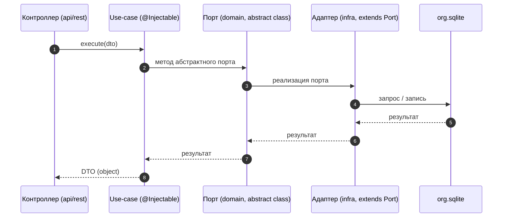

# 08. Слой вариантов использования (application/use-cases)

## Назначение и место в слоях

Слой `apps/server/src/app/application/` содержит варианты использования (use-cases) — чистую бизнес-логику сервера. Расположен между API REST и доменным/инфраструктурным слоями. Use-case вызывает методы абстрактных портов (`*-port.ts`) домена; порты реализуются адаптерами в `infra/`.

## Конвенция файлов

| Суффикс | Назначение |
|---------|------------|
| `*.use-case.module.ts` | модуль DI группы use-cases |
| `*.use-case.ts` | один класс с методом `execute(dto)` |
| `*.use-case.spec.ts` | тест use-case (чистая логика) |

Каждый use-case — один класс, один public метод `execute`. Инъектирует порты по типу (класс, не `import type` — см. правило токенов brix в AGENTS.md и разделе 06). Класомечен `@Injectable()` (проверка `isInjectable` при регистрации в `Container`).

## Домены use-cases (из api.module.ts)

38 директорий в `application/`. Каждый домен имеет модуль DI `*.use-case.module.ts`, регистрирует свои use-cases как провайдеры и экспортирует их.

| Домен | Модуль DI | Назначение |
|-------|-----------|------------|
| `agents` | `AgentUseCaseModule` | управление агентами |
| `approvals` | `ApprovalUseCaseModule` | процессы одобрения |
| `automations` | `AutomationUseCaseModule` | автоматизации |
| `capabilities` | `CapabilitiesUseCaseModule` | возможности |
| `connectors` | `ConnectorUseCaseModule` | соединители |
| `content` | `ContentUseCaseModule` | файловый контент хоста |
| `eula` | `EulaUseCaseModule` | EULA |
| `execution-profile` | `ExecutionProfileUseCaseModule` | профили выполнения |
| `file-access` | `FileAccessUseCaseModule` | правила доступа к файлам |
| `fleet` | `FleetUseCaseModule` (+ `WorkerOrgOpsModule`) | флот узлов |
| `hooks` | `HookUseCaseModule` | хуки |
| `identity` | `IdentityUseCaseModule` | идентичность, сессии, пользователи |
| `integration` | `IntegrationUseCaseModule` | интеграции |
| `issues` | `IssueUseCaseModule` | задачи и доски |
| `knowledge` | `KnowledgeUseCaseModule` | база знаний |
| `lsp` | `LspUseCaseModule` | LSP серверы |
| `manager` | `ManagerUseCaseModule` | менеджер (пульс, хвост) |
| `mcp` | `McpUseCaseModule` | MCP серверы |
| `memory` | `MemoryUseCaseModule` | память |
| `mode-presets` | `ModePresetsUseCaseModule` | режимные пресеты |
| `model-execution` | `AudioUseCaseModule`, `ImageUseCaseModule` | выполнение моделей |
| `org-machine` | `OrgMachineUseCaseModule` | организация/машина |
| `plugins` | `PluginsUseCaseModule` | плагины |
| `presets` | `PresetUseCaseModule` | пресеты |
| `providers` | `ProviderUseCaseModule` | провайдеры моделей |
| `release` | `ReleaseUseCaseModule` | релизы |
| `schedules` | `ScheduleUseCaseModule` | расписания |
| `skills` | `SkillsUseCaseModule` | навыки |
| `source` | `SourceUseCaseModule` | источники данных |
| `teams` | `TeamsUseCaseModule` | команды |
| `terminal` | `TerminalUseCaseModule` | терминал |
| `threads` | `ThreadUseCaseModule` | потоки и выполнение |
| `toolchain` | `ToolchainUseCaseModule` | цепочка инструментов |
| `usage` | `UsageUseCaseModule` | использование/бюджет |
| `use-cases/browser` | `BrowserUseCaseModule` | браузер |
| `vault` | `VaultUseCaseModule` | секреты |
| `webhooks` | `WebhookUseCaseModule` | вебхуки |

## Пример структуры модуля (threads)

`application/threads/thread.use-case.module.ts` регистрирует 27 use-cases: `CreateThreadUseCase`, `ListThreadsUseCase`, `GetThreadUseCase`, `SendThreadMessageUseCase`, `SendThreadRunUseCase`, `CancelRunUseCase`, `CompactThreadUseCase`, `MarkThreadReadUseCase`, `GetThreadPlanUseCase`, `DeleteThreadPlanUseCase`, `RespondRunUseCase`, `RetryRunUseCase`, `StreamRunEventsUseCase`, `DeleteThreadUseCase`, `DeleteThreadEventUseCase`, `UpdateThreadBindingUseCase`, `UpdateThreadPolicyUseCase`, `AddThreadAgentUseCase`, `RemoveThreadAgentUseCase`, `AddThreadParticipantUseCase`, `RemoveThreadParticipantUseCase`, `TickWaitTimersUseCase`, `UploadThreadAttachmentUseCase`, `ListThreadAttachmentsUseCase`, `ListThreadFilesUseCase`, `ReadThreadFileUseCase`, `ListThreadRawModelRequestsUseCase`, `GetThreadRawModelRequestUseCase`, `GetThreadAttachmentUseCase`, `ThreadMessageQueueUseCase`.

Импортирует инфраструктурные модули: `ThreadModule`, `AgentModule`, `ConnectorModule`, `ApprovalModule`, `ModePresetsModule`, `RuntimeModule`, `SourceModule`, `ExecutionProfileModule`, `MachineHomeModule`, `FileAccessModule`, `FleetHubModule`, `FleetUseCaseModule`, `IdentitySqliteModule`, `SkillsModule`, `SkillsUseCaseModule`, `IssueInfraModule`, `UsageModule`. Форма модуля:
```ts
@Module({
  imports: [...],
  providers: [...useCases],
  exports: [...useCases],
})
export class ThreadUseCaseModule {}
```

## Взаимодействие с доменом

Use-case вызывает методы абстрактных портов (`*-port.ts`) доменного слоя. Порта реализуются адаптерами в `infra/` (`provide: Port, useClass: Adapter`). Исполнение может быть отложено или прервано (interrupt): `RespondRunUseCase` обрабатывает ответ на прерывание (ask_user / budget), `CompactThreadUseCase` запускает компакцию потока, `TickWaitTimersUseCase` пробуждает `waiting` runs.

## Диаграмма: схема вызова use-case



## Связанные разделы

- [07-слой-api-rest.md](./07-слой-api-rest.md)
- [09-слой-domain-entities-ports.md](./09-слой-domain-entities-ports.md)
- [10-слой-infra-adapters.md](./10-слой-infra-adapters.md)
- [14-потоки-threads.md](./14-потоки-threads.md)
- [15-выполнение-run-engine.md](./15-выполнение-run-engine.md)
