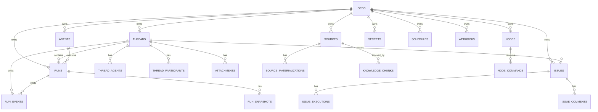

# 11. База данных и схема (org-sqlite)

## Назначение и место в слоях

Основное хранилище организации — SQLite файл через `bun:sqlite` и Drizzle ORM. Схема описана в `apps/server/src/app/infra/org-sqlite/schema/` (Drizzle таблицы) и DDL-константы в `apps/server/src/app/infra/org-sqlite/org-sql.ts` (`CREATE_*_SQL`). Каждая организация имеет свой изолированный SQLite файл по пути `layout.orgDbPath(orgId)`.

## Соединение и сессия

`apps/server/src/app/infra/org-sqlite/org-sqlite-session.ts`:

- `openOrgSqlite(layout, orgId)` — создаёт директорию организации (`layout.ensureOrgDir(orgId)`), открывает `bun:sqlite` базу по пути `layout.orgDbPath(orgId)`, настраивает PRAGMA: `journal_mode = WAL`, `busy_timeout = 5000`, `foreign_keys = ON`. Вызывает `ensureOrgSchema` один раз на организацию (кэш `ensuredOrgs`), затем `migrateConnectorDeliveryCursor`. Возвращает `OrgSqliteDb` (drizzle over `bun:sqlite`).
- `withOrgSqlite` / `withOrgSqliteAsync` — синхронные и асинхронные обёртки с автоматическим открытием и закрытием сессии.
- `OrgSqliteSession = { sqlite: Database; db: OrgSqliteDb; close: () => void }`.

## Обеспечение схемы

`apps/server/src/app/infra/org-sqlite/org-sql-ensure.ts`:

- `ensureOrgSchema(exec, all?)` — выполняет все DDL в строгом порядке: таблицы orgs, nodes, invites, secrets, sources, integrations, llm_providers, llm_models, agents, hook_runs, mode_presets, plugins, knowledge, threads, thread_agents, thread_participants, issue_boards, board_statuses, board_rules, issue_labels, issues, issue_comments, issue_dependencies, issue_attachments, issue_executions, runs, run_events, run_snapshots, attachments, thread_message_queue, approvals, permission_rules, schedules, webhooks, connectors, thread_plans, agent memory (memory_pins, memory_facts, memory_consolidations, memory_reflects, memory_promotions), usage, execution_profiles, execution_profile_nodes, org_execution_settings, org_memory_settings, fleet schema.
- Миграции (conditional ALTER TABLE): `migrateNodesDockerColumn`, `migrateAgentsPolicyColumns` (удаление dropped columns), `migrateAgentsExecutionProfileColumn`, `migrateThreadsBindingColumns` (run_profile_id, run_directory), `migrateRunsAttributionColumns` (started_by_user_id, via, on_node_id), `migrateThreadsInheritedEventCount`, `migrateSourcesVcsColumns` (vcs_json, availability_json, description), `migrateSourceMaterializationCloudColumns`, `migrateIssueExecutionCorrelationIndex`, `migrateModePresetToolColumns` (disabled_tools_json, exposure_json), `migrateTriggerOwnerColumns` (created_by_user_id на schedules, webhooks), `migrateIssuesBranchColumns` (branch, worktree_on_status), `migrateApprovalsTable`, `migrateApprovalsResumeStateColumn`, `migratePermissionRules`, `migrateThreadPlansTable`, `migrateAgentMemoryConsolidationColumns`, `migrateAgentMemoryEmbeddingColumns`, `migrateOrgMemorySettingsModelColumns`, `migrateExecutionProfileIsolation`, `migratePendingRunEventsAttributionColumns`, `migrateInvitesCodeHash`, `migrateUsageTable`.
- Guards: `assertThreadsOwnMembership`, `assertThreadsKindIsConversation`, `assertThreadsThreadSeq`, `assertRunsAgentSnapshot`, `assertRunsOriginConnector`, `assertRunEventsThreadScoped`, `assertIssuesStatusKey`, `assertConnectorsAgentSet`.
- Спектсты миграций: `migrate-org-memory-settings-model-columns.spec.ts`, `migrate-usage-table.spec.ts`.

## Перечень таблиц org-sqlite (из org-sql.ts DDL)

| Таблица | Первичный ключ | Назначение |
|---------|---------------|------------|
| `orgs` | id | организации |
| `nodes` | id | узлы флота (имя, роль, статус, диск, docker) |
| `invites` | id | приглашения узлов (code_hash, node_name, expires_at) |
| `secrets` | key | зашифрованные секреты (ciphertext, iv, tag, key_version) |
| `sources` | id | источники данных (имя, distribution_json, vcs_json, availability_json) |
| `source_materializations` | (org_id, source_id, host_id) | состояние материализации на хосте |
| `source_materialization_projections` | (org_id, source_id, host_id) | проекция состояния материализации |
| `repository_worktrees` | id | worktree репозиториев (source, host, branch, state) |
| `llm_providers` | id | провайдеры LLM (имя, драйвер, api_url, api_key) |
| `llm_models` | id | модели LLM (provider_id, имя, kind, metadata) |
| `agents` | id | агенты организации (имя, роль, инструкции, модель, конфиг, уровень) |
| `mode_presets` | (org_id, id) | режимные пресеты (инструкции, скиллы, паки, права) |
| `plugins` | id | плагины (имя, источник, ревизия, путь, гранты) |
| `plugin_approvals` | (org_id, plugin_name, server_id) | одобрения плагинов |
| `plugin_server_state` | (plugin_name, server_id, org_id) | состояние сервера плагина |
| `knowledge_chunks` | id | чанки знаний (источник, uri, текст, эмбеддинг) |
| `knowledge_chunks_fts` | (FTS5 виртуальная таблица) | полнотекстовый поиск по чанкам (триггеры ai/ad/au) |
| `knowledge_roots` | (source_id, path) | корневые пути индексации |
| `knowledge_settings` | source_id | настройки индекса (backend fts/vector, embed provider/model, watch) |
| `knowledge_files` | (source_id, uri) | файлы индекса (статус, размер, хеш, chunk_count) |
| `knowledge_index_state` | source_id | состояние индексатора (idle/running/error) |
| `threads` | id | потоки (название, kind, политика, родительский поток, run_profile_id, run_directory) |
| `thread_agents` | (thread_id, agent_id) | агенты потока |
| `thread_participants` | id | участники потока (provider, provider_user_id, роль member/blocked) |
| `issue_boards` | id | доски задач |
| `board_statuses` | id | статусы доски (категория backlog/started/finished/cancelled) |
| `board_rules` | id | правила доски (триггер, условия, действия) |
| `issues` | id | задачи (организация, доска, агент, ветка, worktree) |
| `issue_comments` | id | комментарии к задачам |
| `issue_dependencies` | id | зависимости между задачами |
| `issue_attachments` | id | вложения задач |
| `issue_executions` | id | выполнения задач (корреляция, лизинг, состояние reserved/active/handoff) |
| `runs` | run_id | выполнения (статус, лизинг, аренда, попытка, атрибуция) |
| `run_events` | (thread_id, thread_seq) | события выполнения (тип, последовательность, метаданные) |
| `run_snapshots` | run_id | снимки рантайма выполнения |
| `attachments` | id | вложения потоков |
| `thread_message_queue` | item_id | очередь сообщений потока |
| `approvals` | id | одобрения прерываний (interrupt_id, статус, резюме) |
| `schedules` | id | расписания (cron, целевой агент, поток, miss_policy) |
| `schedule_fires` | fire_id | срабатывания расписаний |
| `webhooks` | id | вебхуки (эндпоинт, целевой агент, поток) |
| `connectors` | id | соединители |
| `integration_events` | id | события интеграций |
| `integration_oauth_sessions` | id | OAuth сессии интеграций |
| `integrations` | id | установленные интеграции |
| `permission_rules` | id | правила прав доступа |
| `thread_plans` | thread_id | планы потоков (snapshot_json) |
| `memory_pins` | (org_id, agent_name, key) | закреплённые факты памяти |
| `memory_facts` | id | факты памяти (scope, важность, эмбеддинг) |
| `memory_consolidations` | (org_id, agent_name, thread_id) | консолидации памяти |
| `memory_reflects` | (org_id, agent_name) | отражения памяти |
| `memory_promotions` | id | Promotion фактов памяти (pending/approved/rejected) |
| `usage` | id | использование моделей (токены, стоимость) |
| `budget_marks` | (entity_id, scope) | отметки бюджета |
| `price_overrides` | model_id | переопределения цен моделей |
| `hook_runs` | id | выполнения хуков |
| `org_execution_settings` | org_id | настройки выполнения организации |
| `org_memory_settings` | org_id | настройки памяти организации |

Всего: 46+ таблиц в org-sqlite (точное количество зависит от версии миграций).

## Секреты

`apps/server/src/app/infra/org-sqlite/secrets.schema.ts` — схема секретов (не Drizzle, SQL DDL в org-sql.ts). Шифрование AES-GCM через мастер-ключ (`apps/server/src/app/infra/secret/master-key.ts`): `loadMasterKey` / `loadOrCreateMasterKey` — 32 байта base64, файл `master.key` (chmod 0600) или из конфига (`HARNESYS_MASTER_KEY`). Каждый org имеет изолированное хранилище секретов в своей org-sqlite базе.

## Интеграции — собственные SQLite

Интеграции владеют own SQLite: `orgDataDir(orgId)/integrations/<id>/data.db`, DDL пишет сама интеграция. Нет ядерных таблиц под интеграции в org-sqlite.

## Диаграмма: ER-схема ключевых таблиц

## Связанные разделы

- [10-слой-infra-adapters.md](./10-слой-infra-adapters.md)
- [13-org-и-идентичность.md](./13-org-и-идентичность.md)
- [14-потоки-threads.md](./14-потоки-threads.md)
- [19-источники-и-материализация.md](./19-источники-и-материализация.md)
