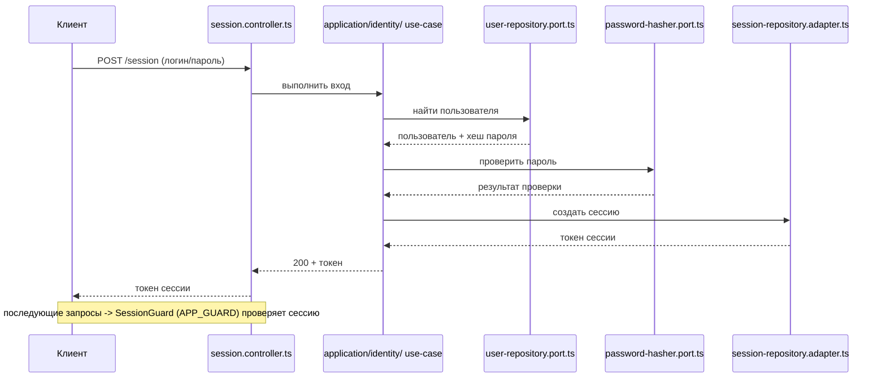
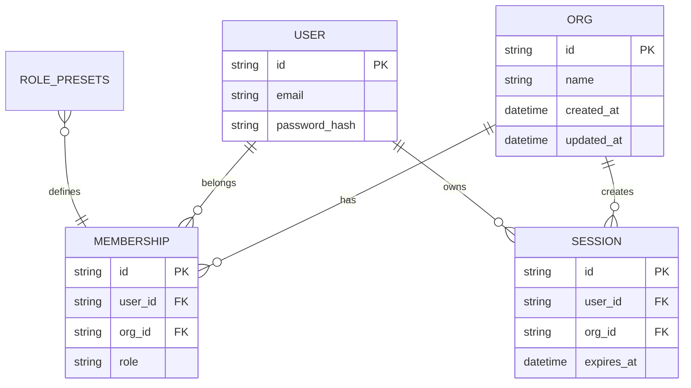

# 13. Организации и идентичность (org, identity)

## Назначение

Домен управляет организациями (org), пользователями, сессиями, членством, ролями и авторизацией. Ядро: `apps/server/src/app/domain/org/` и `apps/server/src/app/domain/identity/`. Адаптеры: `apps/server/src/app/infra/identity-sqlite/`. Организации хранятся в org-sqlite (таблица `orgs`), идентичность — в отдельной identity SQLite.

## Организации (org)

**Домен** `apps/server/src/app/domain/org/`:
- `org-db.port.ts` — порт `OrgDbPort`: `bootstrap(orgId, name): void`, `rename(orgId, name): void`.
- `org.error.ts` — ошибки: `OrgNotFoundException`, `OrgNameRequiredException`, `OrgWorkspacePathInvalidException` (не проверено кодом).

**Схема БД** (таблица `orgs`, `apps/server/src/app/infra/org-sqlite/org-sql.ts:19-26`):
```sql
CREATE TABLE IF NOT EXISTS orgs (
  id TEXT PRIMARY KEY NOT NULL,
  name TEXT NOT NULL,
  created_at TEXT NOT NULL,
  updated_at TEXT NOT NULL
);
```

**Контракты** `packages/contracts/src/org-machine.ts`:
- `CreateOrgBody`, `UpdateOrgBody` — создание / обновление организации.
- `OrgsListResponse` — список организаций.
- `OrgId`, `OrgMachineFile`, `MachineOrgEntry`, `MachineOrgRole` — идентификатор организации, файл машины организации, запись, роль.

**Контроллер:** `orgs.controller.ts`.
**Use-cases:** `application/org-machine/`.

## Идентичность (identity)

**Домен** `apps/server/src/app/domain/identity/`:

**Порты:**
| Порт | Назначение |
|------|------------|
| `user-repository.port.ts` | репозиторий пользователей |
| `user-invite-repository.port.ts` | репозиторий приглашений |
| `session-store.port.ts` | хранилище сессий |
| `password-hasher.port.ts` | хеширование паролей |
| `membership-repository.port.ts` | членство в организации |
| `ticket-key-store.port.ts` | хранилище ключей билетов |
| `identity-audit.port.ts` | аудит идентичности |
| `identity-link.port.ts` | связь идентичностей |

**Сущности и утилиты:**
- `principal.ts` — `UserPrincipal` (`kind: 'user'`, `userId`, `capabilities: string[]`, `orgId`) и `NodePrincipal` (`kind: 'node'`, `nodeId`, `orgId`); тип `Principal = UserPrincipal | NodePrincipal`.
- `capability.ts` — тип `Capability` (union из 23 строк: `org.read`, `org.update`, `org.delete`, `member.read`, `member.invite`, `member.manage`, `fleet.read`, `fleet.invite`, `fleet.manage`, `host.promote`, `desk.read`, `desk.write`, `run.start`, `run.cancel`, `source.read`, `source.write`, `secret.read`, `secret.write`, `terminal.open`, `terminal.open:ro`, `agent.manage`, `schedule.manage`); тип `NodeAction` (`heartbeat`, `work.claim`, `fleet.channel`, `source.materialize`, `run.execute`); константы `CAPABILITIES` и `NODE_ACTIONS`.
- `role-presets.ts` — `OrgRole = 'owner' | 'admin' | 'operator' | 'viewer'` и `ROLE_PRESETS`:
  - `owner`: 27 способностей (полный набор, включая `org.delete`, `host.promote`).
  - `admin`: 21 способность (без `org.delete`, `host.promote`).
  - `operator`: 11 способностей (`org.read`, `fleet.read`, `desk.read`, `desk.write`, `run.start`, `run.cancel`, `source.read`, `source.write`, `terminal.open`, `terminal.open:ro`, `agent.manage`, `schedule.manage`).
  - `viewer`: 4 способности (`org.read`, `desk.read`, `source.read`, `terminal.open:ro`).
- `authorize.ts` — `authorize(principal, action, resource?)`: проверяет совпадение `orgId` ресурса (если задан), для пользователя — наличие `action` в `principal.capabilities`, для ноды — вхождение в `NODE_ACTIONS` (не проверено кодом).
- `identity.error.ts` — доменные ошибки идентичности (не проверено кодом).

**Адаптеры** `apps/server/src/app/infra/identity-sqlite/`:
- `user-repository.adapter.ts`, `user-invite-repository.adapter.ts`, `session-repository.adapter.ts`, `password-hasher.adapter.ts`, `membership-repository.adapter.ts`, `identity-audit.adapter.ts`, `identity-link.adapter.ts`
- `identity-sql.ts`, `identity-sqlite-session.ts`, `identity.schema.ts`, `identity-sqlite.module.ts`

**Контроллеры:** `session.controller.ts`, `members.controller.ts` (`MembersController`, `InvitesController`), `identity-links.controller.ts`.

## Поток аутентификации (по коду)

1. Клиент обращается к `session.controller.ts` (вход / проверка сессии).
2. Use-case (`application/identity/`) вызывает `session-store.port.ts` / `user-repository.port.ts`.
3. Пароль проверяется через `password-hasher.port.ts`.
4. При успехе создаётся сессия (`session-store`), возвращается клиенту.
5. Все последующие запросы защищаются `SessionGuard` (`APP_GUARD`), который проверяет сессию.



## Диаграмма: организации, пользователи, сессии, роли



## Связанные разделы

- [07-слой-api-rest.md](./07-слой-api-rest.md)
- [09-слой-domain-entities-ports.md](./09-слой-domain-entities-ports.md)
- [39-безопасность.md](./39-безопасность.md)
- [11-база-данных-schema.md](./11-база-данных-schema.md)
