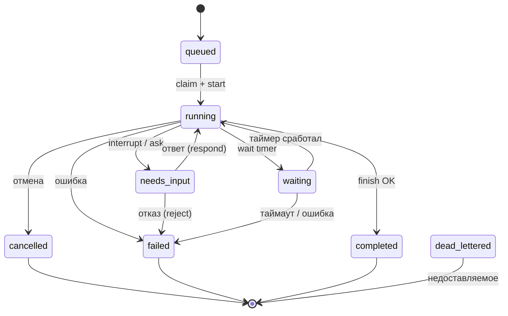

# 14. Потоки (threads)

## Назначение

Поток (thread) — основная единица общения и выполнения. Домен: `apps/server/src/app/domain/thread/`. Контракты: `packages/contracts/src/thread.ts`. Поток принадлежит организации, содержит запуски (runs), события, вложения, агентов и участников.

## Записи домена

**`ThreadRecord`** (`apps/server/src/app/domain/thread/thread.ts:3`):
| Поле | Тип | Описание |
|------|-----|----------|
| `id` | string | идентификатор потока |
| `orgId` | string | организация |
| `title` | string | название |
| `kind` | ThreadKind | `chat` \| `group` \| `schedule` \| `webhook` \| `issue` |
| `autoReplyAgentId` | string \| null | агент автоответа |
| `policy` | ThreadPolicy | `{ version: 2, historyMode?: 'full'\|'none'\|'last', historyLast?: 0..100, historyFromRunId?: uuid, mentionGating? }` |
| `lastThreadSeq` | number | последняя последовательность событий |
| `conversationCount` | number | счётчик разговоров |
| `parentThreadId` | string \| null | родительский поток (форк) |
| `forkAt` | string \| null | момент форка |
| `inheritedEventCount` | number | унаследованные события |
| `metadata` | Record<string, unknown> | метаданные |
| `issueId?` | string \| null | связанная задача |
| `runProfileId` | string \| null | профиль выполнения |
| `runDirectory` | string \| null | абсолютный путь директории выполнения |
| `createdAt`, `updatedAt`, `lastReadAt` | string | временные метки |

`ThreadInsert = Omit<ThreadRecord, 'autoReplyAgentId' | 'policy' | 'lastThreadSeq' | 'conversationCount'> & Partial<Pick<...>>`.
Функция `toThreadRecord(rec)` — нормализация с дефолтами: `autoReplyAgentId: null`, `policy: { version: 2 }`, `lastThreadSeq: 0`, `conversationCount: 0`.

**`ThreadActiveRun`** (`thread.ts:44`):
| Поле | Тип | Описание |
|------|-----|----------|
| `runId` | string | идентификатор запуска |
| `threadId` | string | идентификатор потока |
| `status` | ThreadActiveRunStatus | `queued` \| `running` \| `needs_input` \| `waiting` |
| `leaseExpiresAt?` | number | истечение аренды |
| `startedByUserId?` | string | запустивший пользователь |
| `via?` | `'direct' \| 'agent'` | способ запуска |
| `onNodeId?` | string \| null | узел графа |

## Контракты (`packages/contracts/src/thread.ts`)

- `ThreadKindSchema = z.enum(['chat', 'group', 'schedule', 'webhook', 'issue'])`.
- `ThreadPolicySchema = z.object({ version: z.union([z.literal(1), z.literal(2)]).default(2), historyMode: z.enum(['full', 'none', 'last']).optional(), historyLast: z.number().int().min(0).max(100).optional(), historyFromRunId: z.string().uuid().optional(), mentionGating: z.boolean().optional() })`. Режим по умолчанию — на уровне вида потока: `chat → full`, `group → last`, `schedule/webhook → none`, `issue → full`.
- `RunLifecycleStatusSchema = z.enum(['queued', 'running', 'needs_input', 'waiting', 'completed', 'failed', 'cancelled', 'dead_lettered'])`.
- `RunViaSchema = z.enum(['direct', 'agent'])`.
- `ThreadActiveRunSchema`, `ThreadLastErrorSchema`, `ThreadSummarySchema`, `ThreadPublicSchema` (с событиями).
- `CreateThreadBodySchema` (`agentId`, `agentIds? max 8`, `participantUserIds? max 20`, `title?`, `kind?`, `parentThreadId?`, `forkAt?`).
- `SendThreadRunBodySchema` (`text?`, `effort?`, `mode?`, `skills? max 10`, `attachmentIds?`, `clientEventId?`, `origin?`, `correlationId?`, `sourceId?`, `worktreeId?` (вместе), `agentId?`).
- `RespondRunBodySchema` (`askId`, `payload`, `clientEventId?`), `RejectRunBodySchema` (`askId`, `note?`, `clientEventId?`).
- `StreamRunEventsQuerySchema` (`fromSeq?`).
- `ThreadAttachmentSchema`, `ThreadFileEntrySchema`, `ThreadFilesTreeResponseSchema`.

## Порты (`app/domain/thread/`)

| Порт | Методы | Назначение |
|------|--------|------------|
| `thread-repository.port.ts` | `listByOrg`, `listActiveRuns`, `findActiveRun`, `findById`, `insert`, `patch`, `markRead`, `updateTitle`, `touch`, `delete`, `deleteMany`, `deleteByAgent`, `listByIssue`, `findByIssueAndAgent`, `threadIdsWithRuns` | репозиторий потоков |
| `thread-agent-repository.port.ts` | — | агенты потока |
| `thread-participant-repository.port.ts` | — | участники потока (`role`: `member` \| `blocked`) |
| `thread-events.port.ts` | — | события потока (`ThreadRunEvent`: `failed` \| `cleared` \| `parked` \| `finished` \| `events`) |
| `attachment-repository.port.ts` / `attachment-storage.port.ts` | — | вложения потока (запись / хранение байт) |
| `local-executor.port.ts` | `lifecycle`, `events`, `sessionFor`, `send`, `compact`, `drainMessageQueue`, `cancel`, `retry`, `truncateThreadFrom`, `removeThreadEvent`, `stream`, `tickWaitTimers`, `countWaitingTimers`, `listMcpServers`, `invalidateRuntime` | локальный исполнитель |
| `wait-ticker-gate.port.ts` | `hold`, `release`, `active` | ворота ожидания тикера |

## Use-cases (`application/threads/`)

`CreateThreadUseCase`, `ListThreadsUseCase`, `GetThreadUseCase`, `SendThreadMessageUseCase`, `SendThreadRunUseCase`, `CancelRunUseCase`, `CompactThreadUseCase`, `MarkThreadReadUseCase`, `GetThreadPlanUseCase`, `DeleteThreadPlanUseCase`, `RespondRunUseCase`, `RetryRunUseCase`, `StreamRunEventsUseCase`, `DeleteThreadUseCase`, `DeleteThreadEventUseCase`, `UpdateThreadBindingUseCase` (`runProfileId`, `runDirectory` — абсолютный путь), `UpdateThreadPolicyUseCase`, `AddThreadAgentUseCase`, `RemoveThreadAgentUseCase`, `AddThreadParticipantUseCase`, `RemoveThreadParticipantUseCase`, `TickWaitTimersUseCase`, `UploadThreadAttachmentUseCase`, `ListThreadAttachmentsUseCase`, `ListThreadFilesUseCase`, `ReadThreadFileUseCase`, `ListThreadRawModelRequestsUseCase`, `GetThreadRawModelRequestUseCase`, `GetThreadAttachmentUseCase`, `ThreadMessageQueueUseCase`.

Вспомогательные: `resolve-run-placement.ts`, `run-attribution.ts`, `send-thread-dispatch.ts`, `send-thread-worktree.ts`, `send-thread-attachments.ts`, `send-group-thread.ts`, `thread-files-paths.ts`, `thread-plan.helpers.ts`, `thread-message-queue.use-case.ts`.

## Адаптеры (`infra/thread/`)

`thread-repository.adapter.ts`, `thread-agent-repository.adapter.ts`, `thread-participant-repository.adapter.ts`, `thread-events.adapter.ts`, `attachment-repository.adapter.ts`, `attachment-storage.adapter.ts`, `thread.module.ts`.

## События потока

События хранятся в таблице `run_events` (org-sqlite schema, первичный ключ `(thread_id, thread_seq)`). Поток имеет `lastThreadSeq` (последовательность событий). Поток может быть форком другого потока (`parentThreadId`, `forkAt`, `inheritedEventCount`).

## Жизненный цикл запуска (ThreadActiveRunStatus)

Нетерминальные активные статусы потока: `queued` → `running` → `needs_input` \| `waiting`. Терминальные (из `RunLifecycleStatus`): `completed`, `failed`, `cancelled`, `dead_lettered`.



## Поток данных запуска (SendThreadRunUseCase)

```mermaid
graph TD
    C[Клиент POST /threads/:id/run] --> UC[SendThreadRunUseCase]
    UC --> TRP[thread-repository.port.ts: findById]
    UC --> LEP[local-executor.port.ts: send]
    LEP --> RRP[resolve-run-placement.ts: решение узла/профиля]
    RRP --> F[placement: decidePlacement]
    LEP --> R[Создание run: queued]
    R --> CLAIM[claim + lease (run-claimer)]
    CLAIM --> ENG[createRunEngine.execute]
    ENG --> SG[startGraph]
    SG --> SSE[SSE stream run events]
    SSE --> C
```

## Связанные разделы

- [15-выполнение-run-engine.md](./15-выполнение-run-engine.md)
- [17-compaction-потоков.md](./17-compaction-потоков.md)
- [18-модель-исполнения-graph.md](./18-модель-исполнения-graph.md)
- [11-база-данных-schema.md](./11-база-данных-schema.md)
