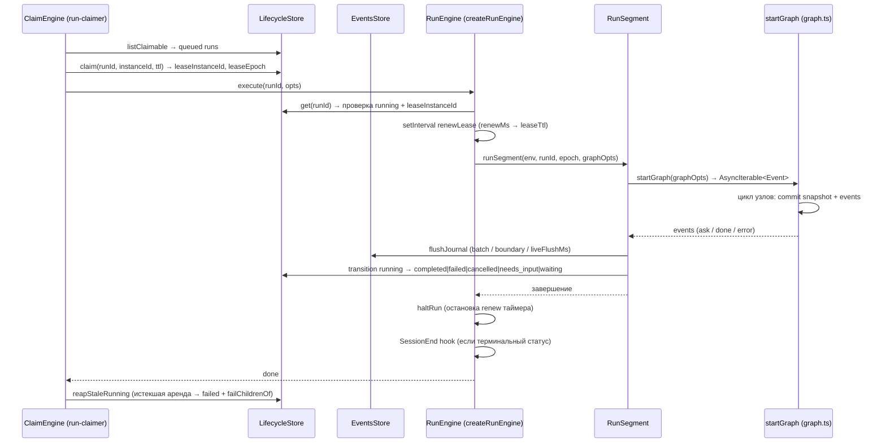

# 15. Выполнение (run engine)

## Обзор

Run — экземпляр выполнения агента в контексте потока. Ядро выполнения находится в `packages/harnesys`; сервер `apps/server` вызывает ядро через порты `create-runtime.ts`, `run-engine-types.ts`, `runtime-state.ts`. Run-claimer планирует и арендует run'ы, run-engine исполняет граф узлов.

## Типы и статусы run

`RunLifecycleStatus` (`packages/harnesys/src/ports/run-lifecycle-store.ts:2`):
```
queued → running → needs_input | waiting → completed | failed | cancelled | dead_lettered
```

- `queued` — поставлено в очередь, ожидает claim.
- `running` — выполняется.
- `needs_input` — требует ввода (interrupt: ask_user, budget, permission, wait).
- `waiting` — ожидает таймер.
- `completed` — завершено успешно.
- `failed` — завершено с ошибкой.
- `cancelled` — отменено.
- `dead_lettered` — отправлено в мёртвую очередь.

`RunVia = 'direct' | 'agent'` — запущено напрямую или агентом.

Нетерминальные статусы `RUN_NON_TERMINAL = ['queued', 'running', 'needs_input', 'waiting']` (`packages/harnesys/src/constants.ts:196-201`).

`RunRecord` (`run-lifecycle-store.ts:18-36`):
- `runId`, `threadId`, `agentId?`, `agentName?`, `originConnectorId?`, `status`, `interruptId?`, `waitFireAt?`, `parentRunId?`, `attempt`, `leaseInstanceId?`, `leaseExpiresAt?`, `leaseEpoch`, `lastSeq`, `createdAt`, `updatedAt`, `attribution?`.

`RunAttribution = { startedByUserId?, via: 'direct' | 'agent', onNodeId? }` (`run-lifecycle-store.ts:13`).

`RunCreateInput = { runId, threadId, agentId, agentName, originConnectorId?, parentRunId?, attribution? }` (`run-lifecycle-store.ts:37`).

`RunTransitionPatch = { from, to, interruptId?, waitFireAt?, advanceAttempt?, events? }` (`run-lifecycle-store.ts:46`).

## RunLifecycleStore (`run-lifecycle-store.ts:54-65`)

| Метод | Сигнатура | Назначение |
|-------|-----------|------------|
| `create` | `(run, events?) => Promise<RunRecord>` | создать run |
| `get` | `(runId) => Promise<RunRecord \| null>` | получить run |
| `activeByThread` | `(threadId) => Promise<RunRecord \| null>` | активный run потока |
| `childrenByParent` | `(parentRunId) => Promise<RunRecord[]>` | дочерние run'ы |
| `claim` | `(runId, instanceId, ttlMs) => Promise<RunRecord \| null>` | арендовать run |
| `transition` | `(runId, expectedEpoch, patch) => Promise<RunRecord>` | переход статуса с проверкой эры |
| `renewLease` | `(runId, instanceId, ttlMs) => Promise<boolean>` | продлить аренду |
| `listClaimable` | `(opts?) => Promise<RunRecord[]>` | список claimable run'ов |
| `listDueTimers` | `(opts?) => Promise<RunRecord[]>` | run'ы с истекшими таймерами |
| `listStaleRunning` | `(opts?) => Promise<RunRecord[]>` | застрявшие running run'ы |

## Run engine (`packages/harnesys/src/application/run-engine.ts`)

`createRunEngine(deps: RunEngineDeps): RunEngine` (`run-engine.ts:44`).

`RunEngine` интерфейс (`run-engine-types.ts:74-80`):
- `execute(runId, opts): Promise<void>`
- `abort(runId): void`
- `stop(): void`
- `whenIdle(): Promise<void>`
- `close(): void` (алиас для `stop`)

`RunEngineDeps` (`run-engine-types.ts:33-50`):
- `lifecycle: RunLifecycleStore`, `events: RunEventStore`, `instanceId: string`
- `leaseTtlMs?` (по умолчанию `DEFAULT_LEASE_TTL_MS = 15000`), `renewMs?` (по умолчанию `DEFAULT_LEASE_RENEW_MS = 5000`)
- `delivery?: () => DeliverySettings` (`liveFlushMs`, `journalBatch`)
- `models: ProviderConfig[] | ModelsPort`, `toolRegistry`, `toolMessages`, `mergeState?`, `packRegistrations?`, `skills?`, `agents: AgentsResolve`, `hooks?`, `childRunner?`, `logger?`

`RunTargetOpts` (`run-engine-types.ts:51-73`): `state: RuntimeState`, `agent: AgentDefinition`, `permissions?`, `paths?`, `notes?`, `packs?`, `capabilitySet?`, `universe?`, `skills?`, `hooks?`, `hooksEmit?`, `hookReport?`, `binDirs?`, `channelNote?`, `process?`, `fileAccess?`, `fileAccessFor?`, `permissionGrants?`, `runtime?`, `steerMessages?`, `ackSteerMessages?`.

## Поток выполнения execute (`run-engine.ts:92-220`)

1. `deps.lifecycle.get(runId)` — запись должна существовать, статус `running`, `leaseInstanceId === deps.instanceId`, иначе `codedRunError('lease_stale', ...)`.
2. Создаётся `RunRuntime` с `AbortController`, таймером продления аренды `setInterval(renewMs)`, добавлен в `active` и `byRun`.
3. Каждые `renewMs` вызывается `deps.lifecycle.renewLease(runId, instanceId, leaseTtl)`; если `!ok` → `run.leaseLost = true`, `run.abort.abort(codedRunError('lease_stale', 'lease lost'))`.
4. `flushJournal(env, ctx)` — сброс накопленных событий в `events.append(runId, epoch, pending)`; при `lease_stale` очистка pending и возврат `false`.
5. `prepareExecuteGraphOpts(...)` — сборка `GraphOpts` (см. `run-engine-prepare.ts`).
6. `runSegment(env, runId, epoch, graphOpts)` — прогон графа через `startGraph` (`run-engine-segment.ts:342`).
7. По завершении: если статус терминальный (`!RUN_NON_TERMINAL.includes(status)`), хук `SessionEnd` через `hooks.bus.close()` + `emitHook(hooks, 'SessionEnd', {})`.
8. В `finally` — `haltRun(run, runId)`: `abort.abort()`, остановка таймера, удаление из `active`/`byRun`, пробуждение `whenIdle` если `active.size === 0`.

## Аренда (lease)

- `DEFAULT_LEASE_TTL_MS = 15000`, `DEFAULT_LEASE_RENEW_MS = 5000` (`constants.ts:52-53`).
- Потеря аренды (`lease_stale`) → прерывание выполнения, не терминальный переход в lifecycle.
- `run-claimer` арендует run через `lifecycle.claim(runId, instanceId, leaseTtl)` перед `engine.execute`.
- `reapStaleRunning` — claimer переводит застрявшие running run'ы (истекшая аренда) в `failed` и рекурсивно failing детей (`failChildrenOf`).

## Дочерние run'ы (spawn)

`childJournal(spawnId, ev)` (`run-engine.ts:125-174`):
- Создаёт дочерний run через `deps.lifecycle.create({ runId: spawnId, threadId, agentId, agentName, parentRunId: runId })`.
- Переводит в `running` через `transition(..., { from: 'queued', to: 'running' })`.
- События рекурсивно пишутся в поток через `deps.events.appendForThread(record.threadId, spawnId, [full])` с переопределением `runId: spawnId`.
- При терминальном статусе дочернего события — переход дочернего run'а в `completed`/`failed`/`cancelled` (`CHILD_TERMINAL_STATUS`).

## Прерывание

- `abort(runId)` — `byRun.get(runId)?.abort.abort('run cancelled')` (`run-engine.ts:221`).
- `stop()` — остановка всех активных run'ов, очистка `byRun`, закрытие хуков (`run-engine.ts:82`).
- `whenIdle()` — промис, резолвится когда `active.size === 0` (`run-engine.ts:224`).
- `close()` — алиас для `stop()`.

## Состояние выполнения (`packages/harnesys/src/ports/runtime-state.ts`)

- `RuntimeState = { readonly sessionId; load(): Snapshot \| null; commit(snapshot, events, meta): Promise<void>; child(spawnId): RuntimeState }`.
- `CommitMeta = { kind: 'intent' \| 'recorded'; sequence: number }`.
- `Snapshot = { sessionId, runId, definitionHash, planHash, sequence, status, runtimeVersion: '0.3.0', initialInput, state, cursor }` (`domain/snapshot.ts:60`).
- `Cursor = { nodes: { phase, nodeExecutionId, attempt? }, pending?, interrupt?, cancellation?, budget {steps, tokens, startedAt, stops?, memoryWrites?, nudges?, extend?, deadlineAt?}, barriers?, timers? }` (`domain/snapshot.ts:6`).
- `Event = { eventId, type, timestamp, sessionId, runId, agentId, sequence, causationId?, correlationId?, metadata? }` (`domain/snapshot.ts:72`).
- `RUNTIME_VERSION = '0.3.0'` (`domain/snapshot.ts:3`).

## Хранилище событий (`packages/harnesys/src/ports/run-event-store.ts`)

- `RunEventStore extends RunSeqAllocator` — `append(runId, expectedEpoch, events)`, `tail(runId, fromSeq)`, `latestSeq`, `listByThread`, `hasRun`, `appendForThread(threadId, runId, events)`, `truncateThreadFrom`, `removeEvent`.
- `RunSeqAllocator = { next(runId): number }`.
- `TruncateThreadResult = { cutoff, removedEvents, removedRunIds, remainingUserCount }`.

## Run-claimer (`packages/harnesys/src/application/run-claimer.ts`)

`createRunClaimer({ lifecycle, targets, engine, instanceId, leaseTtlMs?, sweepMs?, withScope?, onComplete?, shouldReap?, onSweep? })`:
- Таймер `sweep` (`DEFAULT_CLAIMER_SWEEP_MS = 5000`):
  1. `reapStaleRunning` — orphaned runs (истекшая аренда) → `failed` + `failChildrenOf`.
  2. `listClaimable` (`DEFAULT_CLAIMABLE_LIMIT = 10`) — для каждого `tryClaim`.
- `tryClaim(runId)`: проверка `status === 'queued'`, résolution target через `targets.resolve(threadId, runId)`, `lifecycle.claim(runId, instanceId, leaseTtl)`, затем `engine.execute(runId, target)` внутри `withScope`.
- `kick()` — форсированный sweep, `halt()` — остановка таймера, `stop()` — halt + `engine.stop()`.

## Run event feed (`packages/harnesys/src/application/run-event-feed.ts`)

`createRunEventFeed({ events, lifecycle, bus, idleMs? })` → `RunEventFeed = { subscribe(runId, fromSeq), publish(threadId, runId, events) }`:
- `subscribe`: пропуск хвоста `events.tail(runId, fromSeq)`, затем long-polling через `bus.subscribe` с гонкой на `idleMs` (`IDLE_BACKSTOP_MS = 5000`).
- Граница `ask|done|error|run.*` → проверка `isClosedStatus` lifecycle; закрытый статус → завершение итератора.

## Сегмент выполнения (`packages/harnesys/src/application/run-engine-segment.ts`)

`runSegment(env, runId, epoch, graphOpts)`:
- Цикл `for await (const event of startGraph(graphOpts))`:
  - `mapped.type === 'ask'` → `pauseOnAsk` (переход `running → needs_input`, событие `ask` с `resumeSchema`).
  - `mapped.type === 'done'` → `tail.doneText`.
  - `mapped.type === 'error'` → `tail.failMessage` / `tail.cancelReason`.
  - Накопление в `ctx.pending`, flush при `journalBatch`, границах (tool boundary, journal boundary card), или `liveFlushMs`.
- `settleTerminal`: переход в `completed` / `failed` / `cancelled` / `needs_input` / `waiting` в зависимости от статуса снимка.
- `failSegment`: обработка ошибок, `lease_stale` игнорируется, `AskUserInterrupt` → `pauseOnInterrupt`, `signal.aborted` → `cancelled`, иначе → `failed`.
- Busy retries: `withBusyRetries` с задержками `[500, 1000, 2000]` ms при `database is locked`.

## Диаграмма: жизненный цикл run с арендой



## Связанные разделы

- [18-модель-исполнения-graph.md](./18-модель-исполнения-graph.md) — выполнение графа внутри run.
- [16-агенты-и-agent-definition.md](./16-агенты-и-agent-definition.md) — AgentDefinition.
- [17-compaction-потоков.md](./17-compaction-потоков.md) — компакция во время выполнения.
- [54-пакеты-harnesys-ядро.md](./54-пакеты-harnesys-ядро.md) — пакет ядра.
- [52-пакеты-brix.md](./52-пакеты-brix.md) — brix (server side).
- [06-di-контейнер-brix.md](./06-di-контейнер-brix.md) — DI-контейнер.
