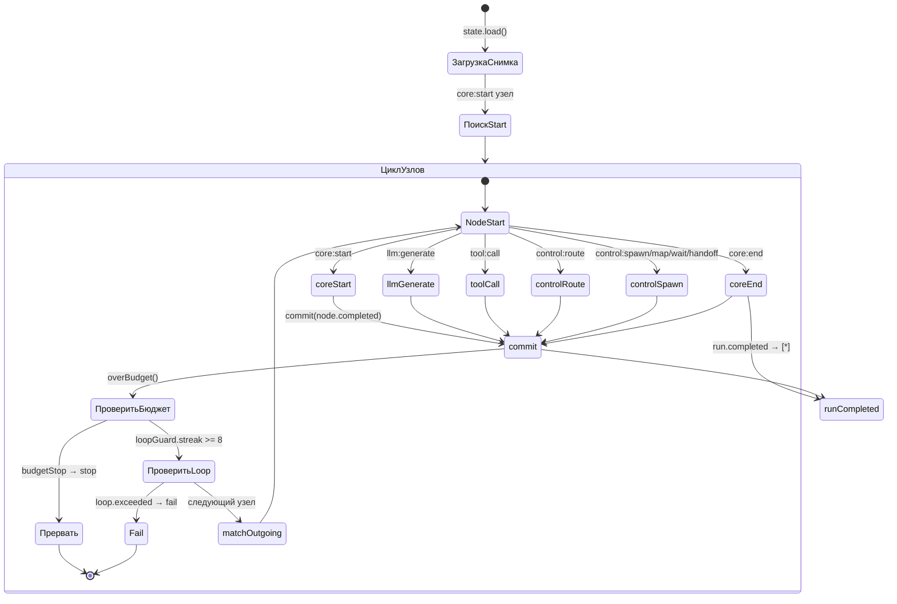
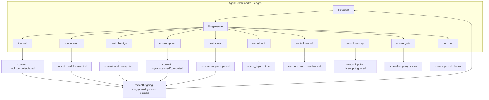

# 18. Модель выполнения графа (graph execution)

## Обзор

Граф выполнения агента — ядро `packages/harnesys/src/application/graph.ts` (`startGraph`, `GraphOpts`). Граф — направленный граф узлов с рёбрами. Выполнение — асинхронный генератор событий `AsyncIterable<Event>`. Ядро не зависит от сервера; сервер вызывает его через `createRuntime` → `run/start`.

## GraphOpts (`graph.ts:372-422`)

`GraphOpts` — контекст выполнения узла:
| Поле | Тип | Описание |
|------|-----|----------|
| `agent` | `AgentDefinition` | определение агента |
| `input` | `unknown` | входные данные |
| `state` | `RuntimeState` | состояние рантайма (снимки, коммиты) |
| `runId?` | string | идентификатор run |
| `permissions?` | `PermissionMap` | права доступа |
| `paths?` | `PathsConfig` | пути доступа |
| `permissionGrants?` | `PermissionGrantsPort` | гранты прав |
| `models` | `ProviderConfig[] \| ModelsPort` | конфигурация моделей или порт моделей |
| `toolRegistry` | `Map<string, ToolDefinition>` | реестр инструментов |
| `plan` | `Plan` | скомпилированный план |
| `toolMessages` | `'barrier' \| 'ordered'` | режим сообщений инструментов |
| `mergeState?` | `MergeStateFn` | функция слияния состояния |
| `signal?` | `AbortSignal` | сигнал отмены |
| `resumePayload?` | `unknown` | данные резюме после interrupt |
| `resumeInterruptId?` | string | ID прерывания резюме |
| `resumeNote?` | string | заметка резюме |
| `startNodeId?` | string | стартовый узел (для ресума) |
| `outputHint?` | `unknown` | подсказка вывода |
| `notes?` | `LlmNoteProvider[]` | поставщики заметок LLM |
| `packOutputs?` | `PackRunMap` | выходы паков |
| `capabilitySet?` | `CapabilitySet` | набор способностей |
| `universe?` | `CapabilityUniverse` | вселенная способностей |
| `skills?` | `SkillRegistry` | реестр навыков |
| `env?` | `Record<string, string>` | переменные окружения |
| `hooks?` | `HookEmitCtx` | контекст хуков |
| `agents` | `AgentsResolve` | resolución агентов |
| `childJournal?` | `(spawnId, ev) => void` | журнал дочерних run'ов |
| `childRunner?` | `ChildRunner` | рантайм дочерних run'ов |
| `placement?` | `NodePlacement` | размещение узла |
| `sandbox?` | boolean | песочница (запреты interrupt/wait) |
| `mapContext?` | `{ item, index }` | контекст map |
| `logger?` | `Logger` | логгер |
| `channelNote?` | string | заметка канала |
| `process?` | `ProcessJobTarget` | цель процесса |
| `fileAccess?` | `FileAccessPolicy` | политика доступа к файлам |
| `fileAccessFor?` | `(agent) => FileAccessPolicy` | политика доступа к файлам по агенту |
| `spawnPath?` | string | путь спавна |
| `runtime?` | `RuntimePromptInfo` | информация промпта рантайма |

## Поток выполнения startGraph (`graph.ts:468-2194`)

1. `opts.state.load()` — загрузка снимка: `st`, `seq`, `runId`, курсор (`currentNodeId` / фаза `executing` для ресума), бюджет (`steps`, `tokens`, `startedAt`, `stops`, `memoryWrites`, `nudges`, `extend`, `deadlineAt`) (`graph.ts:476-572`).
2. Если нет снимка и `agent.state?.initial` — инициализация состояния через `evalExpr` для `$`-выражений (`graph.ts:483-492`).
3. Поиск узла `core:start`; при ресуме (`needs_input`/`running`) курсор восстанавливается из снимка (`graph.ts:493-517`).
4. Хук `SessionStart` (source: `startup`\|`resume`) → контекстная заметка (`graph.ts:560-566`).
5. Инициализация `compactionGuard`, `loopGuard`, `lengthCutLimit`, `overflowCompactionEnabled` (`graph.ts:522-540`).
6. Цикл `while(true)` (`graph.ts:751`):
   - Проверка `opts.signal?.aborted` → `run.paused` (`delegated_ask`) или `run.cancelled`, `break` (`graph.ts:753-767`).
   - Восстановление после interrupt: budget approve/close/extend, `isSkippedEntry` (`graph.ts:775-855`).
   - Хук `NodeStart` (`graph.ts:857`).
   - Обработка узла по типу (см. таблицу ниже).
   - `commit(status, type, kind, metadata)` — `seq += 1`, `mkEv`, `opts.state.commit(mkSnap, [ev], {kind, sequence})` (`graph.ts:601-617`).
   - Хук `NodeEnd` (`graph.ts:2142`).
   - Проверка `overBudget()` → `budgetStop` (`graph.ts:2152-2165`).
   - Проверка `loopGuard.streak >= STOP_AFTER_IDENTICAL_CALLS (8)` → `loop.exceeded` → `run.failed`, `break` (`graph.ts:2166-2177`).
   - `matchOutgoing(edgesByFrom.get(cur), slots)` → следующий узел; `cur = nxt`, `steps += 1` (`graph.ts:2178-2193`).

## commit / mkEv / mkSnap

- `mkEv(ctx, type)`: `{eventId, type, timestamp, sessionId, runId, agentId, sequence: ctx.seq, causationId?, correlationId?, metadata?}` (`graph-snap.ts`).
- `mkSnap(ctx, status)`: `{sessionId, runId, definitionHash, planHash, sequence, status, runtimeVersion '0.3.0', initialInput, state, cursor {nodes phases, interrupt, budget, barriers, timers}}` (`graph-snap.ts`).
- `RUNTIME_VERSION = '0.3.0'` (`domain/snapshot.ts:3`).
- `commit` в `graph.ts:601`: инкремент `seq`, создание события, вызов `opts.state.commit` со снимком и событиями.

## Типы узлов (`domain/agent-definition.ts:172-256`)

| Узел | Назначение | Реализация в graph.ts |
|------|------------|----------------------|
| `core:start` | Приём входа: хук `UserPromptSubmit` (может `blocked` → `run.failed`), запись `user.message` в состояние и журнал, вывод `{ input }` | `graph.ts:858-937` |
| `core:end` | Хук `Stop` (stop-эффект → `run.completed`), `enforceNudge` (память при закрытии), формирование `output` (expr/последнее сообщение), `run.completed`, `break` | `graph.ts:938-1037` |
| `llm:generate` | Промпт/сообщения, инструменты, модель (`findBind` или `ModelsPort.get` через порт), fallback-привязки `resolveFallbackBindings` (`agent.fallback`), компакция `runSummaryPassIfDue` перед запросом, `runForcedCompaction` при `isContextOverflowError`, события `model.chunk`/`model.completed`, учёт токенов, `length` cut до `lengthCutContinuations` (по умолчанию 2) | `graph.ts:1038-1406` |
| `tool:call` | `ToolCallFixed` (одно `name`+`args`) или `ToolCallBatch` (массив выражений, concurrency `parallel`\|`sequential`, лимит 32, barrier policy 'all'). `executeToolCall`: оценка аргументов `$expr`, intent-gate для `sideEffect: financial\|destructive\|credentialed` → `tool.intent` event, `AskUserInterrupt`, результаты `tool.completed`/`tool.failed`. memory-запись увеличивает `memoryWrites` | `graph.ts:1407-1543` |
| `control:route` | LLM-маршрутизация по `routes` с `outputSchema`, `minConfidence`, решение `route` + confidence, учёт токенов | `graph.ts:1544-1632` |
| `control:assign` | Патч состояния `st[k] = applyReducer(k, st[k], ev, {reducers, mergeState})`, поддержка `$expr` и `{$expr}` интерполяций | `graph.ts:1633-1664` |
| `control:goto` | Прямой переход по `evalExpr(target)` без прогона рёбер | `graph.ts:1665-1694` |
| `control:interrupt` | `AskUserInterrupt`, `needs_input`; в sandbox запрещён (`sandbox_blocked`) | `graph.ts:1695-1730` |
| `control:spawn` | Порождение дочерних агентов (`prepareSpawn`, `executeSpawn` с `childRunner` по умолчанию `startGraph`), квота бюджета `childBudgetInPool` из `budgetRemainder`, delegated ask resume, результаты в `spawnResults`, учёт шагов/токенов дерева | `graph.ts:1731-1938` |
| `control:handoff` | Смена агента: `prepareHandoff` подменяет `agent/plan/input/toolRegistry`, событие `agent.handoff`, note в состояние, `cur = prepared.startNodeId` | `graph.ts:1939-1997` |
| `control:map` | `prepareMap` (items, concurrency, timeout, onTimeout fail|partial), `executeMap` с `startGraph` на каждый item, результаты в `mapResults`, таймаут → `timed_out` fail | `graph.ts:1998-2057` |
| `control:wait` | `needs_input` с timer (`waitFireAt`), источник timer|respond, в sandbox запрещён | `graph.ts:2058-2119` |
| `control:yield` | Только внутри map body, иначе `yield_outside_map` fail | `graph.ts:2120-2126` |
| `custom:${string}` | Кастомные узлы плагинов → `node_unsupported` fail | `graph.ts:2127-2136` |

## Бюджет (`packages/harnesys/src/application/budget.ts`)

- `budgetOver(state, now)`: проверка шагов (`steps >= maxSteps + extend.steps`), токенов, дедлайна (`startedAt + deadlineMs`) → `BudgetOver {kind: steps\|tokens\|deadline, limit, used}` (`budget.ts:55`).
- `budgetStop(over)`: `closeOnExhaustion` → `budget.closing` (не останавливает); иначе policy `ask` → `stops += 1`, прерывание `budgetInterruptId = budget/{runId}/{nodeId}/{stop}`, схема резюме `{approved, reason, extend, close}`, `needs_input`; policy `error` → `run.failed` code `budget_exceeded`. При резюме: `approved=false` → отмена; `extend` → `extendState` (шаги/токены/дедлайн); `close` → closing phase (`graph.ts:631-695`).
- `budgetLeft` / `budgetRemainder`: остаток шагов/токенов/мс с уровнями предупреждения `soon`/`last` (`budget.ts:92`, `budget.ts:166`).
- `defaultExtension`: `ceil(limit * extendDefaultPct / 100)`, минимум 1 (`budget.ts:132`).
- `childBudgetInPool(remainder, requested, share)`: деление остатка между дочерними spawned-агентами (`budget.ts:183`).
- `DEFAULT_WARN_AT_STEPS = 3`, `DEFAULT_EXTEND_PERCENT = 25` (`budget.ts:29-30`).

## Fallback-привязки моделей

`resolveFallbackBindings(agent, models)` (`graph.ts:441-467`): для каждой записи `agent.fallback` — если `isPort(models)` → `resolveModelForPort(ref, agent)` → `models.get(provider, model)`; иначе `findBind(models, ref, agent)`. В `llm:generate`: `bindingsToTry = [binding, ...fallbackBindings]`. При отсутствии привязки → `model_unresolved` fail. При отсутствии контекстного окна → `model_context_window_missing` (`graph.ts:1092`).

## Прерывания (interrupt)

`AskUserInterrupt` (`domain/errors.ts:58`): `prompt`, `source?: 'ask_user'\|'approve'\|'permission'`, `tool? {name, input, toolCallId, subject?}`, `delegated? {agentId?, spawnPath?}`, `interruptId?`, `resumeSchema?`.

- `llm:generate`/`tool:call`/`control:interrupt`/`control:spawn` (`DelegatedPermissionAsk`) ловят `AskUserInterrupt`, снимок `needs_input` с `cursor.interrupt {interruptId, reason, resumeSchema, nodeId, source, output, budgetKind/limit/used/extendDefault (для budget), delegated (для permission)}`, событие `interrupt.triggered`, `break` цикла (`graph.ts:1466`, `graph.ts:1695`, `graph.ts:1858`).
- `runSegment` (`run-engine-segment.ts`): `pauseOnAsk` — переход `running → needs_input`, событие `ask` с `resumeSchema` (`run-engine-segment.ts:159`); `pauseFromSnapshot`/`pauseOnWaiting` при терминальном статусе (`run-engine-segment.ts:178`, `run-engine-segment.ts:201`).

## Loop guard

`loop-guard.ts`: `toolCallSignature` (канонизированный JSON `{name, args}`), `recordToolCall` — streak одинаковых вызовов. `NUDGE_AFTER_IDENTICAL_CALLS = 4` (заметка `loop` в LLM), `STOP_AFTER_IDENTICAL_CALLS = 8` (`loop.exceeded` → fail) (`loop-guard.ts:1-2`).

## Memory enforce

`packages/harnesys/src/application/memory/enforce.ts`:
- `enforceNudge(input)`: `true` только если `enforce === true`, `level !== 'delegate'`, не closing, `memoryWrites === 0`, `steps >= minSteps` (default 3), `nudges < maxNudges` (default 1) (`enforce.ts:11`).
- В `core:end` при срабатывании добавляется `[memory]` сообщение, `nudges += 1`, возврат к `lastLlmNodeId` (`graph.ts:962-987`).

## Хуки

`packages/harnesys/src/application/hooks/` (`bus.ts`, `emit-hook.ts`, `executors.ts`, `matchers.ts`, `runtime-ctx.ts`). Хуки на события жизненного цикла сессии и узлов (`SessionStart`, `SessionEnd`, `NodeStart`, `NodeEnd`, `UserPromptSubmit`, `Stop`, `PreCompact`, `PostCompact`, `PermissionRequest`). `HookEmitCtx = {bus, sessionId, runId, agentId, threadId, cwd, permissionMode}`.

## Границы ядра vs сервер

- Ядро `packages/harnesys`: `startGraph`, `createRuntime`, `createRunEngine`, `compile`, бюджет, компакция, инструменты, порты.
- Сервер `apps/server`: bootstrap `Brix.create(AppModule.forRoot())`, REST API, использование ядра через порты `create-runtime.ts` / `run-engine-types.ts` / `runtime-state.ts` (`apps/server/src/main.ts`).

## Диаграмма: цикл узлов графа

## Диаграмма: узлы и рёбра графа

## Связанные разделы

- [15-выполнение-run-engine.md](./15-выполнение-run-engine.md) — рантайм выполнения run.
- [17-compaction-потоков.md](./17-compaction-потоков.md) — компакция.
- [16-агенты-и-agent-definition.md](./16-агенты-и-agent-definition.md) — AgentDefinition.
- [54-пакеты-harnesys-ядро.md](./54-пакеты-harnesys-ядро.md) — пакет ядра.
- [50-технический-дизайн-ключевых-механизмов.md](./50-технический-дизайн-ключевых-механизмов.md) — ключевые механизмы.
