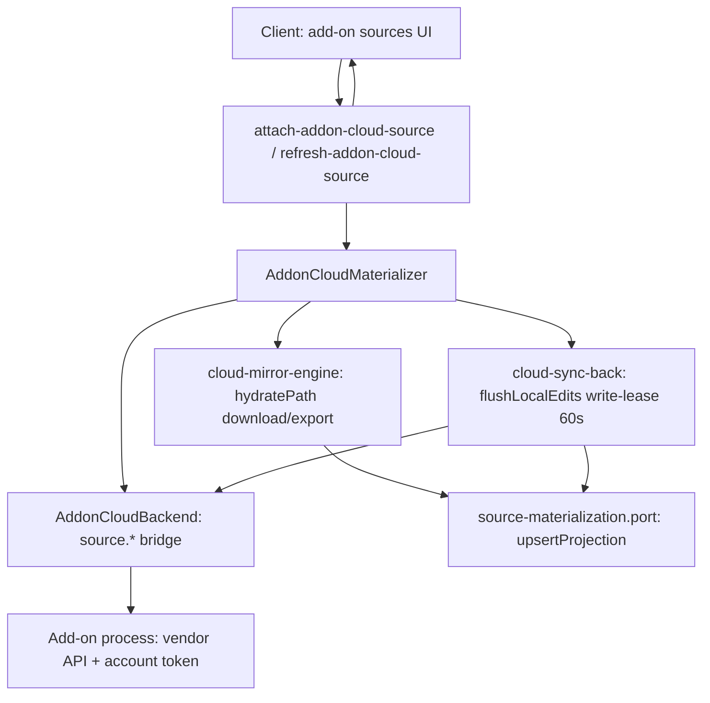

# 21. Cloud sources (add-on provided)

## Purpose

A cloud source mirrors a remote folder into a local directory. The core owns the mirror
engine and the materialization state; the vendor API belongs to the add-on that contributes
the source kind. Core code never names a provider.

Domain: `apps/server/src/app/domain/source/`. Mirror engine and sync-back:
`apps/server/src/app/infra/source/drivers/cloud/`. Add-on bridge:
`apps/server/src/app/infra/addons/source/`. Add-on side of the contract: `@harnesys/sdk`
`source.*` handlers.

## Contracts

`packages/contracts/src/source.ts`:

- `SourceDistribution` (`addon-cloud`): `addonId`, `sourceKindId`, `accountId?`, `remoteFolderId`.
- `MaterializationState`: `absent` | `materializing` | `ready` | `failed`.
- `MaterializationStateFrame`, `MaterializationProjection` (`sourceId`, `hostId`, `state`,
  `revision`, `lastConfirmedAt`, `lastErrorCode?`, `lastConflictPaths?`, `refreshRequired?`).
- `SourceHostStatus`: `hostId`, `nodeStatus` (`online` | `offline` | `draining`),
  `materialization`, `lastConfirmedAt?`, `errorCode?`, `stale`, `defaultWorktreeId?`,
  `lastConflictPaths`, `refreshRequired`, `availabilityReason?`
  (`origin` | `allowed` | `excluded` | `needs-remote`).

Attach and refresh are add-on routes, not core source routes:
`POST /orgs/:orgId/addons/:addonId/source-kinds/:sourceKindId/attach` and
`POST /orgs/:orgId/addons/:addonId/sources/:sourceId/refresh`.

## Ports (`app/domain/source/`)

| Port | Purpose |
|------|---------|
| `cloud-remote-backend.port.ts` | `CloudRemoteBackendPort` (`readonly vendor: string`): `listChildren`, `download`, `upload`, `createFolder`, `delete`, `getMetadata`. `CloudRemoteEntry.export` (`{ mimeType, extension }`) marks an entry the backend can only produce by export. `CloudDocumentExporter.exportDocument(fileId, mimeType)` + `supportsDocumentExport`. |
| `cloud-sync-back.port.ts` | `CloudSyncBackPort`: `syncBackCloudFile`, `flushCloudMirror`. `createBackend` is required and always provided by the add-on bridge. |
| `source-driver.port.ts` | git driver port (`kind: 'git'`) |
| `source-location.port.ts` | mirror root resolution for a source on a host |
| `source-materialization.port.ts` | materialization state and projection |

## Mirror engine (`infra/source/drivers/cloud/`)

- `cloud-mirror-engine.ts` — mirrors a remote tree into `<materializeRoot>/mirror` with
  metadata under `.harnesys-mirror/` (`mode: 0o600`).
  - `MirrorMetaFile`: `remoteId`, `kind` (`file` | `folder`), `remoteModifiedAt?`, `mimeType?`,
    `localHash?` (sha256 of content), `readOnly?`.
  - `hydratePath`: downloads via `backend.download`, or exports via
    `backend.exportDocument(remoteId, entry.export.mimeType)` when the entry declares `export`;
    exported files are recorded with `readOnly: true`.
  - `assertSafeCloudPath` rejects `/`, `\`, `\0`, `.`, `..`, `.harnesys-mirror`, `.git`.
  - `contentHash` (sha256 hex), `conflictLocalName` (`<name> (conflict, <stamp>)`).
- `cloud-mirror-scan.ts` — `scanCloudMirrorChanges(mirror)`: walks the local tree (skipping
  `.harnesys-mirror` and `.git`), compares file hashes with metadata, emits `create` | `change` |
  `delete`.
- `cloud-mirror-sync.ts` — reverse sync:
  - `syncBackFile`: revision check (`remote.modifiedAt` vs `meta.remoteModifiedAt`); on mismatch
    `preserveBothVersions`, otherwise `updateRemoteFile` (`PATCH upload`, `fileId`); unknown file —
    `uploadLocalFile`.
  - `syncBackFolder`: creates the remote folder when metadata is missing.
  - `syncDeletePath`: deletes with revision and non-empty folder checks
    (`CLOUD_FOLDER_NOT_EMPTY`, `CLOUD_REVISION_CHANGED`).
- `cloud-mirror-reconcile.ts` — prunes mirror entries that disappeared remotely.

## Sync back

- `cloud-sync-back.ts` — `syncBackCloudFile` / `syncBackCloudPath` / `flushCloudMirror`. Resolves
  the mirror root through `sourceLocation.resolve`, skips `readOnly` entries (exported documents
  are never written back), and calls the backend from `createBackend`.
- `cloud-sync-back.adapter.ts` / `cloud-sync-back.module.ts` — `CloudSyncBackPort` registration.

Local edits are flushed on explicit refresh (`AddonCloudMaterializer.flushLocalEdits`) and on
every content write (`WriteFileUseCase`). There is no background watcher for `addon-cloud`
sources: the add-on only exists on the host that runs it.

## Add-on bridge (`infra/addons/source/`)

- `addon-cloud.backend.ts` — `AddonCloudBackend extends CloudRemoteBackendPort implements
  CloudDocumentExporter`: maps `listChildren`/`getMetadata`/`download`/`exportDocument`/`upload`/
  `createFolder`/`delete` to `source.list`/`source.stat`/`source.download`/`source.export`/
  `source.upload`/`source.mkdir`/`source.remove`, chunked at 4 MiB, 60 s timeout. Entries pass
  `export` through unchanged.
- `addon-source.adapters.ts` — `AddonCloudBackendPort` and `AddonSourceKindsPort` adapters.
- Credentials never leave the add-on: the backend call carries `sourceKind` and `accountId`, and
  the add-on resolves the account token through `ctx.http.fetch` `auth`.

## Use-cases (`application/addons/sources/`, `application/source/`)

`attach-addon-cloud-source`, `browse-addon-cloud-folder`, `list-addon-cloud-sources`,
`prepare-addon-cloud-source`, `refresh-addon-cloud-source`, `AddonCloudMaterializer`
(local-host only), plus the provider-agnostic `materialize-cloud-source.ts`, `write-file.use-case.ts`
and `mark-cloud-siblings-refresh.ts`.

## Document export

Which remote entries need export, and into what, is add-on knowledge. The
`harnesys.google-drive` add-on maps Google-native documents to DOCX/XLSX/PDF and omits entries it
cannot materialize; the core only reads `entry.export`. Adding a new cloud vendor is an add-on
with a `source-kind` contribution, no core change.

## Data flow

## Related sections

- [19-источники-и-материализация.md](./19-источники-и-материализация.md)
- [27-файловый-доступ-и-политики.md](./27-файловый-доступ-и-политики.md)
- `docs/add-ons/contributions.md` (source-kind contribution)