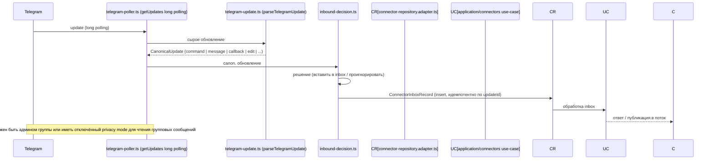

# 23. Интеграция Telegram

## Назначение

Интеграция Telegram — аддон. Подключает одного или нескольких Telegram-ботов к организации, соединяет личный чат, групповой чат или форум-топик с потоком (thread) Harnesys. Пакет: `packages/integration-telegram` (собственная SQLite, фид, читатели, публикация). Серверная инфраструктура соединителя: `apps/server/src/app/infra/connector/` и `apps/server/src/app/domain/connector/`.

## Структура пакета `packages/integration-telegram`

| Файл | Назначение |
|------|------------|
| `src/telegram-integration.ts` | основной модуль интеграции Telegram (`IntegrationDefinition`) |
| `src/index.ts` | экспорты пакета |
| `src/routes.ts` | маршруты интеграции (под `/orgs/:orgId/integrations/telegram/*`) |
| `src/services.ts` | сервисы интеграции |
| `src/publish.ts` | публикация сообщений в Telegram |
| `src/readers.ts` | чтение из Telegram (фид постов) |
| `src/sources.ts` | источники Telegram |
| `src/telegram/client.ts` | клиент Telegram API (getMe, getUpdates, sendMessage и др.) |
| `src/telegram/runtime.ts` | рантайм Telegram |
| `src/auth/login-sessions.ts` | сессии входа (тест) |
| `src/db/schema.ts` | схема своей SQLite БД интеграции |
| `src/db/store.ts` | хранилище (тест `store.spec.ts`) |
| `src/db/posts.ts`, `src/db/readers.ts`, `src/db/rows.ts`, `src/db/rules.ts`, `src/db/sources.ts` | таблицы БД: посты, читатели, строки, правила, источники |
| `src/feed/filter.ts` | фильтрация ленты (тест) |
| `src/feed/ingest.ts` | приём ленты |
| `src/feed/normalize.ts` | нормализация (тест) |
| `src/feed/text.ts` | обработка текста (тест `text.spec.ts`) |
| `src/model/errors.ts`, `src/model/records.ts` (тест `records.spec.ts`), `src/model/schemas.ts` | модели: ошибки, записи, схемы |
| `src/workers.ts` | фоновые работники |

## Домен соединителя (`apps/server/src/app/domain/connector/`)

| Файл | Назначение |
|------|------------|
| `connector.ts` | `ConnectorRecord` (`provider`, `secretRef`, `status` (`awaiting_pair` | `active` | `paused` | `error`), `capabilities`, `policy` (`MirrorPolicy`), `leaseOwner`, `leaseUntil`), `ConnectorBindingRecord`, `ConnectorInboxRecord`, `ConnectorDeliveryRecord` |
| `connector.error.ts` | ошибки соединителя |
| `constants.ts` | константы |
| `draft-buffer.ts` | буфер черновиков |
| `echo.ts` | эхо |
| `hitl-text.ts` | HITL-текст |
| `inbound-decision.ts` (тест) | решение по входящим обновлениям |
| `lease.ts` (тест) | аренда |
| `mirror-policy.ts` | политика зеркала |
| `pair-code.ts` | пар-код |
| `project-event.ts` (тест) | событие проекта |
| `telegram-api.port.ts` | `TelegramApiPort`: `getMe`, `getUpdates` (long polling), `sendMessage`, `editMessageText`, `sendPhoto/Document/Media/MediaGroup/Poll`, `getFile`, `getChatMember`, `getChat`, `createForumTopic`, `setMyCommands` и др.; ошибки `TelegramUnauthorizedError` (401), `TelegramBlockedError` (403) |
| `telegram-poller-sync.port.ts` | порт синхронизации опроса Telegram |
| `telegram-update.helpers.ts` | хелперы обновлений |
| `telegram-update.ts` (тест) | `parseTelegramUpdate`: `CanonicalUpdate` (`command` | `message` | `callback` | `edit` | `generation_stopped` | `chat_member` | `topic_created` | `ignored` | `unsupported`) |
| `thread-kind.ts` (тест) | вид потока |
| `thread-stats.ts` (тест) | статистика потока |

## Адаптер Telegram API (`apps/server/src/app/infra/connector/`)

| Файл | Назначение |
|------|------------|
| `telegram-api.adapter.ts` | адаптер порта `TelegramApiPort` |
| `telegram-api.http.ts` | HTTP слой Telegram API |
| `telegram-api-chat.ts`, `telegram-api-files.ts`, `telegram-api-media.ts` | чаты, файлы, медиа |
| `telegram-poller.ts` | опросник Telegram (long polling, `getUpdates`) |
| `telegram-poller.util.ts` | утилиты опросника |
| `connector-events.adapter.ts` | события соединителей |
| `connector-repository.adapter.ts` (+ bindings, errors, inbox, mappers, store) | репозиторий соединителей |
| `connector.module.ts` | модуль соединителей |

## Use-cases и контроллеры

Use-cases: `application/connectors/connector.use-case.module.ts`. Контроллер: `connectors.controller.ts`.

## WebUI

`apps/webui/src/integrations/telegram/`:
- `api.ts`, `index.ts`, `model/telegram-feed-dialog.ts`, `model/telegram-feed-draft.ts`, `model/telegram-queries.ts`, `model/types.ts`
- `ui/telegram-add-bot-form.tsx`, `ui/telegram-agents-picker.tsx`, `ui/telegram-bot-card.tsx`, `ui/telegram-bot-policy.tsx`, `ui/telegram-bot-section.tsx`, `ui/telegram-chat-row.tsx`, `ui/telegram-connect-panel.tsx`, `ui/telegram-create-topic.tsx`, `ui/telegram-detail.tsx`, `ui/telegram-discovery.tsx`, `ui/telegram-identity-card.tsx`, `ui/telegram-pair-section.tsx`, `ui/telegram-register-chat.tsx`, `ui/telegram-setup-steps.tsx`, `ui/telegram-status.ts`, `ui/telegram-thread-badge.tsx`, `ui/telegram-thread-picker.tsx`
- `ui/telegram-account-settings.tsx`, `ui/telegram-feed-config-dialog.tsx`, `ui/telegram-feed-keywords-field.tsx`, `ui/telegram-feed-limits-fields.tsx`, `ui/telegram-feed-sources-field.tsx`, `ui/telegram-feed-thread-field.tsx`, `ui/telegram-posts-panel.tsx`, `ui/telegram-reader-card.tsx`, `ui/telegram-sources-card.tsx`, `ui/telegram-terms-field.tsx`

## Возможности (по коду)

- Подключение бота Telegram (токен бота, `auth.kind: 'bot-token'` в `CONNECTOR_CATALOG`).
- Подключение аккаунта пользователя Telegram (дополнительная возможность того же сервиса — раздел той же страницы интеграции).
- Пара чата / топика (привязка чата к потоку через `ConnectorBindingRecord.threadId`).
- Публикация сообщений в каналы/чаты (`sendMessage` и медиа).
- Чтение ленты постов (фид через `getUpdates` + `parseTelegramUpdate`).
- Настройка политик бота и агентов (`MirrorPolicy`, `draft-buffer`, `hitl-text`).
- Регистрация чатов и топиков (`register-chat`, `create-topic`).

## Поток данных входящего обновления

## Связанные разделы

- [22-интеграции-общая-модель.md](./22-интеграции-общая-модель.md)
- [10-слой-infra-adapters.md](./10-слой-infra-adapters.md)
- [14-потоки-threads.md](./14-потоки-threads.md) (привязка чата к потоку через `ConnectorBindingRecord.threadId`)
