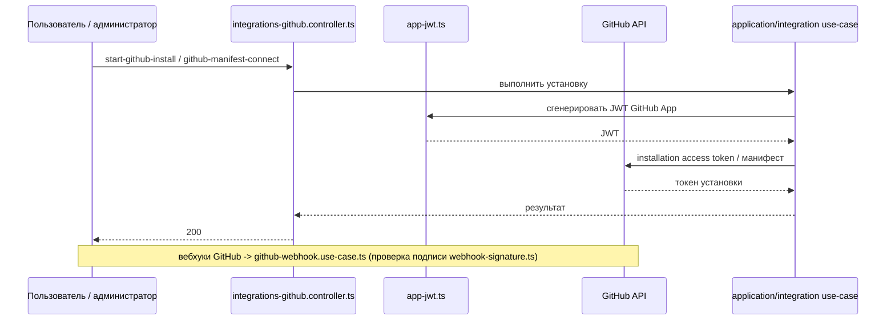

# 24. Интеграция GitHub

## Назначение

Интеграция GitHub — аддон. Реализована в `apps/server/src/app/infra/integration/github/`. Использует GitHub App (JWT аутентификация как приложение), OAuth для пользователей, вебхуки, установки (installations). Данные интеграции хранятся в собственной SQLite (`orgDataDir(orgId)/integrations/<id>/data.db`).

## Файлы интеграции GitHub

| Файл | Назначение |
|------|------------|
| `app-jwt.ts` | JWT для GitHub App (аутентификация как приложение, подпись приватным ключом PEM) |
| `github-api.ts` | базовый клиент GitHub API |
| `github-app-config.ts` (тест `github-app-config.spec.ts`) | конфигурация GitHub App (`AppConfigSchema.githubApp`) |
| `github-app-store.ts` | хранилище конфигураций приложений |
| `github-content-api.ts` | API контента (репозитории, файлы) |
| `github-install-sessions.ts` | сессии установки GitHub App |
| `github-issues-api.ts` | API проблем (issues) |
| `github-manifest.ts` (тест `github-manifest.spec.ts`) | манифест создания приложения |
| `github-pr-ci-api.ts` | API pull request и CI |
| `github-token.adapter.ts` | адаптер токенов GitHub (`IntegrationTokenPort`) |
| `installation-token.ts` (тест `installation-token.spec.ts`) | токены установки (installation access tokens, минтятся на каждую git-операцию) |
| `webhook-signature.ts` (тест `webhook-signature.spec.ts`) | проверка подписи вебхука GitHub |

## Конфигурация GitHub App

Берётся из `AppConfigSchema.githubApp` (`apps/server/src/config.schema.ts`): `appId`, `privateKey` (нормализация PEM), `clientId`, `clientSecret`, `webhookSecret`, `appSlug`. Ошибка `GithubAppNotConfiguredException` (`integration.error.ts:59`) при отсутствии конфигурации.

## Контроллеры

- `integrations-github.controller.ts` — маршруты GitHub интеграции.
- `integrations-google-callback.controller.ts` — callback OAuth (общий для провайдеров).

## Use-cases (`application/integration/`)

`github-app-status.use-case.ts`, `start-github-install.use-case.ts`, `github-install-callback.use-case.ts`, `github-install-adopt.ts`, `poll-github-install.use-case.ts`, `start-github-manifest.use-case.ts`, `github-manifest-connect.use-case.ts`, `github-manifest-callback.use-case.ts`, `github-webhook.use-case.ts`, `github-tools.provider.ts`, `list-github-repos.use-case.ts`, `git-credential.use-case.ts`.

## Контракты (`packages/contracts/src/integrations.ts`)

- `IntegrationProvider`: `github` (и `google`).
- `ConnectorCapability`: `repos` | `issues` | `ci`.
- `ConnectorContent`: `github-repos`.
- `GithubAppStatusResponse` (`configured`, `appSlug`, `contentsAccess`).
- `GithubInstallStartResponse` (`installUrl`, `sessionId`).
- `GithubManifestStartResponse` (`popupUrl`, `sessionId`).
- `GithubInstallStatusResponse` (`pending` | `denied` | `expired` | `ready` с `integrationId`).
- `GithubRepoItem`, `GithubReposResponse`, `GithubReposQuery`.
- `GithubContentsAccess`: `write` | `read` | `none`.

## Использование

Через общую модель интеграций: реестр `installed-integrations.ts`, порт `integration-token.port.ts`, адаптер токенов. Данные интеграции хранятся в собственной SQLite. Аутентификация GitHub App через JWT; токены доступа установки (installation access tokens) минтятся на каждую git-операцию. Вебхуки GitHub обрабатываются `github-webhook.use-case.ts` с проверкой подписи `webhook-signature.ts`.

## Связанные разделы

- [22-интеграции-общая-модель.md](./22-интеграции-общая-модель.md)
- [25-интеграция-google.md](./25-интеграция-google.md)
- [20-источники-git.md](./20-источники-git.md) (репозитории как источники)
