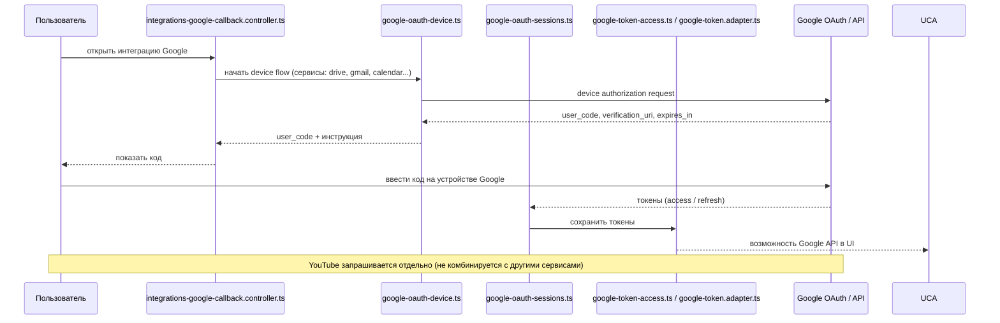

# 25. Интеграция Google

## Назначение

Интеграция Google — аддон. Реализована в `apps/server/src/app/infra/integration/google/`. Использует OAuth device flow для входа пользователя, затем доступ к множеству Google API. Данные интеграции хранятся в собственной SQLite (`orgDataDir(orgId)/integrations/<id>/data.db`).

## Файлы интеграции Google

| Файл | Назначение |
|------|------------|
| `google-app-config.ts` (тест) | конфигурация Google App (`clientId`, `clientSecret`, `apiKey?`, `appId?`) |
| `google-http.ts` | базовый HTTP клиент Google |
| `google-oauth-device.ts` (тест) | OAuth device flow (вход через устройство); `GoogleOAuthClientConfig` |
| `google-oauth-sessions.ts` | сессии OAuth |
| `google-service-scopes.ts` (тест) | области доступа (scopes) Google |
| `google-token-access.ts` (тест) | доступ к токенам Google (`googleCredKey`) |
| `google-token.adapter.ts` | адаптер токенов Google (`IntegrationTokenPort`) |
| `calendar-api.ts` (тест) | Google Календарь |
| `docs-api.ts` | Google Документы |
| `gmail-api.ts` (тест) | Gmail |
| `searchconsole-api.ts` | Google Search Console |
| `sheets-api.ts` | Google Таблицы |
| `youtube-api.ts` | YouTube |
| `youtube-analytics-api.ts` | YouTube Analytics |
| `youtube-mappers.ts` | мапперы YouTube |

## Поток подключения Google

1. Пользователь открывает страницу интеграции Google.
2. Запускается OAuth device flow (`google-oauth-device.ts`): пользователь получает код и авторизуется на устройстве Google.
3. После успешной авторизации создаётся сессия OAuth (`google-oauth-sessions.ts`) и сохраняются токены (`google-token-access.ts`, `google-token.adapter.ts`).
4. Возможности Google API появляются в интерфейсе.

## API Google (по коду)

- Календарь (`calendar-api.ts`)
- Документы (`docs-api.ts`)
- Gmail (`gmail-api.ts`)
- Таблицы (`sheets-api.ts`)
- YouTube + YouTube Analytics (`youtube-api.ts`, `youtube-analytics-api.ts`)
- Search Console (`searchconsole-api.ts`)

## Контроллер

`integrations-google-callback.controller.ts` — обработка callback OAuth.

## Use-cases (`application/integration/`)

`save-google-app-config.use-case.ts`, `get-google-app-status.use-case.ts`, `start-google-oauth-loopback.use-case.ts`, `poll-google-oauth.use-case.ts`, `finish-google-oauth-loopback.use-case.ts`, `finalize-google-integration.use-case.ts`, `get-google-picker-session.use-case.ts`, `google-tools.provider.ts`.

## Контракты (`packages/contracts/src/integrations.ts`)

- `IntegrationProvider`: `google`.
- `GoogleOAuthService`: `drive` | `gmail` | `calendar` | `youtube` | `sheets` | `docs` | `search_console`.
- `GoogleAppConfigBody` (`clientId`, `clientSecret`, `apiKey?`, `appId?`).
- `GoogleAppConfigStatusResponse`, `GoogleOAuthStatusResponse` (`pending` | `denied` | `expired` | `ready` с `integrationId`).
- `GoogleOAuthLoopbackStartBody` (`services[]`; YouTube только отдельно — не комбинируется с другими сервисами).
- `GoogleOAuthLoopbackStartResponse` (`flow: 'loopback'`, `sessionId`, `authUrl`, `expiresIn`).
- `GooglePickerSessionQuery`, `GooglePickerSessionResponse` (`accessToken`, `apiKey`, `appId`).

## Поток данных OAuth device flow

## Связанные разделы

- [22-интеграции-общая-модель.md](./22-интеграции-общая-модель.md)
- [24-интеграция-github.md](./24-интеграция-github.md)
- [21-источники-cloud.md](./21-источники-cloud.md) (источник Google Drive, отделен от интеграции Google API)
