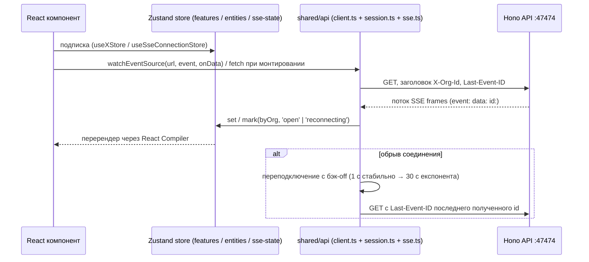

# 43. Управление состоянием и SSE WebUI

## Управление состоянием (Zustand)

Состояние frontend хранится в zustand-хранилищах (`create` из `zustand`, `zustand ^5.0.15`), по одной Store на фичу/сущность. Реактивная подписка компонентов через хуки `useXStore`; React Compiler дополнительно мемоизирует рендеры автоматически (ручного `useMemo`/`useCallback` для перформанса нет).

Группы хранилищ:

- `entities/*/model/*.store.ts` — доменные сущности (14 подпапок): `agent.store.ts` (`items`, `byId`, `inOrg`, `upsert`, `update`, `remove`, `apps/webui/src/entities/agent/model/agent.store.ts`) и хранилища остальных 13 сущностей (`approval`, `automation`, `issue`, `org-machine`, `permission-rule`, `plan`, `project`, `schedule`, `session`, `thread`, `tool-catalog`, `usage`, `webhook`).
- `features/*/model/*.store.ts` — фичи: `issue-drawer.store.ts`, `issue-view.store.ts` (`manage-issues`), `queue.store.ts` (`message-queue`), `desk.store.ts` (`desk`: активная вкладка инспектора, открытые файлы), `agents-display.store.ts`, `ide.store.ts`, `lsp-sessions.store.ts`, `compacting.store.ts`, `app-update.store.ts`.
- `shared/api/sse-state.ts` — `useSseConnectionStore`: `byOrg: Record<string, 'open' | 'reconnecting'>`, действия `mark(orgId, state)`, `clear(orgId)` (`apps/webui/src/shared/api/sse-state.ts`).
- Чистые/производные без своего стора: `section-attention.ts`, `thread-tree.ts` (боковая панель проекта).

Все файлы `kebab-case`, без экспорта по умолчанию, типизация через `interface` для форм объектов и `type` для алгебр/алиасов (AGENTS.md). `export type` обязателен (`useExportType: error`).

## SSE (Server-Sent Events)

`shared/api/sse.ts` (285 строк):

- `readSse(response, options?)` — `AsyncGenerator<SseFrame>`, парсит блоки `event:`/`id:`/`data:` через `TextDecoder`, разделитель `\n\n`, опциональный `idleTimeoutMs` (`withDeadline`, ошибка 'sse stream stalled'). `SseFrame = { event: string; data: string; id?: string }`.
- `watchEventSource(url, event, onData, options?)` — пул соединений (`Map<string, FetchSseConnection>`), ключ `` `${url}::${orgId}` ``, подсчёт ссылок (`refs`), колбэки `onOpen`/`onError`/`onData` по именам событий. Возвращает функцию отписки; при `refs === 0` соединение abort'ится и удаляется из пула.
- `maintainConnection` — цикл попыток: задержка 1 с при стабильном соединении (≥ `SSE_STABLE_MS = 10_000` мс), иначе экспоненциальный бэк-off `1000 * 2**attempt`, кап 30 с (`nextBackoff`). Возобновление потока по заголовку `Last-Event-ID` (`openSseOnce`); при `400` и неверном `lastId` — повтор без `Last-Event-ID`.
- Заголовки запроса: `X-Org-Id`, авторизация через `authenticatedFetch`.

`shared/api/sse-state.ts` (33 строки) — zustand-хранилище состояния SSE-соединения по организации:

```ts
export type SseConnectionState = 'open' | 'reconnecting';
interface SseConnectionStore {
  byOrg: Record<string, SseConnectionState>;
  mark: (orgId: string, state: SseConnectionState) => void;
  clear: (orgId: string) => void;
}
```

Вспомогательная функция `setSseConnectionState(orgId, state)` вызывает `mark` на стор.

События ran (ходы выполнения, чанки модели) потокятся сервером через SSE; клиент подписывается один раз на монтировании/действии, повторного опроса нет (AGENTS.md: запрет сетевого polling, нет `refetchInterval`, нет `setInterval`/`setTimeout` циклов по HTTP). UI-таймеры без сети (countdown) допустимы.

## Диаграмма: SSE и состояние



## Запрет на polling

Никакого сетевого polling: нет `refetchInterval` на API-запросах, нет `setInterval`/`setTimeout` циклов, hitting HTTP "just in case". Push = SSE или WebSocket; одноразовая загрузка допустима при монтировании или действии пользователя; обновление по клику, а не по таймеру (AGENTS.md).

## Связанные разделы

- [41-frontend-архитектура-webui.md](./41-frontend-архитектура-webui.md)
- [42-frontend-страницы-и-виджеты.md](./42-frontend-страницы-и-виджеты.md)
- [44-frontend-api-клиент.md](./44-frontend-api-клиент.md)
- [61-webui-архитектура-страницы-виджеты.md](./61-webui-архитектура-страницы-виджеты.md)
- [62-webui-состояние-api-sse.md](./62-webui-состояние-api-sse.md)
- [15-выполнение-run-engine.md](./15-выполнение-run-engine.md) (события ran на сервере)
