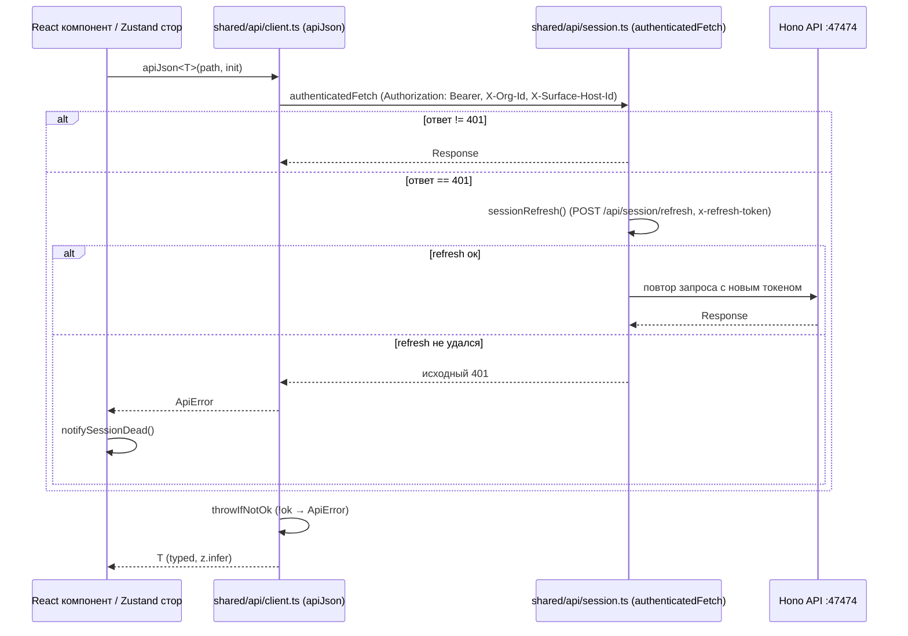

# 44. API клиент WebUI

## Назначение

Единый typed HTTP-клиент фронтенда. Источник истины — бэкенд; фронтенд тонкий, формируется API, слоёв адаптеров нет (AGENTS.md). Все ответы типизируются через `z.infer` из `@harnesys/contracts` и локальных типов (`@harnesys/studio-shared`, `harnesys/*`).

## Базовый клиент (`shared/api/client.ts`)

| Элемент | Поведение | Путь |
|---------|-----------|------|
| `apiJson<T>(path, init?)` | JSON-запрос через `requestJson` → `authenticatedFetch`; возвращает `T` | `client.ts:71` |
| `requestJson` | заголовок `Content-Type: application/json` (кроме FormData), auth-заголовки, `throwIfNotOk` → `ApiError` | `client.ts:75` |
| `throwIfNotOk` | при `!response.ok` читает тело как JSON, извлекает `error ?? message`, бросает `ApiError(status, message, body)`; 204 → `undefined` | `client.ts:56`, `client.ts:82` |
| `ApiError` | `Error` с полями `status: number`, `body?: unknown`, `name = 'ApiError'` | `client.ts:7` |
| `apiUrl(path)` | резолвит относительно `env.localHostOrigin` (`shared/config/env.ts`); абсолютные URL возвращаются как есть | `client.ts:20` |

`applyAuthHeaders` (`client.ts:37`) на каждый запрос:
- `X-Org-Id` — активная организация (`getActiveOrgId`, `shared/api/active-org.ts`); не отправляется на пути `/api/orgs`, `/api/orgs/:id`, `/api/orgs/:id/activate` (`isMachineOrgsPath`).
- `X-Surface-Host-Id` — `selfNodeCached()` (`shared/api/self-node.ts`).

## Аутентификация и сессия (`shared/api/session.ts`)

| Элемент | Поведение | Путь |
|---------|-----------|------|
| `authenticatedFetch(input, init?)` | `fetch` с `Authorization: Bearer <accessToken>` (`withAccessHeader`); при `401` один инфлайт `sessionRefresh()` и повтор с `bearerOf(init)` (снимает старый Authorization); если refresh не удался — возвращает исходный `401` | `session.ts:278` |
| `sessionRefresh()` | инфлайтовое обновление access-токена с защитой от параллельных вызовов (`refreshInflight`) | `session.ts:204` |
| `performRefresh()` | `POST /api/session/refresh`, `credentials: 'include'`, заголовок `x-refresh-token` (refresh-токен в `localStorage` под ключом `harnesys.refresh`); при неудаче `notifySessionDead()` | `session.ts:175` |
| `sessionLogin(login, password)` | `POST /api/session/login`, сохраняет `accessToken` в память и `refreshToken` в `localStorage` (`harnesys.refresh`), `notifySessionReady()` | `session.ts:142` |
| `sessionLogout()` | `POST /api/session/logout`, очищает токены | `session.ts:213` |
| `sessionOwnerStatus()` / `sessionOwnerInit(input)` | проверка/инициализация владельца (`GET /api/session/owner/status`, `POST /api/session/owner/init`) | `session.ts:227`, `session.ts:246` |
| `getAccess()` / `setAccess()` / `clearAccess()` | управление access-токеном в памяти | `session.ts:68` |
| `notifySessionDead()` / `subscribeSessionDead()` | обнуляет токены и оповещает слушателей о мёртвой сессии | `session.ts:80` |
| `subscribeSessionReady()` | оповещение о готовности сессии после логина | `session.ts:61` |

`SessionFailure` — ошибка сессии с `status`, `errorCode`, `message`, `retryAfterSec` (`session.ts:9`).

## Заголовки и переменные окружения (`shared/config/env.ts`)

- `env.localHostOrigin` — `CLIENT_HOST_ORIGIN`, иначе `window.location.origin`; в Tauri — `http://127.0.0.1:47474` (`env.ts:24`).
- `hostWsBase()` — `ws`/`wss` аналог `localHostOrigin` для WebSocket терминала (`env.ts:35`).

## Группы модулей `shared/api/` (69 модулей, `index.ts`)

| Домен | Модули |
|-------|--------|
| Сессия и безопасность | `session.ts`, `sessions.ts` |
| Организации и участники | `orgs.ts`, `members.ts`, `teams.ts`, `org-agents.ts`, `org-audit.ts`, `org-plugins.ts`, `org-mcp.ts`, `org-lsp.ts`, `org-mode-presets.ts`, `org-skills.ts`, `org-toolchain.ts`, `org-capabilities.ts` |
| Проекты | `projects.ts`, `project-base.ts`, `project-mcp.ts`, `project-skills.ts` |
| Потоки и выполнение | `threads.ts`, `thread-files.ts`, `thread-groups.ts`, `thread-queue.ts`, `model-execution.ts`, `raw-model-requests.ts` |
| Агенты и навыки | `agents.ts`, `agent-capabilities.ts`, `skills.ts`, `index-agents.ts` |
| Проблемы (issues) | `issues.ts`, `issue-detail.ts`, `issue-labels.ts`, `index-issues.ts` |
| Знания и индекс | `knowledge-index.ts`, `index-knowledge.ts`, `sources.ts`, `source-location.ts`, `content.ts`, `files.ts`, `blob-url.ts`, `memory.ts`, `usage.ts`, `catalog.ts` |
| Интеграции и соединители | `integrations.ts`, `identity-links.ts`, `placement-queue.ts`, `discovery.ts`, `host-fs.ts`, `repository-worktrees.ts`, `self-node.ts` |
| MCP, провайдеры, модели | `mcp.ts` (внутри project/org), `providers.ts`, `mode-presets.ts`, `org-mode-presets.ts` |
| Плагины | `plugins.ts`, `plugin-registries.ts` |
| Расписания, вебхуки, флот | `schedules.ts`, `webhooks.ts`, `fleet.ts`, `node-tickets.ts`, `terminals.ts` |
| Прочее | `eula.ts`, `meta.ts`, `events.ts`, `automations.ts`, `vault.ts`, `voice-prefs.ts`, `active-org.ts` |
| Поток сообщений | `sse.ts`, `sse-state.ts` (SSE), `terminals.ts` (WebSocket терминала) |

Все экспорты агрегированы в `shared/api/index.ts`.

## Формат ошибок, relied on клиентом

Клиент ожидает транспортный контракт сервера `ErrorResponse`: `{ statusCode, errorCode, message, path, timestamp, traceId?, details? }` (`packages/brix/src/errors/error-filter.ts:10`). `ApiError` извлекает `body.error ?? body.message` как текст ошибки (`client.ts:48`). Сетевые ошибки сервера (401/403/404/500) маппятся глобальным фильтром `DefaultErrorFilter` в `ErrorResponse` (`packages/brix/src/errors/error-filter.ts:135`). Валидация Zod → `400 VALIDATION_ERROR` с `details.issues` (`error-filter.ts:117`).

## Сетевое взаимодействие

Нет polling (AGENTS.md): данные загружаются один раз при монтировании или действии пользователя; обновления по клику; потоковые обновления — SSE (`sse.ts`) или WebSocket (терминал). В dev Vite-проксирует `/api` на `http://127.0.0.1:47474` с `ws: true`, `timeout: 0`, `proxyTimeout: 0` и форсирует заголовки `Cache-Control: no-cache, no-transform`, `X-Accel-Buffering: no`, `Content-Type: text/event-stream` + `flushHeaders` для `text/event-stream` (`vite.config.ts:72-91`).

## Диаграмма: запрос/ответ API клиента

## Связанные разделы

- [41-frontend-архитектура-webui.md](./41-frontend-архитектура-webui.md)
- [42-frontend-страницы-и-виджеты.md](./42-frontend-страницы-и-виджеты.md)
- [43-frontend-state-management.md](./43-frontend-state-management.md)
- [61-webui-архитектура-страницы-виджеты.md](./61-webui-архитектура-страницы-виджеты.md)
- [62-webui-состояние-api-sse.md](./62-webui-состояние-api-sse.md)
- [39-безопасность.md](./39-безопасность.md)
- [40-ошибки-и-логирование.md](./40-ошибки-и-логирование.md)
- [49-каталог-api.md](./49-каталог-api.md) (если существует)
