# 49. Каталог API маршрутов

Все маршруты регистрируются в `apps/server/src/app/app/api/api.module.ts` (`ApiModule`, 48 контроллеров, ~34 use-case модуля). Префикс API задаётся в `application.yml` (`server.api.prefix: api`, порт `SERVER_PORT`, по умолчанию `47474`). Каждый контроллер — тонкая фасада над use-case. Контроллеры возвращают `object | Response`. Ошибки — единый контракт `ErrorResponse` `{ statusCode, errorCode, message, path, timestamp, traceId?, details? }`. Валидация DTO через `ZodValidationPipe` (`@Body` / `@Query`), `400 VALIDATION_ERROR` с `details.issues`. Глобальный guardia: `SessionGuard` (`APP_GUARD`).

Отдельно: `HealthController` (`apps/server/src/app/api/rest/health.controller.ts`) — `GET /health` → `{ status: 'ok' }`, `@Public()`, не использует use-case.

## Диаграмма: маршрут → контроллер → use-case

```mermaid
graph LR
    subgraph Client[Клиент / WebUI]
    C[HTTP / SSE / WS]
    end
    subgraph Guard[Защита]
    SG[SessionGuard APP_GUARD]
    end
    subgraph API[API слой api.module.ts]
    HC[HealthController /health]
    SC[SessionController /session/*]
    OC[OrgsController /orgs/*]
    TC[ThreadsController /orgs/:orgId/threads/*]
    RUC[Runs через ThreadsController /runs/*]
    IC[IssuesController /orgs/:orgId/issues/*]
    BC[BoardsController /orgs/:orgId/boards/*]
    FC[FleetController /fleet/*]
    NC[FleetNodesController /fleet-nodes/*]
    KNC[KnowledgeController /orgs/:orgId/knowledge/*]
    SKC[SkillsController /orgs/:orgId/skills/*]
    VC[VaultController /vault/*]
    PC[ProvidersController /orgs/:orgId/providers/*]
    MC[McpController /orgs/:orgId/mcp/*]
    PlC[PluginsController /orgs/:orgId/plugins/*]
    PrC[PresetsController /presets/*]
    CC[ConnectorsController /orgs/:orgId/connectors/*]
    SRC[SourcesController /orgs/:orgId/sources/*]
    WC[WebhooksController /orgs/:orgId/webhooks/*]
    AC[ApprovalsController /orgs/:orgId/approvals/*]
    SdC[SchedulesController /orgs/:orgId/schedules/*]
    UsC[UsageController /orgs/:orgId/usage/*]
    EWC[EventsWatchController /events/watch]
    end
    subgraph UC[Use-cases app/application/*]
    end
    C --> SG
    SG --> API
    API --> UC
    HC -.-> |без use-case| HC
```

## Таблица маршрутов (method, path, controller, use-case)

Префикс `/api` опущен для краткости.

### Организации, сессия, идентичность

| Method | Path | Controller | Use-case |
|--------|------|------------|----------|
| GET | `/orgs/:id/active-host` | OrgsController | GetActiveHostUseCase |
| GET | `/orgs` | OrgsController | ListOrgsUseCase |
| POST | `/orgs` | OrgsController | CreateRelayOrgUseCase |
| PATCH | `/orgs/:id` | OrgsController | UpdateOrgUseCase |
| DELETE | `/orgs/:id` | OrgsController | DeleteOrgUseCase |
| POST | `/orgs/:id/activate` | OrgsController | ActivateOrgUseCase |
| GET | `/orgs/:id/settings` | OrgsController | GetOrgSettingsUseCase |
| PATCH | `/orgs/:id/settings` | OrgsController | SetOrgSettingsUseCase |
| GET | `/session/owner/status` | SessionController | OwnerStatusUseCase |
| POST | `/session/login` | SessionController | LoginUseCase |
| POST | `/session/refresh` | SessionController | RefreshSessionUseCase |
| POST | `/session/logout` | SessionController | LogoutUseCase |
| POST | `/session/ticket` | SessionController | IssueNodeTicketUseCase |
| POST | `/session/change-password` | SessionController | ChangePasswordUseCase |
| GET | `/session/sessions` | SessionController | ListSessionsUseCase |
| POST | `/session/revoke` | SessionController | RevokeSessionUseCase |
| POST | `/session/revoke-all` | SessionController | RevokeAllSessionsUseCase |
| POST | `/session/owner/init` | SessionController | InitOwnerUseCase |
| GET | `/orgs/:orgId/members` | MembersController | ListMembersUseCase |
| POST | `/orgs/:orgId/members/invites` | MembersController | IssueUserInviteUseCase |
| PATCH | `/orgs/:orgId/members/:userId` | MembersController | UpdateMembershipUseCase |
| DELETE | `/orgs/:orgId/members/:userId` | MembersController | RemoveMembershipUseCase |
| POST | `/orgs/:orgId/members/:userId/reset-password` | MembersController | ResetMemberPasswordUseCase |
| POST | `/invites/accept` | InvitesController | AcceptUserInviteUseCase |
| GET | `/audit` | AuditController | ListOrgAuditUseCase |
| GET | `/identity-links` | IdentityLinksController | — (не проверено кодом) |
| POST | `/identity-links/:provider/code` | IdentityLinksController | — (не проверено кодом) |
| DELETE | `/identity-links/:provider` | IdentityLinksController | — (не проверено кодом) |
| GET | `/org-git/summary` | OrgGitController | GetOrgGitSummaryUseCase |
| GET | `/eula` | EulaController | GetEulaStatusUseCase |
| POST | `/eula/accept` | EulaController | AcceptEulaUseCase |
| GET | `/health` | HealthController | — (без use-case, @Public) |

### Интеграции, источники, флот

| Method | Path | Controller | Use-case |
|--------|------|------------|----------|
| GET | `/orgs/:orgId/integrations` | IntegrationsController | ListIntegrationsUseCase |
| DELETE | `/orgs/:orgId/integrations/:integrationId` | IntegrationsController | DisconnectIntegrationUseCase |
| GET | `/orgs/:orgId/integrations/google/app` | IntegrationsController | GetGoogleAppStatusUseCase |
| PUT | `/orgs/:orgId/integrations/google/app` | IntegrationsController | SaveGoogleAppConfigUseCase |
| POST | `/orgs/:orgId/integrations/google/oauth/loopback/start` | IntegrationsController | StartGoogleOAuthLoopbackUseCase |
| GET | `/orgs/:orgId/integrations/google/oauth/status` | IntegrationsController | PollGoogleOAuthUseCase |
| GET | `/orgs/:orgId/integrations/google/picker` | IntegrationsController | GetGooglePickerSessionUseCase |
| GET | `/orgs/:orgId/integrations/github/app-status` | IntegrationsController | GithubAppStatusUseCase |
| POST | `/orgs/:orgId/integrations/github/install/start` | IntegrationsController | StartGithubInstallUseCase |
| POST | `/orgs/:orgId/integrations/github/manifest/start` | IntegrationsController | StartGithubManifestUseCase |
| GET | `/orgs/:orgId/integrations/github/install/status` | IntegrationsController | PollGithubInstallUseCase |
| GET | `/orgs/:orgId/integrations/github/repos` | IntegrationsController | ListGithubReposUseCase |
| GET | `/integrations/github/git-credential` | IntegrationsGithubController | GitCredentialUseCase |
| GET | `/integrations/github/callback` | IntegrationsGithubController | GithubInstallCallbackUseCase |
| GET | `/integrations/github/manifest/connect` | IntegrationsGithubController | GithubManifestConnectUseCase |
| GET | `/integrations/github/manifest` | IntegrationsGithubController | GithubManifestCallbackUseCase |
| POST | `/integrations/github/webhook` | IntegrationsGithubController | GithubWebhookUseCase |
| GET/POST/PATCH/PUT/DELETE | `/orgs/:orgId/integrations/:integrationId/*` | IntegrationRoutesController | IntegrationHostPort (прокси аддона) |
| GET | `/orgs/:orgId/sources` | SourcesController | ListSourcesUseCase |
| POST | `/orgs/:orgId/sources/git` | SourcesController | AttachGitUseCase |
| POST | `/orgs/:orgId/sources/cloud` | SourcesController | AttachCloudDriveUseCase |
| GET | `/orgs/:orgId/sources/:sourceId` | SourcesController | GetSourceUseCase |
| GET | `/orgs/:orgId/sources/:sourceId/host-status` | SourcesController | GetSourceHostStatusUseCase |
| GET | `/orgs/:orgId/sources/:sourceId/location` | SourcesController | GetSourceLocationUseCase |
| POST | `/orgs/:orgId/sources/:sourceId/git/refresh` | SourcesController | RefreshGitSourceUseCase |
| GET | `/orgs/:orgId/sources/:sourceId/git/branches` | SourcesController | ListGitBranchesUseCase |
| POST | `/orgs/:orgId/sources/:sourceId/git/branch` | SourcesController | SwitchGitBranchUseCase |
| POST | `/orgs/:orgId/sources/:sourceId/git/branch/delete` | SourcesController | DeleteGitBranchUseCase |
| POST | `/orgs/:orgId/sources/:sourceId/cloud/refresh` | SourcesController | RefreshCloudDriveUseCase |
| DELETE | `/orgs/:orgId/sources/:sourceId` | SourcesController | DetachSourceUseCase |
| PATCH | `/orgs/:orgId/sources/:sourceId/visibility` | SourcesController | SetSourceVisibilityUseCase |
| PATCH | `/orgs/:orgId/sources/:sourceId` | SourcesController | RenameSourceUseCase |
| POST | `/orgs/:orgId/sources/:sourceId/git/init` | SourceGitController | InitGitUseCase |
| POST | `/orgs/:orgId/sources/:sourceId/git-remote` | SourceGitController | SetGitRemoteUseCase |
| PATCH | `/orgs/:orgId/sources/:sourceId/availability` | SourceGitController | SetSourceAvailabilityUseCase |
| POST | `/orgs/:orgId/sources/:sourceId/refresh-vcs` | SourceGitController | RefreshSourceVcsUseCase |
| GET | `/source-git/status` | SourceGitController | GetGitStatusUseCase |
| GET | `/source-git/file-status` | SourceGitController | GetGitFileStatusUseCase |
| GET | `/source-git/diff` | SourceGitController | GetGitDiffUseCase |
| POST | `/source-git/add` | SourceGitController | StageGitUseCase |
| POST | `/source-git/commit` | SourceGitController | CommitGitUseCase |
| POST | `/source-git/push` | SourceGitController | PushGitUseCase |
| POST | `/source-git/pull` | SourceGitController | PullGitUseCase |
| POST | `/source-git/checkout` | SourceGitController | CheckoutGitUseCase |
| POST | `/source-git/branches` | SourceGitController | CreateGitBranchUseCase |
| POST | `/source-git/init` | SourceGitController | InitGitUseCase |
| POST | `/source-materialize` | SourceMaterializeController | AttachLocalFolderUseCase |
| POST | `/source-materialize/:sourceId/prepare` | SourceMaterializeController | PrepareGitSourceUseCase / PrepareCloudSourceUseCase |
| GET | `/source-worktrees` | SourceWorktreesController | ListRepositoryWorktreesUseCase |
| POST | `/source-worktrees` | SourceWorktreesController | CreateRepositoryWorktreeUseCase |
| DELETE | `/source-worktrees/:worktreeId` | SourceWorktreesController | DeleteRepositoryWorktreeUseCase |
| GET | `/fleet/nodes` | FleetController | ListFleetNodesUseCase |
| GET | `/fleet/profiles` | FleetController | ListExecutionProfilesUseCase |
| GET | `/fleet/profiles/:profileId` | FleetController | GetExecutionProfileUseCase |
| POST | `/fleet/profiles` | FleetController | CreateExecutionProfileUseCase |
| PATCH | `/fleet/profiles/:profileId` | FleetController | UpdateExecutionProfileUseCase |
| PUT | `/fleet/profiles/:profileId/nodes` | FleetController | SetExecutionProfileNodesUseCase |
| PUT | `/fleet/profiles/default` | FleetController | SetDefaultExecutionProfileUseCase |
| DELETE | `/fleet/profiles/:profileId` | FleetController | DeleteExecutionProfileUseCase |
| GET | `/fleet/connect-info` | FleetController | ConnectInfoUseCase |
| GET | `/fleet/invites` | FleetController | ListInvitesUseCase |
| POST | `/fleet/invites` | FleetController | IssueInviteUseCase |
| DELETE | `/fleet/invites/:id` | FleetController | RevokeInviteUseCase |
| POST | `/fleet/enroll` | FleetController | EnrollOnRelayUseCase |
| POST | `/fleet/heartbeat` | FleetController | HeartbeatUseCase |
| POST | `/fleet/promote` | FleetController | PromoteRelayUseCase (start) |
| POST | `/fleet/promote/complete` | FleetController | PromoteRelayUseCase (complete) |
| POST | `/fleet/proxy/:nodeId` | FleetController | FleetContentProxyPort |
| POST | `/fleet/secrets/resolve` | FleetController | ResolveFleetSecretsUseCase |
| POST | `/fleet/work/claim` | FleetController | ClaimWorkUseCase |
| POST | `/fleet/worker/org-operation` | FleetController | ExecuteWorkerOrgOperationUseCase |
| POST | `/fleet/runs/attachments/fetch` | FleetController | FetchRunAttachmentUseCase |
| GET | `/fleet/cloud-sync/grant` | FleetCloudController | IssueCloudSourceSyncGrantUseCase |
| POST | `/fleet/cloud-sync/complete` | FleetCloudController | ReleaseCloudSourceSyncGrantUseCase |
| GET | `/fleet-nodes/:nodeId/disconnect` | FleetNodesController | DisconnectFleetNodeUseCase |
| POST | `/fleet-nodes/:nodeId/rotate` | FleetNodesController | RotateNodeTokenUseCase |
| DELETE | `/fleet-nodes/:nodeId` | FleetNodesController | RemoveFleetNodeUseCase |
| GET | `/placement-queue/profiles/:profileId/queue` | PlacementQueueController | ListPlacementQueueUseCase |
| POST | `/discovery/pair` | DiscoveryController | PairWithRelayUseCase |
| POST | `/discovery/retarget` | DiscoveryController | RetargetUseCase |
| POST | `/discovery/promote/accept` | DiscoveryController | PromoteRelayUseCase (accept) |

### Потоки (threads), агенты, запуски

| Method | Path | Controller | Use-case |
|--------|------|------------|----------|
| GET | `/orgs/:orgId/threads` | ThreadsController | ListThreadsUseCase |
| POST | `/orgs/:orgId/threads` | ThreadsController | CreateThreadUseCase |
| GET | `/orgs/:orgId/threads/:threadId` | ThreadsController | GetThreadUseCase |
| PATCH | `/orgs/:orgId/threads/:threadId/policy` | ThreadsController | UpdateThreadPolicyUseCase |
| POST | `/orgs/:orgId/threads/:threadId/agents` | ThreadsController | AddThreadAgentUseCase |
| DELETE | `/orgs/:orgId/threads/:threadId/agents/:agentId` | ThreadsController | RemoveThreadAgentUseCase |
| POST | `/orgs/:orgId/threads/:threadId/participants` | ThreadsController | AddThreadParticipantUseCase |
| DELETE | `/orgs/:orgId/threads/:threadId/participants/:participantId` | ThreadsController | RemoveThreadParticipantUseCase |
| PATCH | `/orgs/:orgId/threads/:threadId/binding` | ThreadsController | UpdateThreadBindingUseCase |
| GET | `/orgs/:orgId/threads/:threadId/plan` | ThreadsController | GetThreadPlanUseCase |
| DELETE | `/orgs/:orgId/threads/:threadId/plan` | ThreadsController | DeleteThreadPlanUseCase |
| DELETE | `/orgs/:orgId/threads/:threadId` | ThreadsController | DeleteThreadUseCase |
| DELETE | `/orgs/:orgId/threads/:threadId/events/:threadSeq` | ThreadsController | DeleteThreadEventUseCase |
| POST | `/orgs/:orgId/threads/:threadId/runs` | ThreadsController | SendThreadRunUseCase |
| POST | `/orgs/:orgId/threads/:threadId/send` | ThreadsController | SendThreadRunUseCase (alias) |
| POST | `/orgs/:orgId/threads/:threadId/runs/:runId/cancel` | ThreadsController | CancelRunUseCase |
| POST | `/orgs/:orgId/threads/:threadId/runs/:runId/retry` | ThreadsController | RetryRunUseCase |
| POST | `/orgs/:orgId/threads/:threadId/read` | ThreadsController | MarkThreadReadUseCase |
| POST | `/orgs/:orgId/threads/:threadId/runs/:runId/respond` | ThreadsController | RespondRunUseCase |
| POST | `/orgs/:orgId/threads/:threadId/runs/:runId/reject` | ThreadsController | RespondRunUseCase.reject |
| GET | `/orgs/:orgId/threads/:threadId/runs/:runId/events` | ThreadsController | StreamRunEventsUseCase |
| GET | `/orgs/:orgId/agents` | AgentsController | ListAgentsUseCase |
| GET | `/orgs/:orgId/agents/:agentId` | AgentsController | GetAgentUseCase |
| GET | `/orgs/:orgId/agents/:agentId/capabilities` | AgentsController | ListAgentCapabilitiesUseCase |
| POST | `/orgs/:orgId/agents` | AgentsController | CreateAgentUseCase |
| POST | `/orgs/:orgId/agents/from-preset` | AgentsController | CreateAgentFromPresetUseCase |
| PATCH | `/orgs/:orgId/agents/:agentId` | AgentsController | UpdateAgentUseCase |
| DELETE | `/orgs/:orgId/agents/:agentId` | AgentsController | DeleteAgentUseCase |
| GET | `/agent-hooks/hook-runs` | AgentHooksController | ListHookRunsUseCase |
| POST | `/agent-hooks/hooks/test` | AgentHooksController | TestAgentHookUseCase |
| GET | `/threads/:threadId/queue` | ThreadMessageQueueController | ThreadMessageQueueUseCase.list |
| POST | `/threads/:threadId/queue` | ThreadMessageQueueController | ThreadMessageQueueUseCase.enqueue |
| DELETE | `/threads/:threadId/queue/:itemId` | ThreadMessageQueueController | ThreadMessageQueueUseCase.remove |
| POST | `/threads/:threadId/queue/:itemId/deliver` | ThreadMessageQueueController | ThreadMessageQueueUseCase.deliver |
| POST | `/threads/:threadId/compact` | ThreadCompactController | CompactThreadUseCase |
| GET | `/threads/:threadId/attachments` | ThreadAttachmentsController | ListThreadAttachmentsUseCase |
| POST | `/threads/:threadId/attachments` | ThreadAttachmentsController | UploadThreadAttachmentUseCase |
| GET | `/threads/:threadId/attachments/:attachmentId` | ThreadAttachmentsController | GetThreadAttachmentUseCase |
| GET | `/threads/:threadId/files` | ThreadFilesController | ListThreadFilesUseCase |
| GET | `/threads/:threadId/files/content` | ThreadFilesController | ReadThreadFileUseCase |
| GET | `/threads/:threadId/raw-model-requests` | ThreadRawModelRequestsController | ListThreadRawModelRequestsUseCase |
| GET | `/threads/:threadId/raw-model-requests/:name` | ThreadRawModelRequestsController | GetThreadRawModelRequestUseCase |

### Проблемы, доски, метки, вебхуки, утверждения, расписания

| Method | Path | Controller | Use-case |
|--------|------|------------|----------|
| GET | `/orgs/:orgId/issues` | IssuesController | ListIssuesUseCase |
| POST | `/orgs/:orgId/issues` | IssuesController | CreateIssueUseCase |
| GET | `/orgs/:orgId/issues/:issueId` | IssuesController | GetIssueUseCase |
| PATCH | `/orgs/:orgId/issues/:issueId` | IssuesController | UpdateIssueUseCase |
| PATCH | `/orgs/:orgId/issues/:issueId/status` | IssuesController | UpdateIssueStatusUseCase |
| POST | `/orgs/:orgId/issues/:issueId/nudge` | IssuesController | NudgeIssueUseCase |
| POST | `/orgs/:orgId/issues/:issueId/worktree` | IssuesController | CreateIssueWorktreeUseCase |
| DELETE | `/orgs/:orgId/issues/:issueId` | IssuesController | DeleteIssueUseCase |
| GET | `/orgs/:orgId/issues/:issueId/comments` | IssuesController | ListIssueCommentsUseCase |
| POST | `/orgs/:orgId/issues/:issueId/comments` | IssuesController | AddIssueCommentUseCase |
| POST | `/orgs/:orgId/issues/:issueId/dependencies` | IssuesController | AddIssueDependencyUseCase |
| DELETE | `/orgs/:orgId/issues/:issueId/dependencies/:dependsOnIssueId` | IssuesController | RemoveIssueDependencyUseCase |
| GET | `/orgs/:orgId/issues/:issueId/attachments` | IssuesController | GetIssueUseCase (вложения) |
| POST | `/orgs/:orgId/issues/:issueId/attachments` | IssuesController | UploadIssueAttachmentUseCase |
| POST | `/orgs/:orgId/issues/:issueId/attachments/source` | IssuesController | AddIssueSourceAttachmentUseCase |
| GET | `/orgs/:orgId/issues/:issueId/attachments/:attachmentId` | IssuesController | GetIssueAttachmentUseCase |
| DELETE | `/orgs/:orgId/issues/:issueId/attachments/:attachmentId` | IssuesController | DeleteIssueAttachmentUseCase |
| GET | `/orgs/:orgId/boards` | BoardsController | ListIssueBoardsUseCase |
| POST | `/orgs/:orgId/boards` | BoardsController | CreateIssueBoardUseCase |
| GET | `/orgs/:orgId/boards/:boardId` | BoardsController | GetIssueBoardUseCase |
| PATCH | `/orgs/:orgId/boards/:boardId` | BoardsController | UpdateIssueBoardUseCase |
| POST | `/orgs/:orgId/boards/:boardId/statuses` | BoardsController | AddBoardStatusUseCase |
| PUT | `/orgs/:orgId/boards/:boardId/statuses/order` | BoardsController | ReorderBoardStatusesUseCase |
| PATCH | `/orgs/:orgId/boards/:boardId/statuses/:statusKey` | BoardsController | UpdateBoardStatusUseCase |
| DELETE | `/orgs/:orgId/boards/:boardId/statuses/:statusKey` | BoardsController | RemoveBoardStatusUseCase |
| POST | `/orgs/:orgId/boards/:boardId/rules` | BoardsController | SaveBoardRuleUseCase |
| PUT | `/orgs/:orgId/boards/:boardId/rules/order` | BoardsController | ReorderBoardRulesUseCase |
| PATCH | `/orgs/:orgId/boards/:boardId/rules/:ruleId` | BoardsController | SaveBoardRuleUseCase |
| DELETE | `/orgs/:orgId/boards/:boardId/rules/:ruleId` | BoardsController | RemoveBoardRuleUseCase |
| PATCH | `/orgs/:orgId/boards/:boardId/archive` | BoardsController | SetIssueBoardArchiveUseCase |
| PATCH | `/orgs/:orgId/boards/:boardId/unarchive` | BoardsController | SetIssueBoardArchiveUseCase |
| DELETE | `/orgs/:orgId/boards/:boardId` | BoardsController | DeleteIssueBoardUseCase |
| GET | `/orgs/:orgId/labels` | LabelsController | ListIssueLabelsUseCase |
| POST | `/orgs/:orgId/labels` | LabelsController | CreateIssueLabelUseCase |
| PATCH | `/orgs/:orgId/labels/:labelId` | LabelsController | UpdateIssueLabelUseCase |
| DELETE | `/orgs/:orgId/labels/:labelId` | LabelsController | DeleteIssueLabelUseCase |
| GET | `/orgs/:orgId/webhooks` | WebhooksController | ListWebhooksUseCase |
| POST | `/orgs/:orgId/webhooks` | WebhooksController | CreateWebhookUseCase |
| PATCH | `/orgs/:orgId/webhooks/:webhookId` | WebhooksController | UpdateWebhookUseCase |
| DELETE | `/orgs/:orgId/webhooks/:webhookId` | WebhooksController | DeleteWebhookUseCase |
| POST | `/orgs/:orgId/hooks/:id` | OrgHooksController | FireWebhookUseCase |
| GET | `/orgs/:orgId/approvals` | ApprovalsController | ListApprovalsUseCase |
| POST | `/orgs/:orgId/approvals` | ApprovalsController | RequestApprovalUseCase |
| GET | `/orgs/:orgId/approvals/:approvalId` | ApprovalsController | GetApprovalUseCase |
| POST | `/orgs/:orgId/approvals/:approvalId/decide` | ApprovalsController | DecideApprovalUseCase |
| GET | `/orgs/:orgId/schedules` | SchedulesController | ListSchedulesUseCase |
| POST | `/orgs/:orgId/schedules` | SchedulesController | CreateScheduleUseCase |
| PATCH | `/orgs/:orgId/schedules/:scheduleId` | SchedulesController | UpdateScheduleUseCase |
| DELETE | `/orgs/:orgId/schedules/:scheduleId` | SchedulesController | DeleteScheduleUseCase |

### Файловый контент, навыки, модели, провайдеры, MCP, плагины, пресеты

| Method | Path | Controller | Use-case |
|--------|------|------------|----------|
| GET | `/orgs/:orgId/sources/:sourceId/content/tree` | ContentController | ListTreeUseCase |
| GET | `/orgs/:orgId/sources/:sourceId/content/read` | ContentController | ReadFileUseCase |
| PUT | `/orgs/:orgId/sources/:sourceId/content/write` | ContentController | WriteFileUseCase |
| POST | `/orgs/:orgId/sources/:sourceId/content/mkdir` | ContentController | MkdirUseCase |
| DELETE | `/orgs/:orgId/sources/:sourceId/content/remove` | ContentController | RemovePathUseCase |
| POST | `/orgs/:orgId/sources/:sourceId/content/move` | ContentController | MovePathsUseCase |
| POST | `/orgs/:orgId/sources/:sourceId/content/copy` | ContentController | CopyPathsUseCase |
| POST | `/orgs/:orgId/sources/:sourceId/content/import` | ContentController | ImportPathsUseCase |
| GET | `/orgs/:orgId/sources/:sourceId/content/stat` | ContentController | StatPathUseCase |
| POST | `/orgs/:orgId/sources/:sourceId/content/duplicate` | ContentController | DuplicatePathUseCase |
| POST | `/orgs/:orgId/sources/:sourceId/content/reveal` | ContentController | RevealPathUseCase |
| GET | `/orgs/:orgId/sources/:sourceId/content/download` | ContentController | DownloadPathUseCase |
| GET | `/orgs/:orgId/skills` | SkillsController | ListOrgSkillsUseCase |
| GET | `/orgs/:orgId/skills/effective` | SkillsController | GetEffectiveSkillsUseCase |
| POST | `/orgs/:orgId/skills` | SkillsController | CreateOrgSkillUseCase |
| POST | `/orgs/:orgId/skills/reload` | SkillsController | ReloadOrgSkillsUseCase |
| DELETE | `/orgs/:orgId/skills/:name` | SkillsController | DeleteOrgSkillUseCase |
| POST | `/orgs/:orgId/skills/discover` | SkillsController | DiscoverRepoSkillsUseCase |
| POST | `/orgs/:orgId/skills/install` | SkillsController | InstallRepoSkillsUseCase |
| POST | `/orgs/:orgId/skills/:name/update` | SkillsController | UpdateInstalledSkillUseCase |
| GET | `/orgs/:orgId/skills/search` | SkillsSearchController | SearchSkillsUseCase |
| POST | `/orgs/:orgId/host-skills/:name/restore` | HostSkillsController | RestoreSystemSkillUseCase |
| GET | `/orgs/:orgId/providers` | ProvidersController | ListProvidersUseCase |
| POST | `/orgs/:orgId/providers` | ProvidersController | CreateProviderUseCase |
| GET | `/orgs/:orgId/providers/export` | ProvidersController | ExportProvidersUseCase |
| POST | `/orgs/:orgId/providers/import` | ProvidersController | ImportProvidersUseCase |
| GET | `/orgs/:orgId/providers/:id` | ProvidersController | GetProviderUseCase |
| PATCH | `/orgs/:orgId/providers/:id` | ProvidersController | UpdateProviderUseCase |
| DELETE | `/orgs/:orgId/providers/:id` | ProvidersController | DeleteProviderUseCase |
| POST | `/orgs/:orgId/providers/:id/discover` | ProvidersController | DiscoverProviderModelsUseCase |
| POST | `/orgs/:orgId/providers/:id/ollama-info` | ProvidersController | OllamaModelInfoUseCase |
| POST | `/orgs/:orgId/providers/:id/models` | ProvidersController | CreateProviderModelUseCase |
| PATCH | `/orgs/:orgId/providers/:id/models/:modelId` | ProvidersController | UpdateProviderModelUseCase |
| DELETE | `/orgs/:orgId/providers/:id/models/:modelId` | ProvidersController | DeleteProviderModelUseCase |
| GET | `/orgs/:orgId/mcp` | McpController | GetOrgMcpUseCase |
| GET | `/orgs/:orgId/mcp/config` | McpController | GetOrgMcpConfigUseCase |
| POST | `/orgs/:orgId/mcp/reload` | McpController | ReloadOrgMcpUseCase |
| PUT | `/orgs/:orgId/mcp/servers/:serverId` | McpController | UpsertOrgMcpServerUseCase |
| DELETE | `/orgs/:orgId/mcp/servers/:serverId` | McpController | DeleteOrgMcpServerUseCase |
| PUT | `/orgs/:orgId/mcp/servers/:serverId/state` | McpController | SetOrgMcpServerStateUseCase |
| POST | `/orgs/:orgId/mcp/servers/:serverId/restart` | McpController | RestartOrgMcpServerUseCase |
| GET | `/orgs/:orgId/plugins` | PluginsController | ListPluginsUseCase |
| POST | `/orgs/:orgId/plugins/install` | PluginsController | InstallPluginUseCase |
| POST | `/orgs/:orgId/plugins/:name/update` | PluginsController | UpdatePluginUseCase |
| PUT | `/orgs/:orgId/plugins/:name/grants` | PluginsController | SetPluginGrantsUseCase |
| POST | `/orgs/:orgId/plugins/:name/approvals` | PluginsController | ApprovePluginServerUseCase |
| PUT | `/orgs/:orgId/plugins/:name/options` | PluginsController | SetPluginOptionUseCase |
| DELETE | `/orgs/:orgId/plugins/:name` | PluginsController | RemovePluginUseCase |
| GET | `/plugin-registries` | PluginRegistriesController | ListPluginMarketplacesUseCase |
| POST | `/plugin-registries` | PluginRegistriesController | AddPluginMarketplaceUseCase |
| POST | `/plugin-registries/:id/refresh` | PluginRegistriesController | SyncPluginMarketplaceUseCase |
| DELETE | `/plugin-registries/:id` | PluginRegistriesController | RemovePluginMarketplaceUseCase |
| GET | `/plugin-catalog` | PluginCatalogController | ListPluginCatalogUseCase |
| GET | `/plugins/catalog` | CatalogController | — (DRIVERS из `harnesys`, не проверено кодом) |
| GET | `/presets` | PresetsController | ListPresetsUseCase |
| GET | `/presets/:kind/:owner/:name` | PresetsController | GetPresetUseCase |
| POST | `/presets` | PresetsController | SavePresetUseCase |
| PATCH | `/presets/:kind/:owner/:name` | PresetsController | SavePresetUseCase |
| DELETE | `/presets/:kind/:owner/:name` | PresetsController | DeletePresetUseCase |
| GET | `/presets/:kind/:owner/:name/export` | PresetsController | ExportPresetUseCase |
| POST | `/presets/import` | PresetsController | ImportPresetsUseCase |
| GET | `/mode-presets` | ModePresetsController | ListModePresetsUseCase |
| POST | `/mode-presets` | ModePresetsController | CreateModePresetUseCase |
| PATCH | `/mode-presets/:id` | ModePresetsController | UpdateModePresetUseCase |
| DELETE | `/mode-presets/:id` | ModePresetsController | DeleteModePresetUseCase |
| GET | `/capabilities/capabilities` | CapabilitiesController | ListOrgCapabilitiesUseCase |
| GET | `/capabilities/tools` | CapabilitiesController | ListOrgToolsUseCase |

### Знания, секреты, память, использование, команды, команды

| Method | Path | Controller | Use-case |
|--------|------|------------|----------|
| GET | `/orgs/:orgId/knowledge/settings` | KnowledgeController | GetKnowledgeSettingsUseCase |
| PUT | `/orgs/:orgId/knowledge/settings` | KnowledgeController | PutKnowledgeSettingsUseCase |
| GET | `/orgs/:orgId/knowledge/roots` | KnowledgeController | ListKnowledgeRootsUseCase |
| PUT | `/orgs/:orgId/knowledge/roots` | KnowledgeController | — (не проверено кодом) |
| DELETE | `/orgs/:orgId/knowledge/roots` | KnowledgeController | DeleteKnowledgeRootUseCase |
| GET | `/orgs/:orgId/knowledge/files` | KnowledgeController | ListKnowledgeFilesUseCase |
| GET | `/orgs/:orgId/knowledge/stats` | KnowledgeController | GetKnowledgeStatsUseCase |
| GET | `/orgs/:orgId/knowledge/index-state` | KnowledgeController | GetKnowledgeIndexStateUseCase |
| POST | `/orgs/:orgId/knowledge/reindex` | KnowledgeController | ReindexKnowledgeUseCase |
| POST | `/orgs/:orgId/knowledge/cancel` | KnowledgeController | CancelKnowledgeIndexUseCase |
| GET | `/orgs/:orgId/knowledge/search` | KnowledgeController | SearchKnowledgeUseCase |
| GET | `/orgs/:orgId/knowledge/index-states` | KnowledgeOrgController | ListKnowledgeIndexStatesUseCase |
| GET | `/vault` | VaultController | ListVaultEntriesUseCase |
| PUT | `/vault/:name` | VaultController | PutVaultEntryUseCase |
| DELETE | `/vault/:name` | VaultController | DeleteVaultEntryUseCase |
| GET | `/orgs/:orgId/memory/pins` | MemoryController | ListPinsUseCase |
| PUT | `/orgs/:orgId/memory/pins/:key` | MemoryController | UpsertPinUseCase |
| DELETE | `/orgs/:orgId/memory/pins/:key` | MemoryController | DeletePinUseCase |
| GET | `/orgs/:orgId/memory/semantic` | MemoryController | ListSemanticUseCase |
| POST | `/orgs/:orgId/memory/semantic` | MemoryController | UpsertSemanticUseCase |
| PATCH | `/orgs/:orgId/memory/semantic/:id` | MemoryController | UpdateSemanticUseCase |
| DELETE | `/orgs/:orgId/memory/semantic/:id` | MemoryController | DeleteSemanticUseCase |
| GET | `/orgs/:orgId/memory/promotions` | MemoryController | ListPromotionsUseCase |
| POST | `/orgs/:orgId/memory/promotions/:promotionId/approve` | MemoryController | ApprovePromotionUseCase |
| POST | `/orgs/:orgId/memory/promotions/:promotionId/reject` | MemoryController | RejectPromotionUseCase |
| GET | `/orgs/:orgId/memory/status` | MemoryStatusController | — (не проверено кодом) |
| POST | `/orgs/:orgId/memory/run` | MemoryController | RunMemoryPassUseCase |
| PUT | `/orgs/:orgId/memory/settings` | MemoryController | UpsertMemorySettingsUseCase |
| GET | `/orgs/:orgId/usage` | UsageController | UsageReportUseCase |
| GET | `/orgs/:orgId/usage/runs` | UsageController | UsageRunsReportUseCase |
| GET | `/orgs/:orgId/usage/runs/:runId` | UsageController | RunUsageUseCase |
| PUT | `/orgs/:orgId/usage/price-overrides` | UsageController | SetPriceOverrideUseCase |
| GET | `/orgs/:orgId/usage/price-overrides` | UsageController | ListPriceOverridesUseCase |
| DELETE | `/orgs/:orgId/usage/price-overrides/:modelId` | UsageController | DeletePriceOverrideUseCase |
| POST | `/teams` | TeamsController | CreateTeamFromPresetUseCase |

### Модели (изображение, речь, транскрипция, голоса), LSP, браузер, инструментарий

| Method | Path | Controller | Use-case |
|--------|------|------------|----------|
| POST | `/orgs/:orgId/model-execution/image` | ModelImageController | GenerateImageUseCase |
| POST | `/orgs/:orgId/model-execution/speech` | ModelSpeechController | SynthesizeSpeechUseCase |
| POST | `/orgs/:orgId/model-execution/transcription` | ModelTranscriptionController | TranscribeAudioUseCase |
| GET | `/orgs/:orgId/model-execution/voices` | ModelVoicesController | ResolveVoicesUseCase |
| GET | `/orgs/:orgId/lsp` | LspController | GetOrgLspUseCase |
| PUT | `/orgs/:orgId/lsp` | LspController | PutOrgLspUseCase |
| PUT | `/orgs/:orgId/lsp/servers/:serverId` | LspController | UpsertOrgLspServerUseCase |
| DELETE | `/orgs/:orgId/lsp/servers/:serverId` | LspController | DeleteOrgLspServerUseCase |
| POST | `/orgs/:orgId/lsp/servers/:serverId/install-binary` | LspController | InstallOrgLspBinaryUseCase |
| POST | `/orgs/:orgId/lsp/:serverId/restart` | LspController | RestartOrgLspServerUseCase |
| POST | `/orgs/:orgId/lsp/:serverId/stop` | LspController | — (setState disabled) |
| POST | `/orgs/:orgId/lsp/:serverId/enable` | LspController | — (setState enabled) |
| GET | `/orgs/:orgId/sources/:sourceId/lsp` | LspController | GetSourceLspUseCase |
| PUT | `/orgs/:orgId/sources/:sourceId/lsp` | LspController | PutSourceLspUseCase |
| POST | `/orgs/:orgId/lsp/diagnostics` | LspController | LspDiagnosticsUseCase |
| POST | `/orgs/:orgId/lsp/hover` | LspController | LspHoverUseCase |
| POST | `/orgs/:orgId/lsp/definition` | LspController | LspDefinitionUseCase |
| POST | `/orgs/:orgId/lsp/references` | LspController | LspReferencesUseCase |
| GET | `/orgs/:orgId/lsp/events` | LspController | — (не проверено кодом) |
| GET | `/orgs/:orgId/toolchain` | ToolchainController | GetToolchainDiscoveryUseCase |
| POST | `/orgs/:orgId/toolchain/refresh` | ToolchainController | RefreshToolchainUseCase |
| GET | `/orgs/:orgId/browser` | BrowserController | GetOrgBrowserUseCase |
| PUT | `/orgs/:orgId/browser/settings` | BrowserController | PutBrowserSettingsUseCase |
| POST | `/orgs/:orgId/browser/allowlist` | BrowserController | AddBrowserAllowlistUseCase |
| PUT | `/orgs/:orgId/browser/engines/:engineId/state` | BrowserController | SetBrowserEngineStateUseCase |
| DELETE | `/orgs/:orgId/browser/engines/:engineId` | BrowserController | RemoveBrowserEngineUseCase |
| GET | `/orgs/:orgId/browser/engines/:engineId/versions` | BrowserController | ListBrowserEngineVersionsUseCase |
| POST | `/orgs/:orgId/browser/tools/agent-browser/check-update` | BrowserController | CheckAgentBrowserUpdateUseCase |
| POST | `/orgs/:orgId/browser/tools/agent-browser/install` | BrowserController | InstallAgentBrowserToolUseCase |
| POST | `/orgs/:orgId/browser/install` | BrowserController | InstallBrowserEngineUseCase |

### Коннекторы, события, прочее

| Method | Path | Controller | Use-case |
|--------|------|------------|----------|
| GET | `/orgs/:orgId/connectors` | ConnectorsController | ListConnectorsUseCase |
| GET | `/orgs/:orgId/connectors/:connectorId` | ConnectorsController | GetConnectorUseCase |
| POST | `/orgs/:orgId/connectors/telegram` | ConnectorsController | UpsertTelegramConnectorUseCase |
| PUT | `/orgs/:orgId/connectors/:connectorId/telegram` | ConnectorsController | UpsertTelegramConnectorUseCase |
| DELETE | `/orgs/:orgId/connectors/:connectorId` | ConnectorsController | RemoveTelegramConnectorUseCase |
| POST | `/orgs/:orgId/connectors/:connectorId/telegram/pair-code` | ConnectorsController | IssuePairCodeUseCase |
| POST | `/orgs/:orgId/connectors/:connectorId/telegram/pause` | ConnectorsController | PauseTelegramConnectorUseCase |
| POST | `/orgs/:orgId/connectors/:connectorId/telegram/resume` | ConnectorsController | ResumeTelegramConnectorUseCase |
| POST | `/orgs/:orgId/connectors/:connectorId/telegram/unpair` | ConnectorsController | UnpairTelegramConnectorUseCase |
| PATCH | `/orgs/:orgId/connectors/:connectorId/telegram/policy` | ConnectorsController | PatchTelegramPolicyUseCase |
| POST | `/orgs/:orgId/connectors/:connectorId/telegram/chats/attach` | ConnectorsController | AttachChatUseCase |
| POST | `/orgs/:orgId/connectors/:connectorId/telegram/chats/refresh` | ConnectorsController | RefreshChatsUseCase |
| PATCH | `/orgs/:orgId/connectors/:connectorId/telegram/chats/:bindingId` | ConnectorsController | RenameChatUseCase |
| POST | `/orgs/:orgId/connectors/:connectorId/telegram/chats/:bindingId/connect` | ConnectorsController | ConnectChatUseCase |
| DELETE | `/orgs/:orgId/connectors/:connectorId/telegram/chats/:bindingId/connect` | ConnectorsController | DisconnectChatUseCase |
| POST | `/orgs/:orgId/connectors/:connectorId/telegram/chats/:bindingId/topics` | ConnectorsController | CreateTopicUseCase |
| DELETE | `/orgs/:orgId/connectors/:connectorId/telegram/chats/:bindingId` | ConnectorsController | ForgetChatUseCase |
| GET | `/events/watch` | EventsWatchController | EventsWatchHubPort / SourceWatchGatePort (SSE) |
| POST | `/orgs/:orgId/host-browse/browse-dirs` | HostBrowseController | BrowseHostDirsUseCase |
| POST | `/orgs/:orgId/host-browse/create-dir` | HostBrowseController | CreateHostDirUseCase |
| GET | `/automations` | AutomationsController | ListAutomationsUseCase |
| GET | `/automations/kinds` | AutomationsController | ListAutomationKindsUseCase |
| GET | `/orgs/:orgId/org-terminals` | TerminalsController (org) | ListTerminalSessionsUseCase |
| POST | `/orgs/:orgId/org-terminals` | TerminalsController (org) | CreateTerminalSessionUseCase |
| PATCH | `/orgs/:orgId/org-terminals/:sessionId` | TerminalsController (org) | RenameTerminalSessionUseCase |
| POST | `/orgs/:orgId/org-terminals/:sessionId/stop` | TerminalsController (org) | StopTerminalSessionUseCase |
| DELETE | `/orgs/:orgId/org-terminals/:sessionId` | TerminalsController (org) | DeleteTerminalSessionUseCase |

## Формат ответов и защиты

- Ответы контроллеров: `object | Response`.
- Ошибки: единый контракт `ErrorResponse`. Домен бросает `DomainException`, транспорт мапит в `HttpException` глобальным фильтром. Неизвестное → `500 INTERNAL_ERROR` + `pino.error`.
- Валидация DTO: `ZodValidationPipe` (`@Body(schema)` / `@Query(schema)`), `400 VALIDATION_ERROR` с `details.issues`.
- Защита: `SessionGuard` через `APP_GUARD` (`api.module.ts:255`); отдельные эндпоинты `@Public()` (health, eula, login, invites/accept, OAuth/GitHub callback, webhook, promote/public, discovery).

## Связанные разделы

- [07-слой-api-rest.md](./07-слой-api-rest.md)
- [08-слой-application-use-cases.md](./08-слой-application-use-cases.md)
- [40-ошибки-и-логирование.md](./40-ошибки-и-логирование.md)
- [51-границы-документации.md](./51-границы-документации.md)
