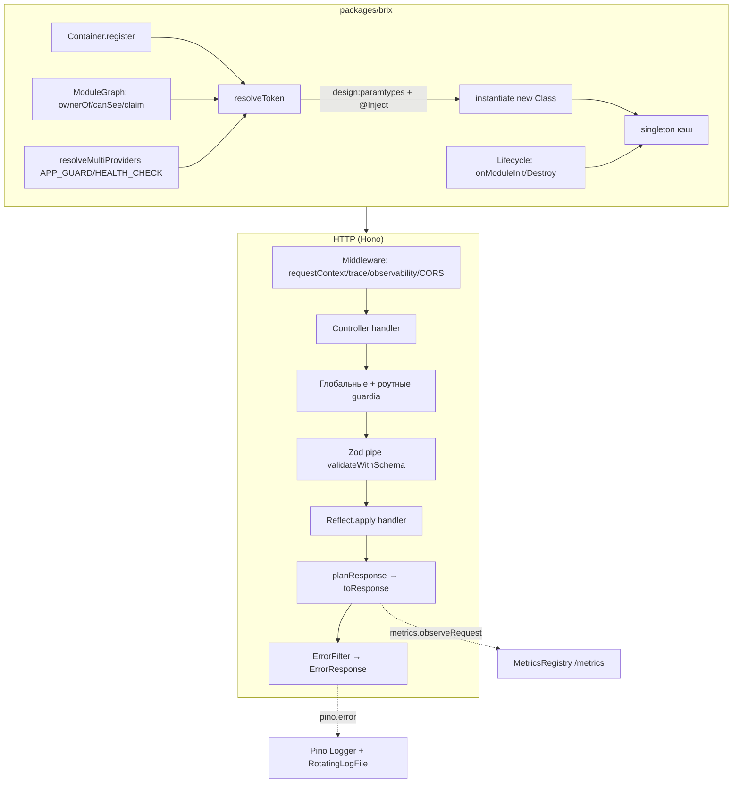

# 52. Пакет brix — DI-контейнер, HTTP-каркас, наблюдаемость

## Назначение

`packages/brix` — рукописный DI-контейнер в стиле NestJS (stripped-down) и HTTP-каркас на базе Hono. Все DI-разрешения строятся на `reflect-metadata` + `design:paramtypes`. Точка входа: `Brix.create(AppModule.forRoot())` (`packages/brix/src/brix.ts:267`), используется в `apps/server/src/main.ts`.

## 1. Brix.create / BrixApp

`Brix.create<TConfig>(module: DynamicModule, options: BrixOptions = {}): BrixApp<TConfig>` (`brix.ts:267`):

1. `new Container()`.
2. Регистрация `ConfigModule.forRoot(options.config)`, `LoggingModule.forRoot()`.
3. `container.register({ provide: APP_FILTER, useClass: DefaultErrorFilter })`.
4. `container.register(MetricsRegistry)`.
5. `buildHonoWithProviders({ modules: [module], container })` — сбор модульного графа, регистрация провайдеров/контроллеров, построение Hono-приложения.
6. `collectHealthChecks(container, built.providers)` — сбор multi-провайдеров `HEALTH_CHECK`.
7. `resolveErrorMapper(container)` — разрешение `APP_FILTER` (строка-токен) в `ErrorMapper`; при отсутствии — `mapToErrorResponse`.
8. Разрешение `CONFIG`, `ServerBindingSchema.parse(config.server)`, `Logger`, `MetricsRegistry` из корневого модуля.
9. Hono с middleware: `requestContextMiddleware()` (AsyncLocalStorage `BrixEnv { traceId }`), `traceMiddleware()` (`x-request-id` или `crypto.randomUUID()`), `observabilityMiddleware(logger, metrics)`, CORS.
10. `buildOpenApiDocument({ info, controllers, apiBasePath, extraPaths: SYSTEM_OPENAPI_PATHS })`.
11. Возврат `BrixApp` с полями: `hono`, `container`, `config`, `binding`, `api`, `logger`, `mapError`, `healthChecks`, `metrics`, `moduleNames`, `openApiDocument`.

`BrixApp.serve(options)`: `Bun.serve({ port, hostname, fetch: hono.fetch, idleTimeout, websocket? })`, регистрация сигналов `SIGTERM`/`SIGINT` → `close()` → `process.exit(0)` (`brix.ts:184`).
`BrixApp.init()` / `runInit()`: `container.resolveAll()` (инстанцирует все単тоны), `logBootstrap`, `runModuleInit(instances)`.
`BrixApp.close()`: `shuttingDown = true`, остановка сервера с `shutdownTimeoutMs` (default 10_000), `runModuleDestroy` в обратном порядке, ошибки собираются в `AggregateError` (`brix.ts:243`).

## 2. Цикл resolve/instantiate (DI)

`packages/brix/src/di/container.ts`:

`Provider` = `UnknownClass | ClassProvider | FactoryProvider | ValueProvider`.

Регистрация (`register`): класс → токен = сам класс. Объект `{provide, useClass/useFactory/useValue}` → токен = `provider.provide`.

`registerModules(graph)`: обходит узлы модульного графа в обратном порядке, регистрирует провайдеры и контроллеры, гарантирует регистрацию ссылки на сам модуль.

Разрешение (`resolveToken`):
1. Видимость: `graph.canSee(requester, token)` — иначе ошибка с именем владельца модуля (`ownerOf`).
2. Токен в `singletons` → вернуть кэш.
3. Нет `definition` → ошибка "no provider registered".
4. Токен в `path` → "Circular dependency detected".
5. `create(definition, path, requester)` → `instantiate` / `useValue` / `useFactory` / `useClass`.
6. Сохранить в `singletons`, вернуть.

`create`:
- функция → `instantiate(target, path, requester)` = `new target(...args)`.
- `useValue` → вернуть значение.
- `useFactory` → разрешить `inject` зависимости, вызвать фабрику.
- `useClass` → `instantiate(useClass, ...)`.

Разрешение аргументов конструктора (`resolveConstructorArgs`):
- `paramtypes = Reflect.getMetadata('design:paramtypes', target)`.
- `overrides = Reflect.getMetadata(injectTokensKey, target)` (`@Inject(token)`).
- `count = max(len(paramtypes), len(overrides))`.
- Для каждого индекса `i`: `token = overrides?.[i] ?? paramtypes?.[i]`.
- Если `token === Object` → ошибка "metadata erased the token to Object (type-only import)".
- Если `token === undefined` → ошибка "Cannot resolve dependency".
- Каждый аргумент: `scopeToConsumer(resolveToken(token, path), classNameOf(target))` — если экземпляр реализует `forConsumer`, вызывается с именем потребителя.

`resolveMultiProviders(container, providers, token)`: проходит все провайдеры с `provide == token`, регистрирует useClass/useFactory/useValue отдельно, возвращает массив инстансов. Используется для `APP_GUARD` и `HEALTH_CHECK`.

## 3. ModuleGraph: visibility / ownerOf / claim

`packages/brix/src/di/module-graph.ts`:

- `ModuleNode = { ref, imports, controllers, providers, exports, global }`.
- `buildModuleGraph(roots, { multi })` — рекурсивный обход импортов (`visit`), построение узлов.
- `claim(token, node)`: токен принадлежит ровно одному модулю (`owners`); dual-ownership → ошибка. `multi`-токены (`APP_GUARD`, `HEALTH_CHECK`) освобождаются от проверки единственности владельца.
- `resolveVisibility`: итеративно растёт `visible[node]` из `exported[source]` (импорты + глобальные модули) до стабильности. `exported[node]` = токены из `exports`, которыми владеет узел или видит через импорты.
- `assertExports`: экспортированный токен должен предоставляться модулем, иначе ошибка.
- `canSee(from, token)`: виден если нет владельца, владелец == `from`, или токен в `visible[from]`.
- `providerToken(provider)`: для класса — сам класс, для объекта — `provider.provide`.
- `describeToken(token)`: строковое представление для сообщений об ошибках.

## 4. Мульти-провайдеры

`APP_GUARD` и `HEALTH_CHECK` — multi-токены в графе. `resolveMultiProviders` собирает все инстансы по токену. Глобальные guardia резолвятся через `resolveGlobalGuards(container, providers)` только если есть хотя бы одинprotected route.

## 5. Жизненный цикл

`packages/brix/src/di/lifecycle.ts` + `packages/brix/src/brix.ts`:

- `ModuleInitHook.onModuleInit()`, `ModuleDestroyHook.onModuleDestroy()` (утиная типизация, `hasModuleInit` / `hasModuleDestroy`).
- `runModuleInit(instances)` — последовательный `await onModuleInit()` в порядке регистрации.
- `runModuleDestroy(instances)` — обратный порядок, ошибки собираются в `AggregateError`.
- `BrixApp.init()` вызывает `resolveAll()` затем `runModuleInit`; `logBootstrap` логирует `InstanceLoader` (модули) и `RouterExplorer` (роуты).

## 6. Hono-адаптер: роуты + Zod pipe + error filter

`packages/brix/src/http/hono-adapter.ts`, `packages/brix/src/validation/zod-pipe.ts`, `packages/brix/src/http/routes.ts`, `packages/brix/src/errors/error-filter.ts`:

- `buildHonoWithProviders({modules, container})`: ModuleGraph, регистрация модулей, сбор контроллеров/провайдеров, глобальные guardia, `registerController` для каждого контроллера.
- `registerController`: экземпляр контроллера через `container.resolveFrom(moduleRef, controller)`; для каждого маршрута (`getRouteTable` читает декораторы `http:route`, `http:http-code`, `params`) вешается `app.on(method, path)`.
- В хендлере: guardia (глобальные + роутные; `IS_PUBLIC_KEY` пропускает), `resolveArguments` (body → `validateWithSchema(schema, body, 'body')`, query → `collapseQueryParams + validateWithSchema`, param → `c.req.param`, custom factory, остальное → контекст `c`), `Reflect.apply`, `planResponse` (201 для POST по умолчанию, 204/304 → пусто), `toResponse`.
- `ZodValidationPipe` (`validateWithSchema`): `schema.safeParse`; неудача → `BadRequestException` с `issues`. Ошибка JSON-тела → `400 Invalid JSON body`.
- Error filter: `ErrorResponse = {statusCode, errorCode, message, path, timestamp, traceId?, details?}`. `DefaultErrorFilter` инжектит `Logger`, логирует unmapped (`pino.error`). Mapping: `HttpException` → свой status/errorCode; `DomainException` → `domainStatusByCode[errorCode]` (ENTITY_NOT_FOUND→404, CONFLICT→409, FORBIDDEN→403, UNAUTHORIZED→401, VALIDATION_ERROR→400, UNSUPPORTED_CAPABILITY→400, VOICE_CATALOG_UNSUPPORTED→404, BUSINESS_RULE_VIOLATION→422, BOARD_VALIDATION→400, RULE_VALIDATION→400, STATUS_NOT_EMPTY→409, SOURCE_HOST_MISMATCH→422, SOURCE_MATERIALIZATION_ABSENT→404, SOURCE_MATERIALIZATION_FAILED→500, PRESET_NOT_FOUND→404, PRESET_VALIDATION→400, PRESET_CONFLICT→409, PRESET_IMMUTABLE→403, INTEGRATION_NOT_FOUND→404, INTEGRATION_NOT_CONNECTED→409, INTEGRATION_SCOPE_MISSING→409, INTEGRATION_NOT_CONFIGURED→500, INTEGRATION_GITHUB_APP_NOT_CONFIGURED→500, INTEGRATION_WEBHOOK_SIGNATURE_INVALID→401, INTEGRATION_TOKEN_REFRESH_FAILED→502, INTEGRATION_PROVIDER_ERROR→502); `ZodError` → 400 VALIDATION_ERROR с `details.issues`; неизвестное → 500 INTERNAL_ERROR + `pino.error`. `APP_FILTER` — строка-токен для переопределения маппера.

## 7. Pino Logger + rotating log

`packages/brix/src/logging/logger.ts`, `packages/brix/src/logging/rotating-log-file.ts`, `packages/brix/src/config/logging-binding.ts`:

- `Logger` (abstract): `child(context)`, `forConsumer(name)`, `info/debug/warn/error(obj, msg)`.
- `PinoLogger` (`@Injectable`, `@Inject(CONFIG)`): корневой `pino` с комбинированными sinks (`combineSinks`): консоль (TTY → цветной pretty) + опциональный файл (`RotatingLogFile`). `onModuleDestroy` закрывает корневой логгер.
- `RotatingLogFile`: пишет чанки; при `sizeBytes + bytes > maxSizeBytes` → `rotate()`: сдвигает архивы `.N → .N+1`, текущий → `.1`, при `maxFiles <= 1` удаляет. `LogFileStore` абстрагирует fs (sync-функции), injectable для тестов.
- `observabilityMiddleware(logger, metrics)`: замер `Date.now()` до/после `next()`, `metrics.observeRequest`, `logRequest` (info/warn/error по ≥500/≥400) с `traceId`.
- `traceMiddleware`: `x-request-id` из заголовка или `crypto.randomUUID()`, в `c.set('traceId', ...)`, возвращается в заголовок.
- `requestContextMiddleware`: `AsyncLocalStorage` с `BrixVariables { traceId }`.
- `logBootstrap`: дочерние логгеры `InstanceLoader` (каждый модуль) и `RouterExplorer` (каждый роут).

## 8. Метрики и health endpoints

`packages/brix/src/metrics/metrics.ts`, `packages/brix/src/health/health.ts`:

- `MetricsRegistry` (`@Injectable`): карта серий по ключу `method\0route`; гистограмма `http_request_duration_seconds` (бакеты 5ms…10s + `+Inf`, `_sum`, `_count`); счётчик `http_request_errors_total` по 5xx. Рендер Prometheus text exposition (0.0.4), роут `GET /metrics`.
- `HealthCheck` (abstract): `name`, `check() → HealthCheckResult`. `HEALTH_CHECK` — multi-провайдер. `collectHealthChecks` собирает все.
- `GET /health/live` → всегда `{"status":"up"}`. `GET /health/ready` → если `shuttingDown()` → 503; иначе `runHealthChecks` (Promise.all), 200 если все `up`, иначе 503.

## 9. OpenAPI

`packages/brix/src/openapi/openapi.ts`:

- `buildOpenApiDocument({info, controllers, apiBasePath?, extraPaths?})`: обходит `getRouteTable(controller)`, строит `OpenApiOperation` (operationId = `method_path`, тег = первый сегмент пути, параметры path/query из Zod через `z.toJSONSchema`, requestBody из body-параметра, ответ 200/201/204). Path-параметры `:id` → `/{id}`. `SYSTEM_OPENAPI_PATHS`: `/health/live`, `/health/ready`, `/metrics`, `/openapi.json` (тег `system`). Роут `GET /openapi.json`. OpenAPI 3.1.0.

## 10. Guards

`packages/brix/src/guards/can-activate.ts`, `packages/brix/src/guards/decorators.ts`:

- `CanActivate` — интерфейс с методом активации. `APP_GUARD = 'APP_GUARD'` — строка-токен для глобальных guardia.
- `IS_PUBLIC_KEY` — маркер публичного маршрута (пропускает guardia).
- `getGuardClasses(controller, handlerName)`, `isPublic(controller, handlerName)` — чтение метаданных guardia через `Reflector`.

## Важное правило: токены и импорты

Токен — любой класс, участвующий в инъекции (порт `abstract class`, адаптер `extends Port`, `@Injectable()` use-case, контроллер, Guard). **Токен никогда не импортируется через `import type`**, иначе при загрузке сервера: `Cannot resolve dependency at index N of X: metadata erased the token to Object (type-only import)`. Если файл экспортирует и класс-токен, и типы, импорты делятся на значение + `import type`.

## Проверка работоспособности

Зелёные типы / линтер / тесты не доказывают корректность DI. Единственное подтверждение — успешная загрузка сервера. После добавления или редактирования контроллера, use-case, порта, адаптера или модуля необходимо загрузить сервер и дождаться успешного перезапуска live-стенда.

## Связанные разделы

- [06-di-контейнер-brix.md](./06-di-контейнер-brix.md) — DI-контейнер подробно.
- [05-архитектура-сервера.md](./05-архитектура-сервера.md)
- [07-слой-api-rest.md](./07-слой-api-rest.md)

## Диаграмма: DI → HTTP

