# 53. Пакет contracts — общие Zod-схемы и z.infer типы

## Назначение

`packages/contracts` — единственный источник типов для сервера и WebUI. Все схемы построены на Zod, типы через `z.infer<typeof Schema>`. `packages/contracts/src/index.ts` ре-экспортит `domains-agents.ts`, `domains-org.ts`, `domains-work.ts` плюс выборочные типы из `thread.ts`. Типы сквозные: `OrgIdSchema = z.string().uuid()` (`org-machine.ts`) используется повсеместно. Сервер и WebUI импортируют `@harnesys/contracts`. Сервер использует схемы для валидации (`@Body(schema)`/`@Query(schema)` через `ZodValidationPipe` в `packages/brix`). WebUI использует `z.infer` типизацию ответов API. Фронтенд тонкий, сформирован API, без слоёв адаптеров.

Все 52 файла в `packages/contracts/src/`:

| Файл | Основные схемы / типы |
|------|----------------------|
| `agent.ts` | `AgentLevel` (top\|delegate), `AgentStatus` (active\|archived), `AgentSourceLevel` (read\|edit), `AgentPublic` (id, orgId, name, role, instructions, modelId, budgetUsdDaily, level, parentId, executionProfileId, status, sharedSourceIds, sourceLevels, secretNames, skills, mcpServers, enabledPlugins, defaultModeId, config, hooks, createdAt, updatedAt), `CreateAgentBody`, `UpdateAgentBody`, `AgentPresetBudget` (maxSteps/maxTokens/deadlineMs, policy ask\|error), `ListAgentsResponse`, `CreateAgentFromPresetBody` |
| `agent-hooks.ts` | `HOOK_EVENT_NAMES` (22 события: SessionStart…NodeEnd), `HookEventNameSchema`, `AgentHookEvent`, `HookCommandShell` (bash\|powershell), `HookHandlerSchema` (discriminated union type: command/http/mcp_tool/prompt/agent), `HookHandlerSpec`, `HookHandlerType`, `AgentHookSchema`, `AgentHook`, `AgentHooks` (max 50), `HookEffectSchema` (block/context/update_input/update_output/ask/stop/remind), `AgentHookEffect`, `HookRunStatus` (ok\|blocked\|failed\|timeout\|skipped\|denied), `HookRun`, `HookRunListResponse`, `HookRunListQuery`, `HookTestRequest`, `HookTestResponse`, `HookDiagnostic` |
| `approvals.ts` | `ApprovalOption` (approve\|approve_once\|deny\|block_path\|close), `APPROVAL_PARK_SOURCES` (permission\|approve\|budget\|interrupt), `ApprovalKind` (tool\|spend\|memory\|question\|file_access), `ApprovalBudgetKind` (steps\|tokens\|deadline), `ApprovalBudget` (kind/limit/used/defaultExtend), `ApprovalStatus` (pending\|approved\|denied\|cancelled\|superseded), `ApprovalSurface` (web\|telegram\|push\|system), `ApprovalDecisionScope` (once\|run\|always), `FileApprovalContext`, `ApprovalContext` (passthrough), `ApprovalPublic` (id, runId, agentId, threadId, interruptId, kind, question, options, context, status, decidedBy, decidedAt, decisionSeq, createdAt), `ListApprovalsQuery/Response`, `CreateApprovalBody`, `CommandApprovalRule` (exact\|program\|prefix), `FileApprovalRule` (file-path, effect allow\|deny), `ApprovalRule` (discriminated union), `DecideApprovalBody` (decision/surface/note/rule/scope/extend), `ApprovalResumeAppliedState` (decided\|applied), `DecideApprovalResponse` (winner/status/resumed/resumeState) |
| `automations.ts` | `AutomationStatus` (active\|paused\|failed), `AutomationConnection`, `AutomationItem` (id, orgId, integrationId, kind, label, description, status, threadId, targetAgentId, connection, meta, availableAt, updatedAt), `ListAutomationsResponse`, `AutomationKind`, `ListAutomationKindsResponse` |
| `board-templates.ts` | `BOARD_TEMPLATES`: dev, simple, crm, blank (статусы и правила) |
| `boards.ts` | `StatusCategory` (backlog\|started\|finished\|cancelled), `BoardStatus` (key/label/category/order/color/isEntry), `BoardStatusInput`, `RuleTrigger` (status_entered\|issue_created), `RuleCondition` (has_label), `RuleAction` (assign_agent\|set_status\|notify_owner), `BoardRule` (id/trigger/conditions/actions/position/enabled), `BoardDefinition` (name/description/icon/color/statuses/rules), `BoardTemplateKey` (dev\|simple\|crm\|blank), `ReorderBoardStatusesBody`, `ReorderBoardRulesBody` |
| `capabilities.ts` | `PackCatalogTool`, `PackCatalogEntry` (name/version/description/icon/hasSettings/tools/skills), `ListOrgCapabilitiesResponse`, `OrgTool`, `ListOrgToolsResponse`, `ExplainKind` (tool\|skill\|mcp\|hook\|subagent\|note\|path), `ExplainStatus` (granted\|deferred\|disabled\|dropped-by-mode\|denied-by-universe\|denied-by-permission\|overrode-host), `ExplainEntry`, `AgentCapabilityRegistryEntry`, `AgentRosterEntry` (id/name/parentId), `AgentCapabilitiesView` |
| `connector.ts` | `ConnectorProvider`, `ConnectorStatus` (awaiting_pair\|active\|paused\|error), `MirrorPolicyPublic` (text/ask/failures/files/appUserEcho), `ConnectorCapabilities`, `ConnectorBindingStatus` (active\|unpaired), `ConnectorBindingPublic` (id/chatId/topicId/chatType/title/status/threadId/threadTitle/threadKind/agentIds/autoReplyAgentId), `ConnectorPublic` (id/orgId/provider/status/botId/botUsername/lastError/pairExpiresAt/capabilities/capabilityWarning/bindings/policy/createdAt/updatedAt), `UpsertTelegramConnectorBody` (token), `PatchTelegramPolicyBody` (strict), `ListConnectorsQuery`, `AttachChatBody`, `ConnectChatBody` (existing/new discriminated union), `CreateTopicBody`, `RenameChatBody`, `RefreshChatIssue`, `RefreshChatsResponse`, `UpsertTelegramConnectorResponse` (connector/pairCode/pairUrl), `ListConnectorsResponse`, `IssuePairCodeResponse`, `TelegramConnectorActionResponse`, `UnpairTelegramConnectorResponse`, `ConnectChatResponse`, `AttachChatResponse`, `CreateTopicResponse`, `ThreadMemberListSchema` |
| `content.ts` | `MAX_EDITOR_BYTES` (2MB), `MAX_DOWNLOAD_BYTES` (100MB), `MAX_TREE_ENTRIES` (20000), `ContentEntryType` (file\|dir), `ContentEntry`, `ContentTreeResponse`, `ContentTreeResult` (interface), `ContentStat`, `ContentWorktreeIdSchema`, `ContentPathQuery`, `ContentWriteBody` (content/encoding utf-8\|base64), `ContentWriteResponse`, `ContentMkdirBody`, `ContentMoveItem`, `ContentMoveBody/CopyBody/ImportBody` (items max 500), `ContentMoveResponse/CopyResponse/ImportResponse`, `ContentDuplicateResponse`, `ContentDownloadResult` (name/bytesBase64), `ContentReadMeta` |
| `domains-agents.ts` | Ре-экспорт: agent, agent-hooks, approvals, capabilities, connector, content, file-access, memory, mode-presets, skills |
| `domains-org.ts` | Ре-экспорт: automations, execution-profile, fleet, fleet-secrets, lsp, mcp, org-execution-snapshot, org-machine, org-settings, toolchain, ui-visibility, vault, webhooks, worker-org-operation |
| `domains-work.ts` | Ре-экспорт: boards, issue-board-ux, issues, plugins, presets, schedules, source, source-location, thread |
| `entity-colors.ts` | `EntityColorName` (9 цветов), `EntityColorSchema`, `ENTITY_COLOR_NAMES`, `ENTITY_COLOR_HEX` |
| `eula.ts` | `EULA_CURRENT_AGREEMENT` (id/version/publishedAt), `EulaAgreement`, `EulaConsent`, `EulaStatus`, `EulaAcceptBody` |
| `execution-profile.ts` | `LOCAL_EXECUTION_PROFILE_ID = 'local'`, `ExecutionProfileIdSchema` (uuid\|'local'), `ExecutionProfileId`, `ProfileSelectedBy` (thread\|issue-rule\|agent\|organization), `ExecutionProfileIsolation` (host\|container), `EffectiveProfile` (profileId/selectedBy), `ExecutionProfile` (id/orgId/name/system/nodeIds/isolation/dockerImage), `ExecutionProfileListItem`, `ExecutionProfilesResponse`, `CreateExecutionProfileBody`, `UpdateExecutionProfileBody` (refine: container требует dockerImage), `SetExecutionProfileNodesBody` (nodeIds уникальны), `SetDefaultExecutionProfileBody`, `ExecutionProfileNodeItem` (nodeId/nodeName/status/role), `ExecutionProfileDetail`, `PlacementQueueCandidate` (nodeId/eligible/reasons/activeClaims), `PlacementQueueItem` (runId/threadId/profileId/createdAt/ageMs/priority 1-4/effectivePriority/triggerKind chat\|issue\|schedule\|webhook\|connector/triggerId/lastReason/attempt/expiresAt/candidates), `PlacementQueueResponse` |
| `file-access.ts` | `FileRuleAction` (read\|edit), `FileRuleEffect` (allow\|deny), `FileRulePublic` (id/orgId/agentId/hostId/pathPattern/action/effect/createdAt/updatedAt), `CreateFileRuleBody`, `ListFileRulesResponse` |
| `fleet-secrets.ts` | `ResolveFleetSecretsBody` (exactly one of runId/operationId + names), `ResolveFleetSecretsResponse` (values record), `ClaimWorkBody` (nodeId), `TaskEnvelopeAttachment`, `TaskEnvelopeIsolation` (container/image), `TaskEnvelopeAttribution` (startedByUserId/via/onNodeId), `TaskEnvelope` (threadId/runId/agentId/secretNames/varNames/leaseEpoch/expiresAt/inputText/relayLastSeq/configRevision/effort/mode/modeShellSpec/attachments/directory/sourceId/worktreeId/isolation/attribution), `ClaimWorkResponse` (envelope), `RunEventFrame` (kind RUN_EVENT/runId/leaseEpoch/fromSeq/events) |
| `fleet.ts` | `INVITE_CODE_ALPHABET`, `INVITE_CODE_LENGTH` (8), `INVITE_TTL_MIN_DEFAULT` (15), `INVITE_TTL_MIN_MAX` (1440), `PRESENCE_OFFLINE_AFTER_MS` (90000), `IssueInviteBody`, `IssuedInvite`, `ActiveInvite`, `EnrollBody` (code/nodeName/nodeId), `EnrollResponse` (nodeId/token/ticketKey/orgId/orgName/description), `RotateNodeTokenResponse`, `PairBody` (relayUrl/inviteCode/nodeName/orgId), `PairResponse` (ok/nodeId/orgId/orgName), `OrgNodeIdentity`, `NodeStatus` (online\|offline\|draining), `NodeConfigSync` (ready\|syncing\|stale\|incompatible\|unknown), `FleetNode` (id/name/role relay\|worker/status/lastSeenAt/enrolledAt/diskFreeBytes/diskTotalBytes/activeClaims/acceptsWork/configSync/acceptedRevision/targetRevision/syncReason), `FleetNodesResponse`, `ConnectInfo` (port/publicOrigin/lanAddresses/relayUrlHint), `HeartbeatBody`, `HeartbeatResponse` (ok/status), `RetargetBody` (orgId/relayUrl), `PromoteStartBody/Response` (promoteToken/orgId/expiresAt/newRelayUrl), `PromoteAcceptBody/Response` (ok/orgId/role relay), `PromoteIdentitySliceResponse` (users/memberships), `PromoteCompleteBody/Response` (ok/orgId/role worker/relayUrl), `ProxyRequest` (method/path/body/contentType) |
| `google-oauth-loopback-body.ts` | только `.spec.ts` файл (тест), основной модуль не существует как отдельный файл — схема в `source.ts` (`GoogleOAuthLoopbackStartResponseSchema`) |
| `identity-links.ts` | `IDENTITY_LINK_CODE_TTL_MS` (10 минут), `IdentityProvider`, `IdentityLink` (provider/providerUserId/displayName/handle/createdAt/updatedAt), `ListIdentityLinksResponse`, `IssueIdentityLinkCodeResponse` (code/expiresAt) |
| `integrations.ts` | `IntegrationProvider` (google\|github), `IntegrationStatus` (connected\|expired\|error), `Integration` (id/orgId/provider/status/accountLabel/externalAccountId/credRef/providerJson/grantedScopes/createdAt/updatedAt/lastRefreshAt), `IntegrationsListResponse`, `DisconnectIntegrationResponse` (detachedSources), `ConnectorCapability` (drive\|calendar\|gmail\|repos\|issues\|ci), `ConnectorContent` (drive-folders\|github-repos\|none), `ConnectorDescriptor` (id google\|github\|slack\|notion\|linear\|discord\|telegram / name/tagline/description/icon/auth kind/content/capabilities/status available\|planned), `CONNECTOR_CATALOG` (6 записей, telegram со статусом 'available', auth bot-token), `GithubContentsAccess` (write\|read\|none), `GithubAppStatusResponse`, `GithubInstallStartResponse`, `GithubManifestStartResponse`, `GithubManifestStartBody`, `GithubInstallStatusQuery`, `GithubInstallStatusResponse` (pending\|denied\|expired\|ready+integrationId), `GithubRepoItem`, `GithubReposResponse`, `GithubReposQuery`, `GoogleOAuthService` (drive\|gmail\|calendar\|youtube\|sheets\|docs\|search_console), `GoogleOAuthLoopbackStartBody` (services, refine: youtube только в одиночку) |
| `issue-board-ux.ts` | `IssueExecutionState` (reserved\|active\|handoff\|released), `IssueExecutionPublic` (id/issueId/runId/agentId/worktreeId/state/requestedStatus/ruleId/profileId/correlationId/createdAt/updatedAt), `IssuePlacementCandidate`, `IssuePlacementDiagnosis` (summary/profileId/profileSource/selectedNodeId/unavailableReason/waiting/candidates), `IssueLaunchPreview` (agentId/ruleId/profileId/profileSource), `CreateIssueWorktreeBody` (baseBranch/branch/createBranch), `GetIssueResponse` (issue/comments/subtasks/dependencies/dependents/attachments/rules/execution/worktree/placement/launchPreview) |
| `issues.ts` | `IssueBoardStatus` (active\|archived), `IssueType` (task\|bug\|research\|feature\|improvement\|review), `IssuePriority` (1-4), `IssueDependencyType` (blocks\|relates\|duplicate), `IssueCommentAuthorType` (human\|agent), `IssueAttachmentKind` (file\|source), `IssueBoardPublic` (id/name/description/color/icon/status/archivedAt/createdAt/updatedAt/statuses/rules), `IssueFireReason` (rule\|override), `IssueFireOutcome` (fired\|thread-busy\|failed), `IssueWorktreeRef`, `IssueFireTrailEntry` (agentId/statusKey/reason/outcome/error/at), `IssuePublic` (id/boardId/title/description/statusKey/priority/type/assigneeAgentId/labels/parentIssueId/dueDate/closedAt/fireTrail/sourceId/branch/worktreeOnStatus/worktree/createdAt/updatedAt), `IssueCommentPublic`, `IssueDependencyPublic`, `IssueAttachmentPublic`, `IssueLabelPublic`, `LabelColorSchema` (#rrggbb), `CreateIssueBoardBody` (template\|statuses refine), `UpdateIssueBoardBody`, `CreateIssueBody`, `UpdateIssueBody`, `UpdateIssueStatusBody`, `AddIssueCommentBody`, `AddIssueDependencyBody`, `AddIssueSourceAttachmentBody`, `CreateIssueLabelBody`, `UpdateIssueLabelBody`, `ListIssueBoardsResponse`, `GetIssueBoardResponse`, `ListIssuesQuery`, `IssueListItem`, `ListIssuesResponse`, `CreateIssueResponse`, `CreateIssueBoardResponse`, `ListIssueLabelsResponse`, `ListIssueCommentsResponse` |
| `lsp.ts` | `LspServerStatus` (live\|off\|error), `OrgLspEntry` (serverId/origin/command/args/extensionToLanguage/disabled/granted/binaryOk/status/lastError), `LspCatalogEntry` (serverId/label/description/command/args/extensionToLanguage/install/installed/binaryOk), `OrgLspListResponse` (servers/diagnostics/catalog/raw), `PutOrgLspBody` (unknown), `UpsertOrgLspServerBody` (command/args/extensionToLanguage) |
| `mcp.ts` | `McpTransportKind` (stdio\|http\|sse), `McpOrigin` (org\|plugin discriminated union), `McpToolSummary`, `McpLiveServer` (serverId/transport/connected/toolCount/tools/resources), `ListOrgMcpResponse`, `McpConfigServer` (serverId/enabled/transport/command/args/env/url/headers/connected/toolCount/origin/disabledByUser/requiredGrant), `ListOrgMcpConfigResponse`, `UpsertOrgMcpServerBody` (superRefine: stdio→command, http/sse→url), `UpsertOrgMcpServerResponse`, `SetOrgMcpServerStateBody` (enabled), `OrgMcpParams` (orgId) |
| `memory-policy.ts` | `MemoryPolicySchema` (strict: read/consolidate/reflect/enforce/promote booleans, minSteps 0-1000, maxNudges 0-10, reflectInterval 1-720ч, decayHalfLifeDays 1-3650, promoteThreshold 0-10, consolidateModelId, projectLimit 1-100, projectBudgetTokens 100-8000, pinBudgetTokens 100-8000, relevanceTopK 1-50, relevanceMinChars 0-1000, factClipChars 40-2000), `DEFAULT_MEMORY_POLICY` (enforce: false, minSteps: 3, maxNudges: 1, reflectInterval: 24, decayHalfLifeDays: 30, promoteThreshold: 8, projectLimit: 20, projectBudgetTokens: 800, pinBudgetTokens: 1500, relevanceTopK: 8, relevanceMinChars: 24, factClipChars: 200), `parseMemoryPolicy(value)` → `MemoryPolicy | undefined` |
| `memory.ts` | `PinSource` (agent\|human), `PinRecord` (key/text/updatedAt/source), `SemanticScope` (session\|long), `MemoryRecordSource` (agent\|human\|compaction), `MemoryRecord` (id/scope/text/key/createdAt/updatedAt/source/threadId), `UpsertPinBody` (text ≤20000), `ListSemanticQuery` (scope/limit 1-500), `UpsertSemanticBody` (scope/text ≤20000/key ≤200/threadId), `UpdateSemanticBody` (text ≤20000), `MemorySettingsBody` (embedModelId/decisionModelId) |
| `mode-presets.ts` | `MODE_OPS` (fs.write\|process\|network\|mcp\|agents), `ModeOpGate` (allow\|ask\|deny), `ModeOpPermissions`, `MODE_ID_RE`, `DEFAULT_MODE_ID = 'default'`, `PackAssignmentBody` (true\|false\|{spec?}\|null), `ModeToolExposure` (direct\|deferred), `ModeDisabledToolsSchema` (max 64), `ModeExposureMapSchema`, `ModePresetPublic` (orgId/id/name/description/instructions/skills/packs/disabledTools/exposure/permissions/builtin/installedByDefault/createdAt/updatedAt), `CreateModePresetBody` (id !== 'default' refine), `UpdateModePresetBody`, `ListModePresetsResponse` |
| `org-execution-snapshot.ts` | `ORG_EXECUTION_SNAPSHOT_SCHEMA_VERSION` (1), `AgentSnapshot`, `SourceSnapshot`, `ProviderSnapshot` (id/orgId/name/driver/apiUrl/apiKeyRef/headers/enabled/createdAt/updatedAt), `ModelSnapshot` (id/providerId/name/kind/metadata/createdAt/updatedAt), `RuntimeSnapshot` (skillsSourceAutoLoad/timezone/browser), `OrgExecutionSnapshot` (schemaVersion/revision/agents/sources/providers/models/fileAccessRules/runtime), `SnapshotAckStatus` (accepted\|incompatible), `SnapshotAckFrame` (kind SNAPSHOT_ACK/revision/status/reason), `ConnectedFrame` (kind CONNECTED/nodeId/snapshot), `SnapshotFrame` (kind SNAPSHOT/snapshot), `RunEventAckFrame` (kind RUN_EVENT_ACK/runId/accepted/lastSeq) |
| `org-machine.ts` | `OrgIdSchema` (uuid), `OrgId`, `MachineOrgRole` (relay\|worker), `MachineOrgEntry` (orgId/name/description/role/relayUrl), `CreateOrgBody` (name/workspacePath), `UpdateOrgBody` (name/description refine), `OrgMachineFile` (version 1/orgs/activeOrgId), `OrgsListResponse` |
| `org-settings.ts` | `isIanaTimeZone`, `ENGINE_ID_PATTERN`, `BrowserDefaultEngine` (auto\|pattern), `ToolchainMode` (auto\|custom), `ToolchainSettings` (mode/shell/node/extraPathDirs/commandOverrides), `LIVE_FLUSH_MS_MIN` (50), `LIVE_FLUSH_MS_MAX` (2000), `LIVE_FLUSH_MS_DEFAULT` (100), `JOURNAL_BATCH_MIN` (1), `JOURNAL_BATCH_MAX` (64), `JOURNAL_BATCH_DEFAULT` (16), `DeliverySettings` (liveFlushMs/journalBatch), `DELIVERY_DEFAULTS`, `OrgSettings` (skillsSourceAutoLoad/timezone IANA/browser.defaultEngine/toolchain/delivery), `OrgSettingsPatch` |
| `permission-grants.ts` | `PermissionGrantPublic` (id/orgId/agentId/operation/decidedBy/createdAt), `ListPermissionGrantsResponse`, `ListPermissionGrantsQuery` (agentId) |
| `permission-rules.ts` | `PermissionRuleKind` (fs-path\|shell-cmd\|op\|ssh-host), `PermissionRuleEffect` (allow\|deny), `PermissionRulePublic` (id/orgId/agentId/hostId/kind/pattern/action read\|edit/effect/decidedBy/createdAt), `ListPermissionRulesQuery`, `ListPermissionRulesResponse`, `CreatePermissionRuleBody` (kind fs-path\|shell-cmd) |
| `plugins.ts` | `GrantClass` (content\|process\|network), `PluginOptionValue` (string\|number\|boolean), `PluginGrantSelection`, `PluginComponentSummary` (kind/status native\|inert\|blocked_by_grant\|dropped/inertReason/source file+pointer), `PluginDiagnostic` (level error\|warning/code/message/path), `PluginSummary` (orgId/name/source/revision/path/dataPath/format/grants/options/registryId/catalogPluginName/installedAt/updatedAt/version/description/components/skillCount/hookCount/mcpServerCount/agentCount/commandCount/lspServerCount), `PluginListItem`, `PluginMutationResponse`, `InstallPluginBody` (superRefine: registryId requires pluginName; path or source required), `UpdatePluginBody` (ref), `SetPluginGrantsBody` (classes), `ApprovePluginServerBody` (serverId), `SetPluginOptionBody` (key/value), `RemovePluginBody` (deleteData), `PluginRecordResponse`, `SetPluginOptionResponse`, `PluginRegistryKind` (claude-marketplace), `PluginRegistrySummary`, `AddPluginRegistryBody`, `CatalogInstallSource` (relative\|github\|url\|git-subdir\|npm\|archive), `PluginCatalogEntry`, `ListPluginCatalogQuery` |
| `preset-id.ts` | `PRESET_ID_PATTERN` (`^[a-z0-9][a-z0-9-]{0,63}/[a-z0-9][a-z0-9-]{0,63}$`), `PresetIdSchema`, `PresetId` |
| `presets.ts` | `PRESET_ENVELOPE_MAX_BYTES` (512KB), `PresetKind` (agent\|team), `PresetOrigin` (system\|user\|registry), `Semver` (`^\d+\.\d+\.\d+$`), `AgentPresetBody` (name/role/instructions/color/skills/mcpServers/budget/capabilities/permissions/graph nodes/edges), `TeamPresetRole` (roleKey/name/agentRef/budgetUsdDaily/requiresModel/capabilitiesExtra), `PresetAssignAgentAction`, `PresetRuleAction` (assign_agent\|set_status\|notify_owner), `PresetBoardRule` (trigger/conditions/actions/position/enabled), `TeamPresetBoard` (name/description/icon/color/statuses min 2/rules), `TeamPresetDigest` (cronDefault/roleKey/detail), `TeamPresetBody` (roles min 1/board/digest), `AgentCatalogItem`, `TeamCatalogItem`, `CatalogItem` (discriminated union kind), `AgentPresetDetail`, `TeamPresetDetail`, `PresetDetail`, `SaveAgentPresetBody`, `SaveTeamPresetBody`, `SavePresetBody`, `ListPresetsQuery` (kind/origin/expand body), `ListPresetsResponse`, `ListPresetDetailsResponse`, `EnvelopeAgent`, `EnvelopeTeam`, `EnvelopePreset`, `PresetManifest` (id/version/kind/name/description/author/tags/harnesysRange), `PresetEnvelope` (formatVersion 1/manifest/presets min 1), `ImportPresetsBody`, `ImportPresetsResponse` |
| `schedules.ts` | `ScheduleStatus` (active\|paused\|failed), `ScheduleHistory` (none\|last\|all), `ScheduleMissPolicy` (catch-up\|skip\|escalate), `SchedulePublic` (id/orgId/name/status/targetAgentId/detail/cron/modeId/history/historyLast/missPolicy/threadId/nextRunAt/lastFiredAt/createdAt/updatedAt), `CreateScheduleBody`, `UpdateScheduleBody`, `ListSchedulesResponse`, `CreateScheduleResponse` (schedule/thread) |
| `skills.ts` | `SkillSidecar` (url/ref/subPath/revision/installedAt), `SkillOrigin` (org\|system\|host\|source sourceId+sourceName+relativePath+outsideContainer\|plugin pluginName/status/inertReason), `OrgSkill` (name/description/whenToUse/origin/path/installedFrom/canDelete/canUpdate/loadable/updateAvailable), `EffectiveSkill` (OrgSkill + granted), `ListEffectiveSkillsResponse`, `DiscoverSkillsBody` (url min 3/ref 1-128), `SkillCandidate` (name/description/subPath/outsideContainer/invalidReason), `DiscoverSkillsResponse` (revision/candidates/diagnostics), `InstallSkillsBody` (url/ref 1-128/revision/selections 1-50), `InstallSkillsResponse` (installed/conflicts), `SkillSearchHit` (id/source/skillId/name/installs/installUrl/isDuplicate), `SkillSearchResponse` (results/degraded/hint), `ListOrgSkillsResponse`, `CreateOrgSkillBody` (name kebab-case/description/whenToUse/instructions), `CreateOrgSkillResponse`, `OrgSkillsParams`, `EffectiveSkillsQuery` (agentId) |
| `source-location.ts` | `SourceLocationQuery` (hostId), `SourceLocationResponse` (absoluteRoot/state/revision) |
| `source.ts` | `SourceDistribution` (host-bound hostId\|cloud-drive google remoteFolderId/integrationId), `SourceVcs` (git remoteUrl/credRef/defaultBranch/integrationId), `SourceAvailability` (hostIds), `SetSourceAvailabilityBody`, `SetGitRemoteBody` (url/credRef/hostId), `Source` (id/orgId/name/description/distribution/uiVisibility/managed/vcs/availability/createdAt/updatedAt), `SourcesListResponse`, `MaterializationState` (absent\|materializing\|ready\|failed), `MaterializationOrigin` (managed\|attached), `MaterializationStateFrame` (sourceId/hostId/revision/state/lastErrorCode/lastConflictPaths/refreshRequired/sourceChanged), `MaterializationProjection`, `SourceHostNodeStatus` (online\|offline\|draining), `SourceHostStatus` (hostId/nodeStatus/materialization/lastConfirmedAt/errorCode/stale/defaultWorktreeId/lastConflictPaths/refreshRequired/availabilityReason origin\|allowed\|excluded\|needs-remote), `SourceHostStatusResponse`, `AttachLocalFolderBody`, `AttachGitBody` (superRefine: xor url/integrationId+repo; credRef incompatible with integrationId; repo required with integrationId), `InitGitBody`, `SwitchGitBranchBody`, `DeleteGitBranchBody`, `GitHostQuery`, `GitHostWorktreeQuery`, `PrepareGitSourceBody`, `RefreshGitSourceBody`, `PrepareGitSourceResponse` (sourceId/hostId/operationId/state/worktreeId), `RefreshCloudDriveBody`, `AttachCloudDriveBody` (backend google/remoteFolderId root/integrationId), `GoogleOAuthLoopbackStartResponse` (flow loopback/sessionId/authUrl/expiresIn), `GoogleAppConfigBody` (clientId/clientSecret/apiKey/appId), `GoogleAppConfigStatusResponse`, `GoogleOAuthStatusResponse` (pending\|denied\|expired\|ready+integrationId), `GoogleOAuthStatusQuery`, `GooglePickerSessionQuery`, `GooglePickerSessionResponse` (accessToken/apiKey/appId), `SetSourceVisibilityBody`, `RenameSourceBody`, `RepositoryWorktreeState` (creating\|ready\|failed\|removing), `RepositoryWorktree` (id/orgId/sourceId/hostId/branch/baseCommit/state/activeRunId/operationId/issueId/lastErrorCode/dirty/unpushed/createdAt/updatedAt), `CreateRepositoryWorktreeBody`, `ListRepositoryWorktreesResponse`, `DeleteRepositoryWorktreeResponse` (worktreeId/operationId/result removed\|failed/errorCode WORKTREE_NOT_CLEAN\|BRANCH_IN_USE\|SOURCE_NOT_READY) |
| `teams.ts` | `CreateTeamBody` (presetId/name/models record/digestCron), `CreateTeamResponse` (agents/boardId/scheduleId) |
| `thread.ts` | `DEFAULT_CONTEXT_WINDOW` (6), `ThreadKind` (chat\|group\|schedule\|webhook\|issue), `ThreadPolicy` (version 1/contextWindow 1-40/mentionGating), `ThreadMember` (id/name), `ThreadParticipantRole` (member\|blocked), `ThreadParticipant` (id/provider/providerUserId/displayName/username/role/lastSeenAt), `RunLifecycleStatus` (queued\|running\|needs_input\|waiting\|completed\|failed\|cancelled\|dead_lettered), `RunVia` (direct\|agent), `ThreadActiveRun` (runId/status/leaseExpired/waitingForProfileId/startedByUserId/startedByName/via/onNodeId/onNodeName), `ThreadLastError` (runId/message/at), `ThreadSummary` (id/orgId/title/agentId/members/autoReplyAgentId/policy/participants/kind/issueId/parentThreadId/forkAt/createdAt/updatedAt/lastReadAt/unread/pinned/runMode/runProfileId/runDirectory/bindingLocked/activeRun/lastError), `ThreadPublic` (ThreadSummary + events/inheritedEventCount), `CreateThreadBody` (agentId/agentIds max 8/participantUserIds max 20/title/kind/parentThreadId/forkAt), `AddThreadAgentBody` (agentId), `AddThreadParticipantBody` (userId), `UpdateThreadPolicyBody` (autoReplyAgentId/contextWindow/mentionGating), `SetThreadParticipantRoleBody` (role), `UpdateThreadBindingBody` (runProfileId/runDirectory refine: at least one, runDirectory absolute path), `ListThreadsResponse`, `SendThreadRunBody` (text/effort/mode/skills max 10/attachmentIds/clientEventId/origin/correlationId/sourceId+worktreeId together/agentId; refine: skills require text or attachments), `AttachmentKind` (image\|audio\|video\|file), `ThreadAttachment`, `ListThreadAttachmentsResponse`, `MAX_THREAD_TREE_ENTRIES` (500), `ThreadFileEntryType` (file\|dir), `ThreadFileEntry`, `ThreadFilesTreeResponse` (subPath/entries/truncated), `ThreadFilesQuery` (subPath default sandbox), `ThreadFilePathQuery`, `RunAcceptedStatus` (queued\|waiting\|failed), `RunAcceptedResponse` (status/runId/threadId/waitingForProfileId), `StoredMessageReason` (duplicate\|deferred\|no_responder), `StoredMessageResponse` (status stored/reason/threadId/threadSeq), `AcceptedRunResponse` (discriminated union status), `CancelRunResponse` (ok true), `RetryRunResponse` (runId), `RespondRunBody` (askId/payload/clientEventId), `RejectRunBody` (askId/note/clientEventId), `RespondRunResponse` (ok true), `StreamRunEventsQuery` (fromSeq) |
| `toolchain.ts` | `ToolchainShellKind` (zsh\|bash\|fish\|sh), `ToolchainShell` (path/kind), `ToolchainNodeManager` (nvm\|fnm\|volta\|mise\|asdf), `ToolchainNodeVersion` (id/version/manager/binDir), `ToolchainCommandSource` (override\|path\|missing), `ToolchainCommandStatus` (command/serverId/resolvedPath/source), `ToolchainDiscovery` (shells/nodeVersions/effectiveDirs/commands/mode) |
| `ui-visibility.ts` | `UiVisibility` (org\|host) |
| `vault.ts` | `VaultEntryKind` (secret\|variable), `VaultEntryName` (буква + 0-63 alnum/_/-), `VaultEntry` (name/kind/value/updatedAt), `VaultListResponse`, `PutVaultEntryBody` (kind/value min 1) |
| `webhooks.ts` | `WebhookStatus` (active\|paused\|failed), `WebhookPublic` (id/orgId/name/status/targetAgentId/detail/endpoint/threadId/lastFiredAt/createdAt/updatedAt), `CreateWebhookBody`, `UpdateWebhookBody`, `ListWebhooksResponse`, `CreateWebhookResponse` (webhook/thread), `FireWebhookBody` (text), `FireWebhookResponse` (runId/status fired\|queued-behind-active-run\|paused) |
| `worker-org-operation.ts` | `WorkerOrgOperation` (discriminated union kind: issue.listBoards/listSources/list/get/create/update/status/nudge/comment/addDependency/removeDependency/addSourceAttachment/listLabels/createLabel/createBoard/updateBoard/deleteBoard/deleteLabel/saveBoardRule/deleteBoardRule / schedule.list/create/update/remove / webhook.list/create/update/remove), `WorkerOrgOperationBody` (runId/operationId/operation), `WorkerOrgOperationResponse` (operationId/result), `FetchRunAttachmentBody` (runId/threadId/attachmentId), `RemoteRunAttachmentMeta` (id/name/mediaType/sizeBytes/kind) |

## Связанные разделы

- [55-пакеты-harnesys-packs.md](./55-пакеты-harnesys-packs.md) — пакеты (capabilities).
- [07-слой-api-rest.md](./07-слой-api-rest.md) — валидация схем на сервере.
- [41-frontend-архитектура-webui.md](./41-frontend-архитектура-webui.md) — z.infer типы на фронтенде.

## Диаграмма: доменная модель контрактов (все Zod-домены)

```mermaid
classDiagram
    class Thread {
        <<Zod>> ThreadKindSchema
        <<Zod>> ThreadPolicySchema
        <<Zod>> ThreadSummarySchema
        <<Zod>> ThreadPublicSchema
        <<Zod>> CreateThreadBodySchema
        <<Zod>> SendThreadRunBodySchema
        <<Zod>> RunLifecycleStatusSchema
        <<Zod>> RunViaSchema
        <<Zod>> ThreadActiveRunSchema
        <<Zod>> RespondRunBodySchema
        <<Zod>> RejectRunBodySchema
        <<Zod>> AcceptedRunResponseSchema
    }
    class Agent {
        <<Zod>> AgentPublicSchema
        <<Zod>> CreateAgentBodySchema
        <<Zod>> UpdateAgentBodySchema
        <<Zod>> AgentLevelSchema
        <<Zod>> AgentStatusSchema
        <<Zod>> AgentPresetBudgetSchema
    }
    class AgentHooks {
        <<Zod>> HookEventNameSchema
        <<Zod>> HookHandlerSchema
        <<Zod>> HookEffectSchema
        <<Zod>> HookRunStatusSchema
    }
    class Approvals {
        <<Zod>> ApprovalOptionSchema
        <<Zod>> ApprovalKindSchema
        <<Zod>> ApprovalStatusSchema
        <<Zod>> ApprovalContextSchema
        <<Zod>> ApprovalPublicSchema
        <<Zod>> DecideApprovalBodySchema
    }
    class Boards {
        <<Zod>> StatusCategorySchema
        <<Zod>> BoardStatusSchema
        <<Zod>> BoardRuleSchema
        <<Zod>> BoardDefinitionSchema
        <<Zod>> BoardTemplateKeySchema
    }
    class Issues {
        <<Zod>> IssueTypeSchema
        <<Zod>> IssuePrioritySchema
        <<Zod>> IssuePublicSchema
        <<Zod>> IssueBoardPublicSchema
        <<Zod>> IssueFireReasonSchema
        <<Zod>> IssueFireOutcomeSchema
        <<Zod>> CreateIssueBodySchema
        <<Zod>> UpdateIssueStatusBodySchema
    }
    class ExecutionProfile {
        <<Zod>> ExecutionProfileIdSchema
        <<Zod>> ExecutionProfileSchema
        <<Zod>> ProfileSelectedBySchema
        <<Zod>> PlacementQueueItemSchema
    }
    class Fleet {
        <<Zod>> NodeStatusSchema
        <<Zod>> FleetNodeSchema
        <<Zod>> HeartbeatBodySchema
        <<Zod>> PairBodySchema
    }
    class MCP {
        <<Zod>> McpTransportKindSchema
        <<Zod>> McpOriginSchema
        <<Zod>> McpConfigServerSchema
        <<Zod>> UpsertOrgMcpServerBodySchema
    }
    class Memory {
        <<Zod>> MemoryPolicySchema
        <<Zod>> DEFAULT_MEMORY_POLICY
        <<Zod>> MemoryRecordSchema
        <<Zod>> PinSourceSchema
        <<Zod>> SemanticScopeSchema
        <<Zod>> UpsertSemanticBodySchema
    }
    class ModePresets {
        <<Zod>> MODE_OPS
        <<Zod>> ModeOpGateSchema
        <<Zod>> ModePresetPublicSchema
        <<Zod>> PackAssignmentSchema
        <<Zod>> DEFAULT_MODE_ID
    }
    class OrgSettings {
        <<Zod>> OrgSettingsSchema
        <<Zod>> DeliverySettingsSchema
        <<Zod>> LIVE_FLUSH_MS_DEFAULT
        <<Zod>> JOURNAL_BATCH_DEFAULT
    }
    class Source {
        <<Zod>> SourceSchema
        <<Zod>> SourceDistributionSchema
        <<Zod>> SourceVcsSchema
        <<Zod>> MaterializationStateSchema
        <<Zod>> RepositoryWorktreeSchema
        <<Zod>> AttachGitBodySchema
    }
    class Skills {
        <<Zod>> SkillOriginSchema
        <<Zod>> OrgSkillSchema
        <<Zod>> InstallSkillsBodySchema
        <<Zod>> DiscoverSkillsBodySchema
    }
    class Teams {
        <<Zod>> CreateTeamBodySchema
        <<Zod>> CreateTeamResponseSchema
    }
    class Presets {
        <<Zod>> PresetKindSchema
        <<Zod>> AgentPresetBodySchema
        <<Zod>> TeamPresetBodySchema
        <<Zod>> PresetEnvelopeSchema
        <<Zod>> PRESET_ENVELOPE_MAX_BYTES
    }
    class Schedules {
        <<Zod>> ScheduleStatusSchema
        <<Zod>> SchedulePublicSchema
        <<Zod>> CreateScheduleBodySchema
    }
    class Vault {
        <<Zod>> VaultEntryKindSchema
        <<Zod>> VaultEntryNameSchema
        <<Zod>> VaultEntrySchema
        <<Zod>> PutVaultEntryBodySchema
    }
    class Webhooks {
        <<Zod>> WebhookStatusSchema
        <<Zod>> WebhookPublicSchema
        <<Zod>> FireWebhookResponseSchema
    }
    class Permissions {
        <<Zod>> PermissionRuleKindSchema
        <<Zod>> PermissionRuleEffectSchema
        <<Zod>> PermissionRulePublicSchema
    }
    class Connectors {
        <<Zod>> ConnectorStatusSchema
        <<Zod>> ConnectorPublicSchema
        <<Zod>> UpsertTelegramConnectorBodySchema
        <<Zod>> ConnectChatBodySchema
    }
    class Integrations {
        <<Zod>> IntegrationProviderSchema
        <<Zod>> IntegrationStatusSchema
        <<Zod>> IntegrationSchema
        <<Zod>> CONNECTOR_CATALOG
    }
    class OrgMachine {
        <<Zod>> OrgIdSchema
        <<Zod>> MachineOrgRoleSchema
        <<Zod>> CreateOrgBodySchema
    }
    class FileAccess {
        <<Zod>> FileRuleActionSchema
        <<Zod>> FileRuleEffectSchema
        <<Zod>> FileRulePublicSchema
    }
    class LSP {
        <<Zod>> LspServerStatusSchema
        <<Zod>> OrgLspEntrySchema
        <<Zod>> LspCatalogEntrySchema
    }
    class Automations {
        <<Zod>> AutomationStatusSchema
        <<Zod>> AutomationItemSchema
    }
    class Content {
        <<Zod>> ContentEntrySchema
        <<Zod>> ContentTreeResponseSchema
        <<Zod>> ContentWriteBodySchema
    }
    class Eula {
        <<Zod>> EulaAgreementSchema
        <<Zod>> EulaConsentSchema
        <<Zod>> EulaStatusSchema
    }
    class IdentityLinks {
        <<Zod>> IdentityLinkSchema
    }
    class Plugins {
        <<Zod>> PluginSummarySchema
        <<Zod>> InstallPluginBodySchema
        <<Zod>> PluginCatalogEntrySchema
    }
    class Toolchain {
        <<Zod>> ToolchainShellKindSchema
        <<Zod>> ToolchainDiscoverySchema
    }
    class UiVisibility {
        <<Zod>> UiVisibilitySchema
    }
    class WorkerOrgOperation {
        <<Zod>> WorkerOrgOperationSchema
        <<Zod>> WorkerOrgOperationBodySchema
    }

    contracts --> Thread
    contracts --> Agent
    contracts --> AgentHooks
    contracts --> Approvals
    contracts --> Boards
    contracts --> Issues
    contracts --> ExecutionProfile
    contracts --> Fleet
    contracts --> MCP
    contracts --> Memory
    contracts --> ModePresets
    contracts --> OrgSettings
    contracts --> Source
    contracts --> Skills
    contracts --> Teams
    contracts --> Presets
    contracts --> Schedules
    contracts --> Vault
    contracts --> Webhooks
    contracts --> Permissions
    contracts --> Connectors
    contracts --> Integrations
    contracts --> OrgMachine
    contracts --> FileAccess
    contracts --> LSP
    contracts --> Automations
    contracts --> Content
    contracts --> Eula
    contracts --> IdentityLinks
    contracts --> Plugins
    contracts --> Toolchain
    contracts --> UiVisibility
    contracts --> WorkerOrgOperation
```

