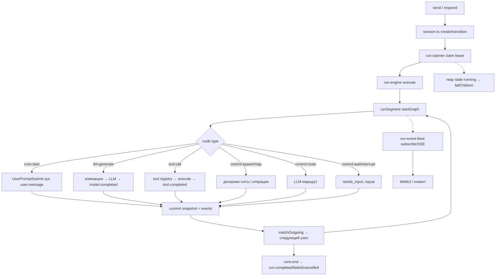

# 54. Пакет harnesys — ядро выполнения агентов

## Назначение

`packages/harnesys` — ядро исполнения агентов. Графовый рантайм (`startGraph`), бюджет выполнения, компакция контекста, хуки, навыки, паки (packs), инструменты, порты для сервера. Используется сервером `apps/server` через порты `create-runtime.ts`, `run-engine-types.ts`, `runtime-state.ts` и др. Публичные экспорты — `packages/harnesys/index.ts`.

## Публичные экспорты (index.ts)

Ключевые экспорты (`packages/harnesys/index.ts`):

- `startGraph`, `GraphOpts` — `src/application/graph.ts:468`
- `createRuntime`, `RuntimeHandle`, `AgentsResolve`, `AgentRosterEntry`, `CreateRuntimeOptions` — `src/ports/create-runtime.ts`
- `createRunEngine`, `RunEngine`, `RunEngineDeps`, `RunTargetOpts`, `DeliverySettings` — `src/application/run-engine.ts`, `run-engine-types.ts`
- `compile`, `Plan` — `src/application/compile.ts`
- `defineAgent`, `AgentDefinition`, `Node`, `Edge`, `AgentGraph`, `AgentBudget`, `AgentGenerationSettings`, `AgentModelRef`, `AgentPaths`, `InterruptReason` — `src/domain/agent-definition.ts`
- `Snapshot`, `Event`, `Cursor`, `CommitKind`, `CursorPhase`, `RUNTIME_VERSION` — `src/domain/snapshot.ts`
- `validateStructural`, `Diagnostic` — `src/application/validate.ts`
- `AskUserInterrupt`, `codedRunError`, `ValidationError`, `ThreadBusyError` — `src/domain/errors.ts`
- `EVENT_TYPES`, event meta типы — `src/domain/events.ts`
- `resolveCapabilitySet`, `CapabilitySet`, `CapabilityUniverse` — `src/application/capability-set.ts`
- `packCatalog`, `packTools`, `PackCatalogEntry` — `src/application/packs/tool-names.ts`
- `definePack`, `registerPack`, `Pack`, `PackRegistration` — `src/domain/pack.ts`
- `createRunClaimer`, `RunClaimer` — `src/application/run-claimer.ts`
- `createRunEventFeed`, `RunEventFeed` — `src/application/run-event-feed.ts`
- Пакеты: `agentsCapability`, `filesCapability`, `shellCapability`, `coreCapability`, `githubCapability`, `googleCapability`, `imageCapability`, `issuesCapability`, `mcpCapability`, `memoryCapabilities`, `memoryCapabilityList`, `knowledgeMemoryCapability`, `pinMemoryCapability`, `semanticMemoryCapability`, `planCapability`, `schedulerCapability`, `telegramCapability`, `threadsCapability`, `webCapability`, `webhookCapability`, `lspCapability`, `managerCapability` — `src/packs/index.ts`

## 1. startGraph — цикл выполнения узлов

`packages/harnesys/src/application/graph.ts` (`startGraph`, `AsyncGenerator<Event>`) (`graph.ts:468`).

Цикл `while(true)` над планом (`plan.nodes`, `plan.edgesByFrom`):

1. **Загрузка снимка** (`state.load()`): `st`, `seq`, `runId`, курсор (currentNodeId / фаза executing для ресума), бюджет (steps/tokens/stops/memoryWrites/nudges/extend/deadlineAt) (`graph.ts:476–572`). При отсутствии снимка и наличии `agent.state.initial` — инициализация состояния через `evalExpr` для строк со знаком `$` (`graph.ts:483–491`).
2. **Поиск `core:start`** узла; при ресуме (`needs_input`/`running`) курсор восстанавливается из `loaded.cursor.currentNodeId` или узла с фазой `executing` (`graph.ts:493–517`).
3. **Хук `SessionStart`** (source: startup|resume) → контекстная заметка (`graph.ts:560–566`).
4. **Итерация по узлам**: `NodeStart` хук → обработка по типу → `NodeEnd` хук → `matchOutgoing(edges, slots)` → следующий узел; после каждого узла `steps += 1`, проверка `overBudget()` → `budgetStop`; `loopGuard.streak >= STOP_AFTER_IDENTICAL_CALLS (8)` → `loop.exceeded` → fail (`graph.ts:751–2193`).
5. **Прерывание по `opts.signal.aborted`**: `run.paused` (delegated_ask) или `run.cancelled` (`graph.ts:753`).

**commit** (`commit(status, type, kind='recorded'|'intent', metadata)`): `seq += 1`, `mkEv(ctx(), type)`, `opts.state.commit(mkSnap(ctx(), status), [ev], {kind, sequence})` — атомарная запись снимка + событий. `mkSnap` фиксирует `cursor` с фазами узлов, interrupt, бюджет, барьеры, таймеры (`graph.ts:601`).

## 2. Диаграмма: startGraph cycle → run-engine → claimer → event-feed

```mermaid
flowchart TD
    subgraph Sender["Источник запуска"]
        S1[send / respond / schedule / webhook]
        S2[session.ts create/transition]
    end
    subgraph Claimer["run-claimer (createRunClaimer)"]
        C1[sweep таймер 5с]
        C2[listClaimable queued runs]
        C3[tryClaim: claim lease instanceId+epoch]
        C4[engine.execute(runId, target)]
        C5[reapStaleRunning: orphaned → failed + failChildren]
    end
    subgraph Engine["run-engine (createRunEngine)"]
        E1[execute: get record, lease check]
        E2[setInterval renewLease DEFAULT_LEASE_TTL_MS 15s / renew 5s]
        E3[lease lost → abort + lease_stale]
        E4[prepareExecuteGraphOpts: compile, capabilitySet, hooks]
        E5[runSegment: startGraph loop + journal flush]
        E6[SessionEnd хук при терминальном статусе]
    end
    subgraph Graph["startGraph (grafовый рантайм)"]
        G1[load snapshot / resume cursor]
        G2[core:start → UserPromptSubmit хук → user.message]
        G3{node type}
        G4[llm:generate → компакция → LLM → model.completed]
        G5[tool:call → registry → execute → tool.completed/failed]
        G6[control:spawn/map → дочерние run'ы]
        G7[control:route → LLM маршрут]
        G8[control:wait/interrupt → needs_input пауза]
        G9[core:end → enforceNudge память → run.completed/failed]
        G10[matchOutgoing → следующий узел]
        G11[commit snapshot + events]
    end
    subgraph Feed["run-event-feed (createRunEventFeed)"]
        F1[subscribe(runId, fromSeq)]
        F2[events.tail пропуск хвоста]
        F3[long-polling bus.subscribe idleMs 5000]
        F4[границы ask/done/error/run.* → проверка статуса]
        F5[SSE / long-poll клиенту]
    end
    subgraph Store["RunEventStore / RunLifecycleStore"]
        ST1[append events / transition статус]
        ST2[claim / renewLease / listStaleRunning]
    end

    S1 --> S2
    S2 --> C1
    C1 --> C2
    C2 --> C3
    C3 --> C4
    C4 --> E1
    E1 --> E2
    E2 --> E3
    E4 --> E5
    E5 --> G1
    G1 --> G2
    G2 --> G3
    G3 --> G4
    G3 --> G5
    G3 --> G6
    G3 --> G7
    G3 --> G8
    G4 --> G11
    G5 --> G11
    G6 --> G11
    G7 --> G11
    G8 --> G11
    G9 --> G11
    G11 --> G10
    G10 --> G3
    G9 --> S1
    E5 -.-> F1
    F1 --> F2
    F2 --> F3
    F3 --> F4
    F4 --> F5
    E5 --> ST1
    C3 --> ST2
    C5 --> ST2
```

## 3. Типы узлов (`domain/agent-definition.ts`, `Node` union)

| Узел | Назначение |
|------|------------|
| `core:start` | приём входного сообщения, хук `UserPromptSubmit` (может `blocked` → fail), запись `user.message` в состояние и журнал (`graph.ts:858`) |
| `core:end` | хук `Stop` (может `stop` эффект → completed), `enforceNudge` (память при закрытии), вывод `output` (expr/последнее сообщение), `run.completed` (`graph.ts:938`) |
| `llm:generate` | модели, промпт/сообщения, инструменты. `runLlmGenerate` с привязкой модели (`findBind` или `ModelsPort.get` через порт), fallback-привязки (`resolveFallbackBindings` из `agent.fallback`), события `model.chunk`/`model.completed`, учёт токенов, `length` cut (продолжение до `lengthCutContinuations`, по умолчанию 2), компакция (`runSummaryPassIfDue` перед запросом, `runForcedCompaction` при overflow) (`graph.ts:1038`) |
| `tool:call` | `ToolCallFixed` (один вызов, `name`+`args`) или `ToolCallBatch` (массив выражений, concurrency parallel\|sequential, лимит 32, barrier policy 'all'). `executeToolCall`: оценка аргументов (`$expr`), чекпоинт/восстановление, `runBatchWorkerPool` для параллели, `PostToolBatch` хук, запись `tool.completed\|tool.failed` с результатом. memory-запись увеличивает `memoryWrites` (`graph.ts:1407`) |
| `control:route` | LLM-маршрутизация по `routes` с `outputSchema`, `minConfidence`, решение `route` + confidence, учёт токенов (`graph.ts:1544`) |
| `control:assign` | патч состояния `st[k] = applyReducer(k, st[k], ev, {reducers, mergeState})`, поддержка `$expr` и `{$expr}` interpolations (`graph.ts:1633`) |
| `control:goto` | прямой переход по `evalExpr(target)`, без прогона边 (`graph.ts:1665`) |
| `control:interrupt` | `AskUserInterrupt` (needs_input), в sandbox запрещён (`sandbox_blocked`) (`graph.ts:1695`) |
| `control:spawn` | порождение дочерних агентов (`prepareSpawn`, `executeSpawn` с `childRunner` по умолчанию `startGraph`), квота бюджета (`childBudgetInPool` из `budgetRemainder`), delegated ask resume (`DelegatedPermissionAsk`), результаты склеиваются в `spawnResults`, учёт шагов/токенов дерева (`graph.ts:1731`) |
| `control:handoff` | смена агента посредине: `prepareHandoff` подменяет `agent/plan/input/toolRegistry`, событие `agent.handoff`, note в состояние (`graph.ts:1939`) |
| `control:map` | `prepareMap` (items, concurrency, timeout, onTimeout fail\|partial), `executeMap` с `startGraph` на каждый item, результаты в `mapResults`, таймаут → `timed_out` fail (`graph.ts:1998`) |
| `control:wait` | `needs_input` с timer (`waitFireAt`), источник timer\|respond, в sandbox запрещён (`graph.ts:2058`) |
| `control:yield` | только внутри map body (`graph.ts:2120`) |
| `custom:${string}` | кастомные узлы плагинов (`graph.ts:2127`) |

## 4. Бюджет (`application/budget.ts`)

`AgentBudget`: `maxSteps`, `maxTokens`, `deadlineMs`, `policy` (ask\|error), `warnAtSteps` (default 3), `closeOnExhaustion`, `extendDefaultPct` (default 25), `spawnBudget` (pool\|inherit) (`agent-definition.ts:82`).

- `budgetOver(state, now)`: проверяет шаги (`steps >= maxSteps + extend.steps`), токены, дедлайн (`startedAt + deadlineMs`). Возвращает `BudgetOver {kind: steps\|tokens\|deadline, limit, used}` (`budget.ts:55`).
- `budgetStop(over)`: если `closeOnExhaustion` → `budget.closing` (не останавливает); иначе policy `ask` → `stops += 1`, прерывание `budgetInterruptId = budget/{runId}/{nodeId}/{stop}`, схема резюме `{approved, reason, extend, close}`, `needs_input`; policy `error` → `run.failed` code `budget_exceeded`. При резюме `approved=false` → отмена; `extend` → `extendState` (шаги/токены/дедлайн); `close` → closing phase (`graph.ts:631`).
- `budgetLeft` / `budgetRemainder`: остаток шагов/токенов/мс с уровнями предупреждения `soon`/`last` (`budget.ts:92`, `budget.ts:166`).
- `defaultExtension`: `ceil(limit * extendDefaultPct / 100)`, минимум 1 (`budget.ts:132`).
- `childBudgetInPool(remainder, requested, share)`: деление остатка между дочерними spawned-агентами (`budget.ts:183`).

## 5. Компакция (`application/compaction/run.ts`, `domain/compaction.ts`)

`CompactionSkipReason`: `no-context-window`, `invalid-output-reserve`, `near-threshold`, `empty-history`, `resume-pending`, `already-covered`, `no-cut-plan`, `hook-blocked`, `empty-window`, `breaker-open`, `rapid-refill` (`compaction/run.ts:62`).

- `runSummaryPassIfDue(ctx)`: пороговая компакция (`auto`). `compactionGuardOpen`: `breaker-open` при `consecutiveFailures >= 3`, `rapid-refill` при ≥3 компакциях за 3 шага. `passIfDue`: `estimateTokens`, если `total >= available * thresholdRatio` (0.8) → план среза (`planCut`, защита недавних `protectRecentRatio` 0.1 окна), хук `PreCompact` (может заблокировать), `streamSummary` (SUMMARY_SYSTEM_PROMPT шаблон Objective/Important Details/Work State/Next Move/Relevant Files), результат `CompactionMessage {kind:'compaction', coveredFrom, coveredUntil, reason, stats.tokensBefore/After, coveredCount}`, `PostCompact` хук, запись файла (`writeCompactionFile`). Пропуск → `near-threshold` предупреждение (за gap 0.1 до порога) (`compaction/run.ts:404`).
- `runForcedCompaction(ctx)`: при `context overflow` (finishReason=length без окна), 'overflow' причина, ошибка если не сжалось (`compaction/run.ts:446`).
- `compactForced(ctx)`: ручная ('manual') компакция (`compaction/run.ts:512`).
- В `graph.ts` `llm:generate`: перед запросом `drainCompaction(runSummaryPassIfDue(...))`; при `isContextOverflowError` → `overflowRecovered`, `attempt = -1`, `runForcedCompaction`, повторить с той же модели (`graph.ts:1147`, `graph.ts:1275`).

`THRESHOLD_SUMMARY_NAME = 'threshold-summary'`. `CompactionSpec`/`ParsedCompactionSpec` (thresholdRatio 0.8, protectRecentRatio 0.1, auto, summaryModel, microcompact, failureLimit, rapidRefillSteps, overflowCompaction) (`domain/compaction.ts`).

## 6. Fallback-привязки моделей

`resolveFallbackBindings(agent, models)`: для каждой записи `agent.fallback` (`AgentModelRef`) — если `isPort(models)` → `resolveModelForPort(ref, agent)` → `models.get(provider, model)`; иначе `findBind(models, ref, agent)`. Результат в `llm:generate` (`bindingsToTry = [binding, ...fallbackBindings]`) и `control:route`. При отсутствии привязки → `model_unresolved` fail. При отсутствии контекстного окна → `model_context_window_missing` (`graph.ts:441`, `graph.ts:1092`).

## 7. Прерывания (interrupt)

`AskUserInterrupt` (`domain/errors.ts`): `prompt`, `source` (ask_user\|approve\|permission), `tool {name, input, toolCallId, subject}`, `delegated {agentId, spawnPath}`, `interruptId`, `resumeSchema`.

- `llm:generate`/`tool:call`/`control:interrupt`/`control:spawn` (DelegatedPermissionAsk) ловят `AskUserInterrupt`, снимок `needs_input` с `cursor.interrupt {interruptId, reason, resumeSchema, nodeId, source, output, budgetKind/limit/used/extendDefault (для budget), delegated (для permission)}`, событие `interrupt.triggered`, `break` цикла (`graph.ts:1466`, `graph.ts:1695`, `graph.ts:1858`).
- `runSegment` (`run-engine-segment.ts`): `pauseOnAsk` — переход `running → needs_input`, событие `ask` с `resumeSchema`, `pauseOnInterrupt`, `pauseFromSnapshot`/`pauseOnWaiting` при терминальном статусе (`run-engine-segment.ts:159`).
- `session.ts` (`respond`/`reject`): `hitl.answer` с `interruptId`, валидация по `resumeSchema`, переход `→ queued`, `claimer.kick()` (`session.ts`).
- `tool-permission.ts`: `throwPermissionAsk` (sandbox → AskUserInterrupt; иначе хук `PermissionRequest`, при блоке → denied, иначе AskUserInterrupt), `resumeApproved`/`resumeScope` (`once`\|`run`\|`always`).

## 8. Коммит: mkEv / mkSnap / seq

`packages/harnesys/src/application/graph-snap.ts`:

- `mkEv(ctx, type)`: `{eventId, type, timestamp, sessionId, runId, agentId, sequence: ctx.seq, causationId?, correlationId?, metadata?}`.
- `mkSnap(ctx, status)`: `{sessionId, runId, definitionHash, planHash, sequence, status, runtimeVersion '0.3.0', initialInput, state, cursor {nodes phases, interrupt, budget, barriers, timers}}`.
- `Event` (`domain/snapshot.ts`): базовое событие с `agentId`. `RUNTIME_VERSION = '0.3.0'` (`domain/snapshot.ts:3`).

## 9. Хуки (`application/hooks/`, `domain/hook.ts`)

`HookEventName`: SessionStart, SessionEnd, UserPromptSubmit, PreToolUse, PostToolUse, PostToolUseFailure, PostToolBatch, Stop, SubagentStart/Stop, PreCompact, PostCompact, Notification, PermissionRequest/PermissionDenied, PreModelCall, PostModelCall, NodeStart/NodeEnd. Неподдерживаемые: Setup, UserPromptExpansion, MessageDisplay, FileChanged, и др. (`domain/hook.ts`).

- `HookEmitCtx = {bus, sessionId, runId, agentId, threadId, cwd, permissionMode}`.
- `emitHook(ctx, event, fields)`: собирает `HookPayload`, вызывает `bus.emit`. Если нет биндингов → undefined.
- `HookBus` (`bus.ts`): `emit` — синхронные биндинги последовательно (может `abort` при `block` эффекте), асинхронные (`command async: true`) — параллельно с отслеживанием, `drainDeferred()` отдаёт отложенные эффекты (`context`, `update_input`...), `close` убивает все процессы.
- `foldOutcome`: эффекты по приоритету: `block` (одно), `context` (склеиваются текстами), `update_input`, `update_output`, `ask` (только PreToolUse), `stop` (только Stop/SubagentStop), `remind`.
- В графе: `SessionStart` (контекст → hookNotes), `UserPromptSubmit` (prefix `[hooks]` к пользовательскому сообщению, `blocked` → fail), `NodeStart/NodeEnd`, `Stop` (стоп-эффект → completed), `PreCompact/PostCompact` (компакция), `PostToolBatch` (после пачки инструментов), `PermissionRequest` (ток-доступ).

## 10. run-engine / run-claimer / run-event-feed

### run-engine.ts (`createRunEngine`)

Аренда run'а (`claim` с `leaseInstanceId`, `leaseEpoch`), `setInterval` продления аренды (`DEFAULT_LEASE_TTL_MS 15s`, renew 5s); потеря аренды → `abort` + `lease_stale`. `execute` → `prepareExecuteGraphOpts` → `runSegment`; по завершении хук `SessionEnd`. Дочерние run'ы (spawn) ведут свой журнал через `childJournal` (`appendForThread`). `runSegment` буферизирует события в `ctx.pending` и флашит в журнал при достижении `journalBatch`, `isToolBoundary`, `isJournalBoundaryCard` или `liveFlushMs` (`run-engine-segment.ts:378`).

### run-claimer.ts (`createRunClaimer`)

Таймер `sweep` (5s): `reapStaleRunning` (orphaned runs → failed + failChildren), `listClaimable`, `tryClaim` (claim + `engine.execute` внутри `withScope`). `kick()` force-супп. `onComplete` колбэк.

### run-event-feed.ts (`createRunEventFeed`)

`subscribe(runId, fromSeq)` — пропуск хвоста событий (`events.tail`), затем long-polling через `bus.subscribe` с гонкой на `idleMs` (5000); граница (`ask/done/error/run.*`) → проверка статуса生命cycle; закрытый статус → завершение итератора. `publish(threadId, runId, events)` — публикация в шину (`run-event-bus.ts`).

### replay-thread-history.ts (`rebuildThreadMessages`)

События сессии → массив сообщений LLM (user/assistant/tool). Компакция сбрасывает буфер (`compaction` event → anchor message). `text-delta` буферизируются по runId, `model.usage` флашит, `tool` фазы requested/completed. `repairOrphanCalls` добавляет `SYNTHETIC_TOOL_RESULT_ENDED` для неотвеченных вызовов.

## 11. Навыки (skills): catalog / compose / parse / load

`packages/harnesys/src/application/skills/`, порты `packages/harnesys/src/ports/skills.ts`:

- `SkillRegistry` — mapa навыков; `filterSkills(fsSkills, def.skills)` оставляет только заявленные в агенте; `combineSkillRegistries(fs, packSkills)` объединяет ФС-навыки и паковые (коллизии имён — erste выигрывает, предупреждение).
- `parse-skill-file.ts`, `compose-skill-registries.ts` — чтение и сборка реестров.
- Домен `skill.ts`: `SkillSummary {name, description, whenToUse?}`, `SkillDocument` (+instructions, files?), `SkillFile {path, content}`.

## 12. Пакеты (packs)

`packages/harnesys/src/domain/pack.ts`, `application/packs/registry.ts`, `application/packs/pack-run.ts`, директории `src/packs/{agents,base,core,files,github,google,image,issues,lsp,manager,mcp,memory,plan,scheduler,shell,skills,telegram,threads,web,webhook}`.

- `Pack<Ports,Spec> = {name, version, description, icon?, specSchema?, meta {tools, skills, hasSettings}, create(ctx) → {tools?, skills?, notes?}}`. `PackCtx = {ports, spec, scope {orgId, agentId, sourceIds, threadId}, policy?}`.
- `definePack` валидирует name/version/description/meta. `registerPack` → `PackRegistration {pack, ports?, resolveScope?}`.
- `resolvePacks(def, registrations, settingDefaults?)`: по `def.packs {name: true\|false\|{spec?}}`, сортировка по имени, AJV-валидация `specSchema`, предупреждения `pack_unknown`, `pack_port_missing` (ports без resolveScope), `spec_invalid`, `skill_name_collision`. `applySettingDefaults` накладывает дефолты настроек.
- `buildPackRun`: вызывает `pack.create` для каждой включённой регистрации; ошибка без портов → `pack_port_missing` предупреждение + исключение; с портами → проброс ошибки. Навыки проверяются на коллизии имён. Возвращает `PackRunMap (Map<name, PackRunOutput>)`, `enabled`, `diagnostics`, `excluded`.
- `selectPackOutputs(def, outputs)`: по `def.packs` оставляет включённые (не false/null/undefined), пропускает исключённые/неизвестные с диагностикой.
- `effectiveSkillRegistry`: ФС-навыки, отфильтрованные по `def.skills`, + навыки из паков.

## 13. Инструменты: tool-registry / tool-call / tool-message / tool-permission / loop-guard

- `tool-registry.ts`: `createToolRegistry` (Map, коллизия → ошибка), `mergeTools`, `subtractDeniedTools` (блокирует `disallowedTools` и MCP-инструменты не из `agent.mcpServers`), `validateToolInput` (AJV draft-07/2020-12 по `$schema`).
- `tool-call.ts` (`executeToolCall`): `ToolCallContext` (state, output, input, resume, registry, permissions, paths, signal, runId, nodeId, sessionId, hooks, sandbox, fileAccess, permissionGrants...). Фиксированный вызов (`name`, args через `$expr`, id `{runId}:{nodeId}:0`, sequential) или батч (массив выражений, ≤32, concurrency, barrier). Чекпоинт/восстановление (`tool-approve-checkpoint.ts`), `runBatchWorkerPool`, `PostToolBatch` хук, результаты с `input`.
- `tool-message.ts`: `ToolMessage {role:'tool', toolCallId, name, content}`, `serializeToolResult`, `collectUnansweredToolCalls`, `buildToolMessage`, медиа-материализация (`materializeToolMedia`: изображения из tool-результатов, base64, лимиты `MAX_IMAGE_BYTES 3.67MB`, `MAX_IMAGE_DIMENSION 1568`, `MAX_MATERIALIZED_IMAGES 2`, эйджинг `MAX_MATERIALIZED_AGE_USER_TURNS 2`, стабы `aged_out/excluded/overflow`).
- `tool-permission.ts` (`applyPermissionGate`): чекпоинт granted, durable `permissionGrants.granted(agentId, operation)`, `runOpGrants`, `resumeApproved`/`resumeScope`, хук `PermissionRequest`, `throwPermissionAsk` (`AskUserInterrupt` с `perm/{nodeExecutionId}/{idx}`), `sandboxDenyText`. `PERMISSION_RESUME_SCHEMA` / `PERMISSION_RESUME_SCOPE_SCHEMA`.
- `loop-guard.ts`: `toolCallSignature` (канонизированный JSON {name, args}), `recordToolCall` — streak одинаковых вызовов. `NUDGE_AFTER_IDENTICAL_CALLS = 4` (заметка `loop` в LLM), `STOP_AFTER_IDENTICAL_CALLS = 8` (`loop.exceeded` → fail).

## 14. LLM-заметки (llm-notes)

`packages/harnesys/src/application/llm-notes.ts`:

- `LlmNote {tag, text}`, `LlmNoteProvider = (ctx) => LlmNote[]|Promise<LlmNote[]>`, `LlmNoteContext {agentId, runId, sessionId, nodeId, steps, state, permissions?, userText?}`.
- `assembleNotes` — `<tag>\ntext\n</tag>` блоки.
- `budgetNote(left, closing)` — шаги/токены/время remaining, уровни `soon`/`last` (последний шаг, инструменты недоступны), `closing` variant.
- `loopNote(tool, repeats)` — предупреждение об идентичных вызовах, блокировка при `repeats >= 7`.
- В графе заметки собираются из `hooks.bus.drainDeferred()` (kind 'context'), `compactionNote`, `loopNote`, `opts.notes`, паковые `caps.enabled.notes` — передаются в `runLlmGenerate` как `notes` (`graph.ts:1182–1217`).

## 15. Memory enforce

`packages/harnesys/src/application/memory/enforce.ts`:

- `enforceNudge(input)`: `true` только если `enforce === true`, `level !== 'delegate'`, не closing, `memoryWrites === 0`, `steps >= minSteps` (default 3), `nudges < maxNudges` (default 1). В `core:end` при срабатывании добавляется `[memory]` сообщение, `nudges += 1`, возврат к `lastLlmNodeId` (`enforce.ts:11`, `graph.ts:962`).

## 16. Порты (ports)

`packages/harnesys/src/ports/`: agents-catalog, create-runtime, file-access, github-repos, google-workspace, google-docs-suite, google-youtube, image-generation, issue-tracker, llm-plan, logger, lsp, manager-observation, mcp-manage, mcp, memory, model-usage, models, paths, permission-grants-port, permissions, plan, plugins, run-event-store, run-lifecycle-store, run-targets, runtime-prompt, runtime-state, scheduler, secret-resolver, session, session-events, session-event-types, skills, telegram-chats, thread-attachments, threads, tools, webhook.

## 17. Границы ядра vs сервер

- Ядро `packages/harnesys`: `startGraph`, `createRuntime`, `createRunEngine`, `compile`, бюджет, компакция, инструменты, порты.
- Сервер `apps/server`: bootstrap `Brix.create(AppModule.forRoot())` (`apps/server/src/main.ts`), REST API, вызывает ядро через порты `create-runtime.ts` / `run-engine-types.ts` / `runtime-state.ts`.

## 18. Диаграмма: поток данных графа (agent engine)



## 19. Проверка работоспособности

Зелёные типы / линтер / тесты не доказывают корректность DI и графа. Единственное подтверждение — успешная загрузка сервера и выполнение run'а. После изменения графа, бюджета, компакции, хуков или паков необходимо загрузить сервер и проверить выполнение run'а.
