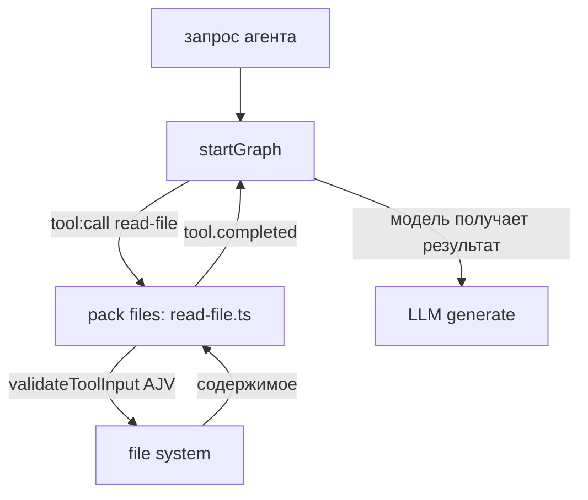

# 55. Пакет harnesys — пакеты инструментов (packs) детально

## Назначение

Пакеты (`packages/harnesys/src/packs/*`) — наборы инструментов, навыков, портов и хуков, которые подключаются к агенту через `def.packs`. Каждый пакет экспортирует `definePack` + `registerPack` + `create(ctx)` возвращающий `{tools?, skills?, notes?}`. Публичные экспорты — `packages/harnesys/src/packs/index.ts`.

## Домен паков (`domain/pack.ts`)

- `Pack<Ports, Spec> = { name, version, description, icon?, specSchema?, meta { tools, skills, hasSettings }, create(ctx) → { tools?, skills?, notes? } }` (`domain/pack.ts:140`).
- `PackCtx<Ports, Spec> = { ports: Ports, spec: Spec, scope: CapabilityScope, policy?: MemoryPolicy }` (`domain/pack.ts:134`).
- `CapabilityScope = { orgId: string, agentId: string, agentName?: string, sourceIds: string[], threadId: string }` (`domain/pack.ts:5`).
- `PackSkill = { name, description, whenToUse?, body: string }` (`domain/pack.ts:12`).
- `PackToolMeta = { name, description }` (`domain/pack.ts:18`).
- `PackMeta = { tools: PackToolMeta[], skills: string[], hasSettings: boolean }` (`domain/pack.ts:22`).
- `PackOverride = { spec?: Record<string, unknown>, disabledTools?: string[], exposure?: Record<string, ToolExposure> }` (`domain/pack.ts:30`).
- `PackAssignment = boolean | PackConfig | PackOverride` (`domain/pack.ts:35`).
- `definePack(def)` — валидация name/version/description/meta; возвращает `Pack` (`domain/pack.ts:158`).
- `registerPack(pack, opts?)` → `PackRegistration = { pack, ports?, resolveScope? }` (`domain/pack.ts:167`).
- `packValueIssues(value, check?)` — валидация значения пака: `packs_value`, `packs_spec`, `packs_disabled_tools`, `packs_exposure` (`domain/pack.ts:104`).
- `packsShapeError(packs)` — строка ошибки или null (`domain/pack.ts:121`).
- `normalizePackAssignment(value)` — булево → `{}`, иначе значение как есть (`domain/pack.ts:176`).

## Механизм подключения паков (`application/packs/registry.ts`)

- `resolvePacks(def, registrations, settingDefaults?)`: по `def.packs {name: true | false | {spec?}}`, сортировка по имени, AJV-валидация `specSchema`, предупреждения `pack_unknown`, `pack_port_missing`, `spec_invalid`, `skill_name_collision`. `applySettingDefaults` накладывает дефолты настроек (`registry.ts`).
- `applySettingDefaults(spec, defaults)`: слияние с overlay (явные значения побеждают, рекурсивное слияние объектов) (`registry.ts:97`).
- `buildPackRun(def, registrations)`: вызывает `pack.create` для каждой включённой регистрации; ошибка без портов → `pack_port_missing` предупреждение + исключение; с портами → проброс ошибки. Навыки проверяются на коллизии имён. Возвращает `{ outputs: PackRunMap, enabled: PackRunOutput[], excluded: Set<string> }` (`pack-run.ts`).
- `PackRunOutput = { reg, config, tools: ToolDefinition[], skills: PackSkill[], notes: LlmNoteProvider[] }` (`pack-run.ts:16`).
- `PackRunMap = Map<string, PackRunOutput>` (`pack-run.ts:23`).
- `selectPackOutputs(def, outputs)`: по `def.packs` оставляет включённые (не false/null/undefined), пропускает исключённые/неизвестные с диагностикой (`pack-run.ts`).
- `effectiveSkillRegistry(def, fsSkills, outputs)`: ФС-навыки, отфильтрованные по `def.skills`, + навыки из паков (`pack-run.ts`).
- `printPackDiagnostics(diagnostics, logger)` — логирование диагностики паков (`pack-run.ts`).
- `excludedPackNames(outputs)` — множество имён исключённых паков (`pack-run.ts`).
- `fallbackScope()` — `{ orgId: '_', agentId: '_', sourceIds: [], threadId: '_' }` (`pack-run.ts:28`).

## Сборка набора возможностей (`application/capability-set.ts`)

`resolveCapabilitySet(def, universe): CapabilitySet` (`capability-set.ts:80`):

- `CapabilityUniverse = { registrations, baseRegistry: Map<string, ToolDefinition>, roster: AgentRosterEntry[], fsSkills?, makeLoadTools, discoverTool?, makeLoadSkill?, mode?, sandbox? }` (`capability-set.ts:41`).
- `CapabilitySet = { registry: RunRegistry, packOutputs: PackRunMap, skills: string[], mcpServers: string[], subagents: AgentRosterEntry[], notes: LlmNoteProvider[], pathEntries: PathEntrySpec[], explain: ExplainEntry[], fatal: string[] }` (`capability-set.ts:53`).
- Этапы:
  1. `buildPackLayer` → `buildPackRun(def, registrations)`.
  2. `grantHostTools`: инструменты из `baseRegistry`; MCP-инструменты только если сервер в `agent.mcpServers` (иначе `deniedByUniverse`).
  3. `reportAssignments`: фатальные ошибки не зарегистрированных паков; пак с `disabledTools` без активного источника.
  4. `grantPackTools`: инструменты паков, коллизия с хостом → `overrodeHost`.
  5. `applySourceOverrides`: `disabledTools`/`exposure` override на уровне источника пака.
  6. `subtractDisallowed`: `def.disallowedTools` (через `resolveToolAlias`).
  7. `applyMode`: режим работы, `deferred`/`disabledTools` (предзагрузка, удаление).
  8. `applySandbox`: запрет агентских инструментов (group === 'agents') в sandbox.
  9. `grantCoreServices`: core pack — `load_tools`, `load_skill`, `Skill` (`CORE_SERVICE_TOOLS = ['load_tools', 'load_skill', 'Skill']`).
  10. `collectPackOutputs` → навыки, заметки, объяснения.
  11. `explainMcpGrants` для `def.mcpServers`.
  12. `collectSubagents` из roster.
- `CORE_SERVICE_TOOLS = ['load_tools', 'load_skill', 'Skill']` (`capability-set.ts:64`).

## Перечень пакетов и их содержимое

| Пакет | Экспорт | Инструменты / навыки / порты |
|-------|---------|------------------------------|
| `agents` | `agentsCapability`, `AgentsCapabilityPorts` | инструменты spawn/handoff/update агентов, run-guard, scope (`src/packs/agents/`) |
| `base` | `filesCapability`, `shellCapability` | базовые навыки: файлы, оболочка (`src/packs/base.ts`) |
| `core` | `coreCapability` | ядро возможностей: `ask_user`, `map`, `wait` (`src/packs/core/index.ts`) |
| `files` | — | read_file, file_read_image, extract_file_text, write_file, write_xlsx, write_docx, edit_file, list_dir, glob, grep (`src/packs/files/`) |
| `github` | `githubCapability`, `GithubCapabilityPorts`, `GithubPackSpec` | контент репозиториев, проблемы, pull request (`src/packs/github/`) |
| `google` | `googleCapability`, `GoogleCapabilityPorts`, `GooglePackSpec` | Календарь, Документы, Gmail, Search Console, Таблицы, YouTube (`src/packs/google/`) |
| `image` | `imageCapability`, `ImageCapabilityPorts` | генерация изображений (`src/packs/image/`) |
| `issues` | `issuesCapability`, `IssuesCapabilityPorts` | создание задач, мета, workspace, source-summary (`src/packs/issues/`) |
| `lsp` | `lspCapability`, `LspCapabilityPorts` | LSP инструменты (`src/packs/lsp/`) |
| `manager` | `managerCapability`, `ManagerCapabilityPorts` | инструменты менеджера (`src/packs/manager/`) |
| `mcp` | `mcpCapability`, `McpCapabilityPorts` | MCP инструменты (`src/packs/mcp/`) |
| `memory` | `memoryCapabilities`, `memoryCapabilityList`, `knowledgeMemoryCapability`, `pinMemoryCapability`, `semanticMemoryCapability` | знания, пины, семантическая память, продвижение, релевантность (`src/packs/memory/`) |
| `plan` | `planCapability`, `PlanCapabilityPorts` | инструменты плана (`src/packs/plan/`) |
| `scheduler` | `schedulerCapability`, `SchedulerCapabilityPorts` | инструменты расписания (`src/packs/scheduler/`) |
| `shell` | — | shell, terminal_spawn/write/read/kill/list, port_forward, remote_copy (`src/packs/shell/`) |
| `skills` | — | инструменты навыков (`src/packs/skills/`) |
| `telegram` | `telegramCapability`, `TelegramCapabilityPorts`, `TelegramPackSpec` | бот, аккаунт, каналы, медиа, топики (`src/packs/telegram/`) |
| `threads` | `threadsCapability`, `ThreadsCapabilityPorts` | инструменты потоков, история (`src/packs/threads/`) |
| `web` | `webCapability`, `WebPackPorts`, `WebPackSpec` | агентский браузер (agent-browser, engine-catalog), fetch, поиск (`src/packs/web/`) |
| `webhook` | `webhookCapability`, `WebhookCapabilityPorts` | инструменты вебхуков (`src/packs/webhook/`) |

Пример регистрации в рантайме (`create-runtime.ts:81`): базовые паки `files`, `web` регистрируются если не переданы хостом; `shell` регистрируется с портами `{ jobs: processJobs }` если не передан.

## Пример взаимодействия с паком (файлы)



## Пример взаимодействия с паком (shell)

```mermaid
flowchart TD
    GR[startGraph] -->|tool:call shell| SH[pack shell: shell.ts / shell-chain.ts]
    SH -->|shell-gate (allow/deny)| PTY[PTY процесс / ssh]
    PTY -->|stdout/stderr| SH
    SH -->|tool.completed| GR
```

## Связанные разделы

- [16-агенты-и-agent-definition.md](./16-агенты-и-agent-definition.md) — AgentDefinition.packs.
- [18-модель-исполнения-graph.md](./18-модель-исполнения-graph.md) — выполнение графа с инструментами паков.
- [54-пакеты-harnesys-ядро.md](./54-пакеты-harnesys-ядро.md) — пакет ядра harnesys.
- [53-пакеты-contracts.md](./53-пакеты-contracts.md) — контракты паков (`capabilities.ts`, `mode-presets.ts`).
