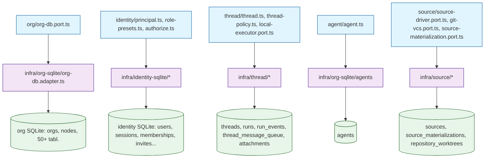

# 57. Сервер — доменный слой: организации, идентичность, потоки, выполнение

## 57.1 Организации (org)

`apps/server/src/app/domain/org/org-db.port.ts` — порт `OrgDbPort`:

```ts
export abstract class OrgDbPort {
  abstract bootstrap(orgId: string, name: string): void;
  abstract rename(orgId: string, name: string): void;
}
```

`bootstrap` создаёт org-директорию через `HostFsLayoutPort`, открывает приватную SQLite (`org-sqlite-session.ts`), прогоняет `ensureOrgSchema` (~50+ таблиц `schema/`), вставляет строку `orgs` и узел relay (роль `relay`, статус `online`). Реализация: `apps/server/src/app/infra/org-sqlite/org-db.adapter.ts` (`OrgDbAdapter`, `@Injectable`). Ошибки в `apps/server/src/app/domain/org/org.error.ts`: `OrgNotFoundException`, `OrgNameRequiredException`, `OrgWorkspacePathInvalidException`.

Контракты (`packages/contracts/src/org-machine.ts`): `OrgIdSchema` (uuid), `MachineOrgRole` (`relay` | `worker`), `CreateOrgBody`, `UpdateOrgBody`, `OrgMachineFile`, `OrgsListResponse`, `MachineOrgEntry`.

## 57.2 Идентификация и авторизация (identity)

`apps/server/src/app/domain/identity/`:

- `principal.ts`: `UserPrincipal { kind:'user', userId, capabilities[], orgId }` | `NodePrincipal { kind:'node', nodeId, orgId }`.
- `capability.ts`: `Capability` (`org.read`, `org.update`, `org.delete`, `member.*`, `fleet.*`, `host.promote`, `desk.read/write`, `run.start`, `run.cancel`, `source.read/write`, `secret.read/write`, `terminal.open`, `terminal.open:ro`, `agent.manage`, `schedule.manage`) и `NodeAction` (`heartbeat`, `work.claim`, `fleet.channel`, `source.materialize`, `run.execute`).
- `role-presets.ts`: `OrgRole = owner | admin | operator | viewer`, `ROLE_PRESETS`. Owner — все права, Viewer — только `org.read`, `desk.read`, `source.read`, `terminal.open:ro`.
- `authorize.ts`: `authorize(principal, action, resource?)` — проверяет совпадение `orgId`, для user — наличие capability, для node — `NODE_ACTIONS`.
- Порты: `membership-repository.port.ts`, `user-repository.port.ts`, `session-store.port.ts`, `password-hasher.port.ts`, `ticket-key-store.port.ts`, `identity-audit.port.ts`, `identity-link.port.ts`, `user-invite-repository.port.ts` (названия портов не все проверены кодом в объёме этого раздела).

Реализация (адаптеры): `apps/server/src/app/infra/identity-sqlite/` — `identity-sqlite.module.ts`, `identity-audit.adapter.ts`, `identity-link.adapter.ts`, `membership-repository.adapter.ts`, `password-hasher.adapter.ts`, `session-repository.adapter.ts`, `user-invite-repository.adapter.ts`, `user-repository.adapter.ts`, `identity-sql.ts`, `identity.schema.ts`, `identity-sqlite-session.ts`. Пароли хешируются через `password-hasher.adapter.ts`.

Таблицы identity-sqlite (`identity.schema.ts`): `users`, `memberships`, `sessions`, `consumed_refreshes`, `login_attempts`, `user_invites`, `identity_links`, `identity_link_codes`, `identity_audit`.

Сессия и подключение: `identity-sqlite-session.ts` — `openIdentitySqlite(layout)` открывает `bun:sqlite` базу по пути `layout.identityDbPath()`, настраивает PRAGMA (`journal_mode = WAL`, `busy_timeout = 5000`, `foreign_keys = ON`), вызывает `ensureIdentitySchema`, возвращает `IdentitySqliteDb` (drizzle over bun:sqlite). `withIdentitySqlite` для операций с автоматическим закрытием.

Поток: контроллер API → principal (из сессии/токена) → use-case → `authorize(principal, action, {orgId})`. При `false` — `ForbiddenException`.

## 57.3 Потоки (threads)

`apps/server/src/app/domain/thread/thread.ts`:

- `ThreadRecord`: id, orgId, title, kind (`chat|group|schedule|webhook|issue`), policy, lastThreadSeq, conversationCount, parentThreadId, forkAt, runProfileId, runDirectory, метаданные.
- `ThreadActiveRunStatus = queued | running | needs_input | waiting`; `ThreadActiveRun { runId, threadId, status, leaseExpired, waitingForProfileId, startedByUserId, startedByName, via:'direct'|'agent', onNodeId }`.
- `ThreadAgentRecord`, `ThreadParticipantRecord` (роль 'member'|'blocked').
- `thread-policy.ts`: парсинг `ThreadPolicy` (Zod), `contextWindowOf`, `allowsMentions`.
- `local-executor.port.ts`: `CompactThreadResult`, `ThreadQueueDrainResult` — компакция, дренаж очереди сообщений.

Порты: `thread-repository.port.ts`, `thread-agent-repository.port.ts`, `thread-participant-repository.port.ts`, `thread-events.port.ts`, `attachment-repository.port.ts`, `attachment-storage.port.ts`, `wait-ticker-gate.port.ts`.

Адаптеры: `apps/server/src/app/infra/thread/` — `thread-repository.adapter.ts`, `thread-agent-repository.adapter.ts`, `thread-participant-repository.adapter.ts`, `thread-events.adapter.ts`, `attachment-repository.adapter.ts`, `attachment-storage.adapter.ts`, `thread-patch-updates.ts`, `thread.module.ts`.

Жизненный цикл run: `queued → running → needs_input | waiting → completed | failed | cancelled | dead_lettered`. Не-терминальные: `queued`, `running`, `needs_input`, `waiting`. Уникальный активный корневой run на поток (частичный индекс `runs_active_root_idx` по `thread_id` где `parent_run_id IS NULL` и статус не-терминальный).

Статусы `RunLifecycleStatusSchema` (`packages/contracts/src/thread.ts`): `queued`, `running`, `needs_input`, `waiting`, `completed`, `failed`, `cancelled`, `dead_lettered`. `RunViaSchema = z.enum(['direct','agent'])`.

`ThreadRecord.runProfileId` / `runDirectory` — привязка выполнения к профилю и каталогу. `UpdateThreadBindingBodySchema` требует хотя бы один из `runProfileId`, `runDirectory`; `runDirectory` должен быть абсолютным путём.

`ThreadActiveRun.leaseExpiresAt` — время истечения аренды выполнения. Fleet использует для удержания run на узле.

## 57.4 Агент (agent)

`apps/server/src/app/domain/agent/agent.ts`: `AgentRecord` (modelId, budgetUsdDaily, level, parentId, executionProfileId, status, sharedSourceIds, sourceLevels, secretNames, skills, mcpServers, enabledPlugins, hooks). Маппинг в `AgentDefinition` (`harnesys`) — `apps/server/src/app/infra/runtime/agent-definition.mapper.ts` (`toAgentDefinition`): graph (FALLBACK_GRAPH start→think→act→end), budget, permissions, packs, mcpServers, hooks. Порт `agent-registry.port.ts` (`findById`, `list`), `agent-memory.port.ts`, `hook-run-store.port.ts`. Адаптер агента — таблица `agents` в `infra/org-sqlite/`.

## 57.5 Источник (source)

`apps/server/src/app/domain/source/`:

- `source-driver.port.ts` (`SourceDriverPort`): `ensureMaterialized`, `configureCredentialHelper`, `resolveContentRoot`, `refresh`, `switchBranch`, `createBranch`, `createStandaloneWorktree`, `observeWorktree` и т.д. kind = 'git'.
- `git-vcs.port.ts` (`GitVcsPort`): probe, status, diff, branches, checkout, commit, push, pull, init.
- `source-materialization.port.ts` (`SourceMaterializationPort`): `MaterializationRecord` (state, revision, lastConflictPaths, refreshRequired), `decideMaterializationRevision` (applied|ignored|idempotent).
- `cloud-materialization-state.ts`: `CloudSyncOutcome`, `applyCloudSyncOutcome`.
- `repository-worktree.ts`: `RepositoryWorktreeState = creating|ready|failed|removing`, `canDeleteWorktree`, `decideStaleCreatingRecovery`.
- Порты: `cloud-remote-backend.port.ts`, `cloud-sync-back-watch.port.ts`, `git-watch-events.port.ts`, `source-watch-gate.port.ts`, `source-location.port.ts`, `source-registry.port.ts`, `decide-source-vcs.ts`, `source-host-status.ts`, `vcs-capability.ts`, `materialization-events.port.ts`, `source.error.ts`, `ui-visibility.policy.ts`.

Адаптеры: `infra/source/source-materialization.adapter.ts` (таблицы `source_materializations`, `source_materialization_projections`), `infra/source/source-registry.adapter.ts` (`sources`), `infra/source/source-location.adapter.ts`, драйверы `infra/source/drivers/git/git.driver.ts` + `git-engine.ts` (реализация `SourceDriverPort` через git CLI/werktrees), `infra/source/drivers/cloud/google-drive.backend.ts`, `cloud-mirror-*.ts`, `cloud-sync-back-*.ts`.

Материализация: `source-materialization.adapter.ts` пишет в таблицы `source_materializations` и `source_materialization_projections`. Worktree привязки — `repository_worktrees` (`org-sql.ts`).

## 57.6 Диаграмма: взаимодействие домена



## Связанные разделы

- [09-слой-domain-entities-ports.md](./09-слой-domain-entities-ports.md)
- [10-слой-infra-adapters.md](./10-слой-infra-adapters.md)
- [11-база-данных-schema.md](./11-база-данных-schema.md)
- [13-org-и-идентичность.md](./13-org-и-идентичность.md)
- [14-потоки-threads.md](./14-потоки-threads.md)
- [15-выполнение-run-engine.md](./15-выполнение-run-engine.md)
- [59-сервер-инфраструктура-и-рантайм.md](./59-сервер-инфраструктура-и-рантайм.md)
