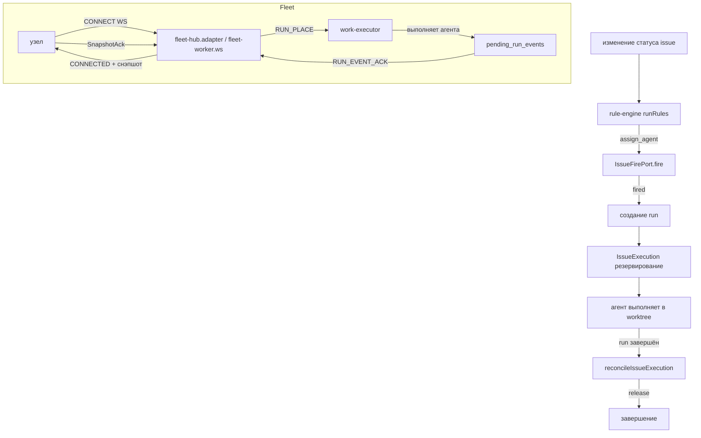
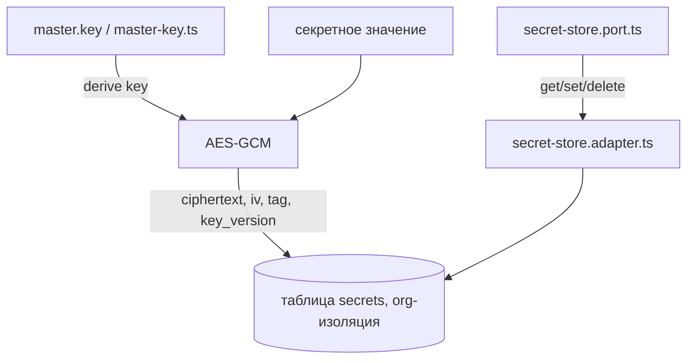

# 58. Сервер — доменный слой: задачи, флот, знания, навыки, секреты

## 58.1 Задачи (issue)

`apps/server/src/app/domain/issue/`:

- `issue.ts`: `IssueRecord` (boardId, statusKey, priority, type, assigneeAgentId, fireTrail[], sourceId, branch, worktreeOnStatus), `IssueDependencyRecord`, `IssueAttachmentRecord`, `appendFireTrail` (лимит 10 записей).
- `rule-engine.ts`: `runRules` — очередь событий (`issue_created`, `status_entered`), условия по меткам (`dead-ref` при отсутствии ссылки), действия `assign_agent`/`notify_owner`/`set_status`, каскад ограничен `MAX_CASCADE_TRANSITIONS = 5`, защита от повторов статуса (`visited`). `pickAssignment` — выбор агента по правилу.
- `dependency-cycle.ts`: `createsBlocksCycle` — обход графа зависимостей `blocks`, защита от циклов.
- `issue-fire.port.ts` (`IssueFirePort`): `fire(request)` → `{outcome:'fired', runId}` или иной исход.
- Порты: `board-repository.port.ts`, `issue-repository.port.ts`, `issue-execution.port.ts`, `issue-dependency-repository.port.ts`, `label-repository.port.ts`, `issue-comment-repository.port.ts`, `issue-attachment-repository.port.ts`, `issue-events.port.ts` (названия портов не все проверены кодом в объёме этого раздела).

Адаптеры: `infra/issues/` (таблицы `issue_boards`, `board_statuses`, `board_rules`, `issues`, `issue_dependencies`, `issue_labels`, `issue_comments`, `issue_attachments`, `issue_executions`), `infra/org-sqlite/org-sql-issues.ts` (DDL).

Поток issue: событие изменения статуса → `runRules` → если `assign_agent`, `IssueFirePort.fire` → создаётся run → `IssueExecution` резервируется → агент выполняет задачу в worktree → по завершении run `reconcileIssueExecution` освобождает execution.

`issue-execution.ts`: `IssueExecution` (state: reserved|active|handoff|released, leaseEpoch, correlationId `issue:${issueId}:${status}:${agentId}`). `decideIssueReservation` (proceed/idempotent/conflict/handoff-blocked), `reconcileIssueExecution` (keep/release по статусу run), `canIssueHandoff`.

## 58.2 Флот (fleet)

`apps/server/src/app/domain/fleet/`:

- `placement.ts`: `decidePlacement` — оценка узлов (inProfile, status online, sourcesReady, dockerAvailable), ранжирование по `activeClaims`, `PlacementResult = selected|unavailable`. Причины отказа: not-in-profile, offline, draining, source-not-ready, docker_missing.
- `pending-placement.ts`: `PendingPlacement` (runId, profileId, attempt, priority, trigger: chat|issue|schedule|webhook|connector, payload, expiresAt), `effectivePriority` (старение каждые 30 мин), `decidePendingReconcile` (noop|delete|reenqueue|resolve).
- `worker-command.ts`: `WorkerCommand` — HTTP_PROXY, RUN_PLACE (TaskEnvelope), WORK_CANCEL, WORK_ASK_RESUME, APPROVAL_RESUME, NODE_DRAIN/RESUME/REMOVED, ORG_DELETED, SOURCE_MATERIALIZE/ATTACH/REFRESH/WORKTREE_CREATE/REMOVE. `isQueueableCommand`.
- `node-command-queue.port.ts`: enqueue/list/remove/drain (TTL, лимит на узел).
- `org-execution-replica.port.ts`: `apply(snapshot)` → `SnapshotAckStatus`, `get`, `acceptedRevision`, `isCompatible`, `isReadyForRevision`.
- `fleet-hub.port.ts` (`FleetHubPort`): presence, ping, sweepOffline, attachPeer/detachPeer (WS peers), broadcastToOrg, sendToPeer, routeCommand (команда в WS или в `node_command_queue` если оффлайн), requestHttpProxy/resolveProxyResult.

Порты: `node-repository.port.ts`, `node-identity-store.port.ts`, `node-snapshot-ack.port.ts`, `org-audit.port.ts`, `org-config-revision.port.ts`, `pending-run-event.port.ts`, `event-claim.port.ts`, `work-claim.constants.ts`, `worker-org-operation-receipt.port.ts`, `invite-repository.port.ts`, `fleet-events.port.ts`, `fleet-content-proxy.port.ts`, `promote-session.port.ts`, `source-write-lease.port.ts`.

Адаптеры: `infra/fleet-hub/fleet-hub.adapter.ts` (sweep каждые 30с, `PRESENCE_OFFLINE_AFTER_MS`), `infra/fleet-hub/fleet-worker.ws.ts` (WS `/api/fleet/worker`, кадры CONNECT/SNAPSHOT_ACK/PING/HTTP_PROXY_RESULT/RUN_EVENT/SOURCE_MATERIALIZATION/SOURCE_WORKTREE), `infra/fleet-hub/worker-dialer.adapter.ts` (heartbeat к relay, dialer WS, обработка COMMAND → workExecutor), `infra/fleet-hub/work-executor.ts`, `work-executor.claimer.ts`, `work-executor.forwarder.ts`, `work-executor.resume.ts`, `work-executor.util.ts`, `work-executor.process.ts`, `work-executor.compose.ts`, `worker-dialer.commands.ts`, `worker-dialer.place-run.ts` (flushDeferredPlaces), `infra/org-sqlite/` (таблицы `nodes`, `node_commands`, `pending_placements`, `pending_run_events`, `org_execution_sync`, `event_claims`, `source_write_leases`, `source_operation_grants`, `org_config_revisions`, `node_snapshot_acks`, `org_execution_replica`, `worker_org_operation_receipts`, `org_ticket_keys`, `org_audit`).

Контракты (`packages/contracts/src/fleet.ts`): `INVITE_CODE_ALPHABET`, `INVITE_CODE_LENGTH = 8`, `INVITE_TTL_MIN_DEFAULT = 15`, `INVITE_TTL_MIN_MAX = 1440`, `PRESENCE_OFFLINE_AFTER_MS = 90_000`, `IssueInviteBody`, `IssuedInvite`, `ActiveInvite`, `EnrollBody`, `EnrollResponse`, `RotateNodeTokenResponse`, `PairBody`, `PairResponse`, `OrgNodeIdentity`, `NodeStatus` (`online`|`offline`|`draining`), `NodeConfigSync`, `FleetNode`, `ConnectInfo`, `HeartbeatBody`, `HeartbeatResponse`, `RetargetBody`, `PromoteStartBody`, `PromoteCompleteBody`, `ProxyRequest`.

Поток флота: нода шлёт CONNECT через WebSocket → сервер отвечает CONNECTED + снэпшот состояния (org execution replica) → нода подтверждает SnapshotAck → сервер шлёт RUN_PLACE через WorkerCommand → `work-executor.place` создаёт рантайм и выполняет агента → события run пишутся в `pending_run_events` → нода подтверждает через RUN_EVENT_ACK → `ackThrough` очищает события.

## 58.3 Диаграмма: задачи и флот

## 58.4 База знаний (knowledge)

`apps/server/src/app/domain/knowledge/`:

- `knowledge-indexer.port.ts` (`KnowledgeIndexerPort`): `startFullReindex`, `cancel`, `getState`, `listIndexStates`, `onFileEvent`.
- `knowledge-search.port.ts`, `knowledge-store.port.ts`, `knowledge-roots.port.ts`, `files-watcher.port.ts`, `knowledge-index-events.port.ts`.

Адаптеры: `infra/knowledge/knowledge.adapter.ts`, `knowledge-indexer.ts`, `knowledge-indexer-full.ts` (scan→index фазы, `knowledge_chunks`, `knowledge_files`, `knowledge_index_state`, FTS5 таблица `knowledge_chunks_fts` с триггерами ai/ad/au), `knowledge-indexer-watch.ts` (инкрементальный дренаж `pendingUris`), `knowledge-indexer-uri.ts`, `knowledge-index-file.ts`, `knowledge-walk.ts`, `knowledge-embeddings.ts` (backend fts|vector), `fts-query.ts`, `sqlite-client.ts`. Таблицы: `knowledge_chunks`, `knowledge_roots`, `knowledge_settings`, `knowledge_files`, `knowledge_index_state`.

Бэкенд поиска: FTS5 (`knowledge_chunks_fts` с триггерами ai/ad/au) или векторный (embedding BLOB). Настройки: `knowledge_settings` (backend: 'fts'|'vector', embed_provider, embed_model, watch_enabled).

Поток: включение watch → `KnowledgeSourceWatch` следит за файлами через `FilesWatcherPort` → `onFileEvent` → индексатор переиндексирует файл → chunks пишутся в `knowledge_chunks` + FTS triggers.

## 58.5 Навыки (skills)

`apps/server/src/app/domain/skills/`:

- `org-skills.port.ts` (`OrgSkillsPort`): `list/create/remove`, `readSidecar`, `writeSkillDirAtomic`. Орг-навыки хранятся как файлы (SKILL.md + `.harnesys-skill.json`) в `skillsDir(orgId)`.
- `source-skills.port.ts` (`SourceSkillsPort`): `scan(root)` ищет skill-ди렉тории и agent-маркдауны.
- `org-settings.port.ts`, `skills-events.port.ts`, `skills.error.ts`.

Адаптеры: `infra/skills/` — `org-skills.adapter.ts` (файловое хранение), `org-settings.adapter.ts`, `skill-name.ts`, `skills-events.adapter.ts`, `skills-search.adapter.ts`, `skills-tier-cache.ts` (кеш реестров навыков system/host уровней), `skills-walk.ts`, `system-skills-seed.ts`, `skills.module.ts`.

`SkillsTierCache` кеширует `FsSkillRegistry` из `harnesys/adapters/node` для system и host директорий навыков.

## 58.6 Секреты и хранилище (secret/vault)

`apps/server/src/app/domain/secret/`:

- `vault-keys.ts`: префиксы `secret:`, `var:`, `llm_provider:`, `cloud:`. Функции `isValidVaultName`, `vaultStorageKey`, `parseVaultStorageKey`, `parseVaultRef`, `isSystemSecretKey`, `legacyProviderSecretKey`, `secretRef`, `slugVaultName`.
- `secret-store.port.ts` (`SecretStorePort`): get/set/delete по ключу.
- `provider-api-key.ts`, `secret.error.ts`.

Реализация: `infra/secret/secret-store.adapter.ts` (шифрование AES-GCM в таблицу `secrets` с key, ciphertext, iv, tag, key_version), `master-key.ts` (главный ключ шифрования), `secret.module.ts`.

Поток шифрования: `master-key` → derived key → AES-GCM → ciphertext/iv/tag в `secrets` таблице. Каждый org имеет изолированное хранилище секретов. `master-key.ts`: `loadMasterKey`/`loadOrCreateMasterKey` — 32 байта base64, файл `master.key` (chmod 0600) или из конфига.

## 58.7 Диаграмма: шифрование секретов

## Связанные разделы

- [09-слой-domain-entities-ports.md](./09-слой-domain-entities-ports.md)
- [10-слой-infra-adapters.md](./10-слой-infra-adapters.md)
- [11-база-данных-schema.md](./11-база-данных-schema.md)
- [26-issues-и-доски.md](./26-issues-и-доски.md)
- [28-флот-узлы-fleet.md](./28-флот-узлы-fleet.md)
- [35-знания-и-индекс-knowledge.md](./35-знания-и-индекс-knowledge.md)
- [31-секреты-и-хранилище-vault.md](./31-секреты-и-хранилище-vault.md)
- [59-сервер-инфраструктура-и-рантайм.md](./59-сервер-инфраструктура-и-рантайм.md)
