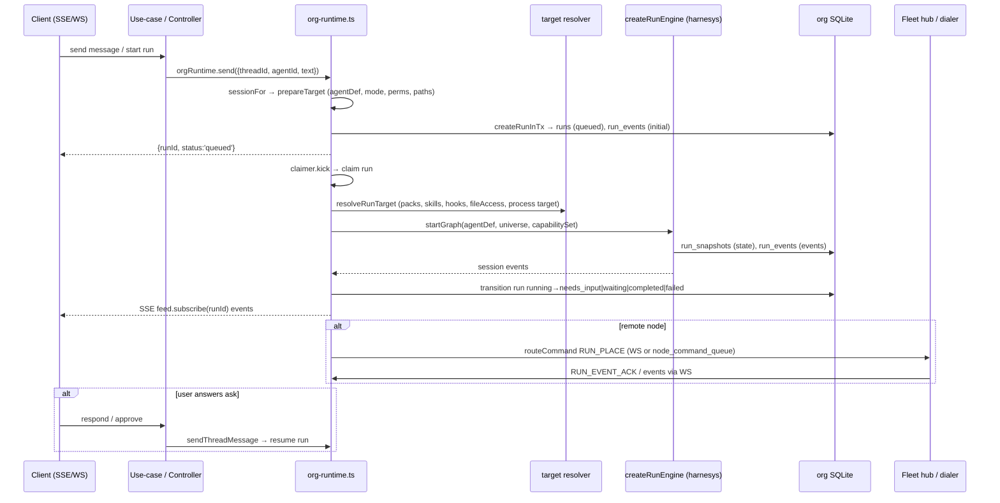

# 60. Сервер — рантайм выполнения и взаимодействие подсистем

## 60.1 Сбор runtime (холодный старт на org)

`apps/server/src/app/infra/runtime/org-runtime.ts` `openOrgRuntime(deps)`:

1. `openOrgSqlite(layout, orgId)` — сессия org SQLite (`bun:sqlite`, WAL, busy_timeout 5000, foreign_keys ON).
2. `recoverOrphanedRuns`, `recoverIssueExecutionsIfPresent`, `recoverStaleWorktrees` — восстановление после перезапуска.
3. `createRunEventBus` + `createOrgEventPublisher` — публикация событий в `run_events` + `thread-events.port.ts` (SSE/эмиссия), `observeThreadErrors` — фиксация `lastError` потока.
4. `createOrgRunStores` — `runEvents` (запись run_events), `runLifecycle` (переходы статусов run: queued→running→needs_input/waiting→completed/failed/cancelled/dead_lettered с `leaseEpoch`), `reconcileApprovals`, `shouldReap`.
5. `wireOrgPacks(orgPackInputs(...))` — регистрации пакетов (`core`, `files`, `shell`, `web`, `lsp`, `agents`, `mcp`, `plan`, `threads`, `scheduler`, `webhook`, `issues`, `manager`, `google`, `github`, `pin-memory`, `semantic-memory`, `knowledge-memory`, `skills`, `telegram`) → `PackRegistration[]` + `ProcessJobRegistry`.
6. `wireOrgPlugins(deps.plugins, orgId)` — `PluginRuntimeBundle` (MCP реестр, навыки, агенты плагинов) → `OrgPluginWiring` (makeRegistry, skills, listMcp/applyMcp).
7. `createOrgModelsPort(orgId, providers, models, secrets)` — `ModelsPort.get(provider, model)` с разрешением apiKey из vault.
8. `createAgentsResolve(deps, plugin)` — resolución агента: локальный `AgentRegistryPort` → `definitionOf` (`agent-definition.mapper.ts`, `toAgentDefinition`) с наложением `applyShellRulePatterns` (permission rules); иначе плагиновый агент (`plugin.view.resolvePluginAgent`).
9. `createRunEngine({ lifecycle, events, models, toolRegistry: plugin.makeRegistry(), skills, agents: agentsResolve, packRegistrations })` — ядро `harnesys` (`packages/harnesys/src/application/run-engine.ts`).
10. `createRunClaimer` — claimer циклов: берет queued run, `resolveRunTarget`, `engine.startGraph`, по завершении `drainMessageQueue`.
11. `createRuntime(...)` — `RuntimeHandle` с `session(agentDef, {state, permissions, paths})`.
12. `sessionFor(threadId, agentId)` — `prepareTarget` (thread + agent + model + provider + mode-preset + права + пути: cwd/threadDir/attachments, sandbox dir), `branchSeed.seededThreadState` (SqliteRuntimeState), `runtime.session(...)`.

## 60.2 Prepare target

`apps/server/src/app/infra/runtime/prepare-org-target.ts` `prepareTarget`:

- Берёт `ThreadRecord` + `AgentRecord` + модель + провайдер.
- `resolveRuntimePrimary` — определяет первичную директорию/источник/ворктри из опций привязки потока (`ThreadBinding`: directory, sourceId, worktreeId, isolation, triggerKind).
- `threadRuntimeContextOf` — runtime контекст: hostId, threadSandbox, primary directory, primarySource (git/folder), sharedSources (из `agent.sharedSourceIds` + `sourceLevels`).
- Режим (`ModeCapabilityFields`) из `thread.runProfileId`/`agent.defaultModeId` → `mode_presets` (packs, disabledTools, exposure, permissions).
- Права: `intersectPermissions(agent.config.permissions, preset.permissions)`.
- Shell-правила: `applyShellRulePatterns` (allow/blocklist из `permission_rules`).
- Пути: `allow`/`write` — attachmentsDir + primaryDirectory; `cwd` = primaryDirectory; `threadDir`.
- Результат `PreparedTarget` → `AgentDefinition` (с запрошенными навыками `sessionRequested`).

## 60.3 Run target resolution

`apps/server/src/app/infra/runtime/org-runtime-run-target.ts` `createRunTargetResolver` → `resolveRunTarget(threadId, state, selector)`:

- `resolveAgentId` — из селектора или `lifecycle.get(runId)?.agentId`.
- `prepareTarget` → агент, mode, permissions, paths, scope, runtime.
- `composeRunSkills` — навыки: плагиновые (`plugin.skills`), обнаружение по источникам (`source-skills.port.ts`, `resolveRunSourceRefs` через `sourceLocation.resolve` → абсолютный корень), автозагрузка по настройке org.
- `CapabilityUniverse`: packRegistrations, базовый реестр MCP-инструментов + `THREADS_HISTORY_TOOL`, roster агентов (`agentsResolve.list`), fs skills, mode, `makeLoadSkill`, `makeLoadTools`, `discoverTool` (фильтр MCP по `agent.mcpServers`).
- `resolveCapabilitySet(agentDef, universe)` внутри `runInHostToolScope(scope)` — правит tool exposure.
- `resolveProcessTarget(deps, binding, paths)` — если `isolation.mode === 'container'`: `WorkspaceContainerPort.ensure` (Docker workspace, mounts: orgDataDir, primaryDir, threadDir, declared rule dirs) → `ProcessJobTarget`.
- Целевой объект `RunTarget`: state, agent, permissions, paths, packs, capabilitySet, universe, skills, hooks (`resolveTargetHooks` — `plugin.view.hooksFor` + `resolveHookSecrets` из vault), binDirs, scope, fileAccess (`runTargetFileAccess` — `derivedFileRules` + `fileRuleInputsOf`), permissionGrants, runtimePromptInfo, steerMessages/ackSteerMessages (очередь сообщений потока).

## 60.4 Запуск графа и поток событий

1. Клиент → REST controller → use-case → `orgRuntime.send({threadId, agentId, text, ...})` (`org-runtime-runs.ts` `sendThreadMessage`):
   - `sessionFor` → `handle.send(...)` → `createRunInTx` (`sqlite-run-records.ts`): идемпотентность по `clientEventId` (проверка `run_events`), вставка run со статусом `queued`, запись initial events, `leaseEpoch=0`. Ограничение одного active root run на поток (unique index `runs_active_root_idx`).
   - Возврат `{runId, status:'queued'}`.
2. Claimер (`createRunClaimer`) забирает run, `resolveRunTarget`, вызывает `engine.startGraph` (harnesys runtime):
   - Статус run → `running` (transition с lease, `leaseExpiresAt`).
   - Граф executes LLM через `modelsPort` (org-models → провайдер + apiKey из vault), инструменты из `toolRegistry`, навыки, хуки (SessionStart и др., таймаут 30с).
   - События пишутся в `run_events` (thread_seq), состояние сессии — `SqliteRuntimeState` (`run_snapshots`, commit при не-терминальных статусах, удаление при terminal).
   - События рассылаются через `RunEventFeed` (`packages/harnesys/src/application/run-event-feed.ts`) → `feed.subscribe(runId)` — SSE/WebSocket клиенту.
   - При `needs_input` (ask/interrupt) — run ждёт ответа, claimер не блокируется вечно (wait-ticker, `sweepWaitTimers`).
   - При завершении: `completed`/`failed`/`cancelled`/`dead_lettered` → snapshot удаляется, run terminal.
3. Отклик клиента (approve/deny ask, message) → `sendThreadMessage` повторно или `WORK_ASK_RESUME`/`APPROVAL_RESUME` команда через `NodeCommandQueuePort` (если узел удалённый).
4. `compactThread` (`org-runtime-compact.ts`) — `compactForced` (harnesys) над загруженным состоянием, запись события `compaction` в `run_events`, обновление `run_snapshots`.
5. `tickWaitTimers` (`wait-ticker.ts`) — пробуждение `waiting` runs по `wait_fire_at`, `release(waitGate)`.

`RunEventFeed` (`packages/harnesys/src/application/run-event-feed.ts`):
- `subscribe(runId, fromSeq)` → `AsyncIterable<SessionEvent>` — пропускает пропущенные события через `events.tail`, затем live через `bus.subscribe`; boundary events (`ask`, `done`, `error`, `run.completed`, `run.failed`, `run.cancelled`) проверяют закрытие run; idle backstop `IDLE_BACKSTOP_MS`.
- `publish(threadId, runId, events)` — публикация через `bus.publish`.

`packages/harnesys/src/application/run-engine.ts` `createRunEngine(deps)`:
- Аренда run: `leaseTtlMs`, `renewMs`, `renewLease` с `leaseLost` флагом, `AbortController` на отмену.
- `execute(runId, opts)` — проверяет владение арендой, выполняет сегмент графа, переходит в `failed` при ошибке, закрывает хуки `SessionEnd` при terminal.
- `abort(runId)` — отменяет выполнение.
- `stop()` / `close()` — останавливает все активные runs.

`packages/harnesys/src/application/create-runtime.ts` `createRuntime(options)`:
- `RuntimeHandle` с методами: `run`, `start`, `resume` (удалён, использует `SessionHandle.respond`), `compile`, `check`, `session`, `skills.list`, `packs.list`, `tools.list/registry`, `mcp.list`, `reloadSkills`, `reloadMcp`, `close`.
- Собирает `CapabilityUniverse` (registrations, baseRegistry, roster, fsSkills, makeLoadTools, makeLoadSkill).
- `assembleRunHooks` — создаёт hook bus с биндингами.
- MCP registry: загрузка `CursorMcpJson` через `MpRegistryClass`.

## 60.5 Орг-уровневые сущности runtime (wiring)

- `org-runtime-compact.ts` — компакция потока.
- `org-runtime-file-access.ts` — `runTargetFileAccess` / `runTargetFileAccessForAgent` (path jail из правил агента + пресета + общих источников).
- `org-runtime-hooks.ts` — хуки цели с разрешением секретов.
- `org-runtime-permission-rules.ts` — shell allow/blocklist + проверки операций.
- `org-runtime-publish.ts` — публикация событий в `thread-events.port.ts` с дедупликацией frames (окно 2048).
- `org-runtime-queue.ts` — `createThreadQueueDrainer` (очередь сообщений потока `thread_message_queue`, `SteeringChannel` steer/ack), `createSteeringChannel`.
- `org-runtime-run-target.ts` — resolución цели графа.
- `org-runtime-source-refs.ts` — `resolveRunSourceRefs` (источники → корни через `SourceLocationPort`).
- `org-runtime-agents.ts` — `createAgentsResolve` (roster локальных + плагиновых агентов).
- `org-runtime.ts` — точка сборки: `openOrgRuntime` → `OrgRuntime` (sessionFor, send, compact, cancel, retry, stream, tickWaitTimers, close).

## 60.6 Flotte взаимодействие (развернутый запуск на узле)

- Relay: WS `/api/fleet/worker` (`fleet-worker.ws.ts`) — узел CONNECT (токен → `NodeRepository.findByTokenHash`), `hub.attachPeer`, снэпшот организации (`BuildOrgExecutionSnapshotUseCase`), RUN_EVENT → `IngestRunEventUseCase` → `RUN_EVENT_ACK` обратно.
- Worker: `WorkerDialerAdapter` — heartbeat к relay (HTTP), dialer WS, CONNECT → `applyConnectedSnapshot` (`OrgExecutionReplicaPort`), replay pending run events, `flushDeferredPlaces` (отложенные RUN_PLACE), обработка COMMAND: `RUN_PLACE` → `workExecutor` (контейнер + запуск графа на узле), `SOURCE_*` → материализация/ворктри.
- Команды узла: `NodeCommandQueueAdapter` (таблица `node_commands`, TTL, лимит), доставка через `FleetHubAdapter.routeCommand` (WS если онлайн, иначе очередь).

## 60.7 Диаграмма: поток данных runtime

## Связанные разделы

- [10-слой-infra-adapters.md](./10-слой-infra-adapters.md)
- [11-база-данных-schema.md](./11-база-данных-schema.md)
- [15-выполнение-run-engine.md](./15-выполнение-run-engine.md)
- [57-сервер-домен-org-identity-thread-run.md](./57-сервер-домен-org-identity-thread-run.md)
- [59-сервер-инфраструктура-и-рантайм.md](./59-сервер-инфраструктура-и-рантайм.md)
- [54-пакеты-harnesys-ядро.md](./54-пакеты-harnesys-ядро.md)
