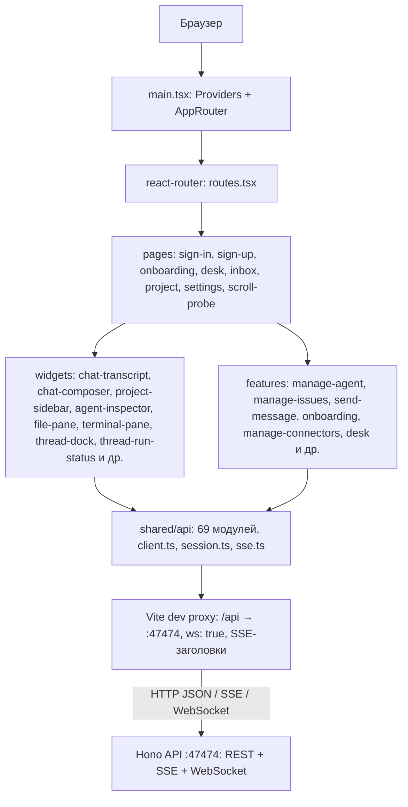

# 61. WebUI — архитектура, страницы, виджеты, фичи

## Назначение

Развёрнутое описание архитектуры `apps/webui`: стек, прокси, точка входа и провайдеры, отображение маршрутов на страницы, виджеты и их API-вызовы, ключевые фичи. Дублирует и уточняет [41](./41-frontend-архитектура-webui.md) / [42](./42-frontend-страницы-и-виджеты.md); при расхождении приоритет — исходный код.

## Стек

| Слой | Технология | Источник |
|------|------------|----------|
| Сборщик | Vite 8, `@rolldown/plugin-babel` | `apps/webui/vite.config.ts:2,57` |
| Фреймворк | React 19 + React Compiler (`babel-plugin-react-compiler`, `reactCompilerPreset`) | `apps/webui/vite.config.ts:4,57`, `package.json` |
| UI kit | shadcn `base-nova`, `components.json`, пакеты `shadcn` + `@shadcn/react` | `apps/webui/components.json` |
| Стили | Tailwind 4, `@tailwindcss/vite`, CSS-переменные | `apps/webui/vite.config.ts:58` |
| Маршрутизация | react-router v8 | `react-router ^8.4.0`, `apps/webui/src/app/router.tsx` |
| Состояние / кэш | Zustand хранилища features/entities + TanStack Query | `zustand ^5.0.15`, `@tanstack/react-query ^5.90.2` |
| HTTP | `apiJson` / `authenticatedFetch` (`shared/api/client.ts`, `session.ts`) | `shared/api/` |
| Поток | SSE (`sse.ts`, `sse-state.ts`), WebSocket (терминал) | `shared/api/sse.ts` |

React Compiler мемоизирует компоненты автоматически; ручные `useMemo`/`useCallback` только при требовании стабильной ссылки извне React (AGENTS.md).

## Точка входа и провайдеры

- `main.tsx` (`apps/webui/src/main.tsx:10`): `createRoot(root).render(<Providers><AppRouter /></Providers>)`.
- `app/providers.tsx`: `ThemeProvider(defaultTheme="dark")` → `QueryProvider` → `EulaGate` → `SessionGate` → `OrgProvider` → `Toaster` (`{children}` + `AppUpdateCheck`).
- `app/router.tsx`: `createBrowserRouter(routes)` + `RouterProvider`.
- `app/routes.tsx`: `routes: RouteObject[]` с `AppFrame` (`OrgTimeZoneProvider` + `OverlayProvider` + `Outlet`), `RootGate` (гейт организации → редирект на стол или `/worker`), `WorkerOrgShade`, `SettingsIndexRedirect`, `BareProjectRedirect`, `OrgLayout` (`WorkerOrgShade` → `OrgBootstrap` → `OrgScopeSync` → `OrgDeskSync` → `DeskSync` → `Outlet`).

## Dev-прокси и порты

- `/api` → `http://127.0.0.1:47474`, `ws: true`, `timeout: 0`, `proxyTimeout: 0` (`vite.config.ts:72-77`).
- Для `text/event-stream` прокси форсирует `Cache-Control: no-cache, no-transform`, `X-Accel-Buffering: no`, `Content-Type: text/event-stream`, `flushHeaders` (SSE не буферизируется) (`vite.config.ts:78-88`).
- `quiet-ws-proxy-disconnects` плагин подавляет безвредные ошибки ws-прокси (`EPIPE`, `ECONNRESET`, `ECONNABORTED`) (`vite.config.ts:12-45`).
- Порты: API `:47474` (`DEFAULT_API_PORT`, `shared/config/constants.ts:1`), web `:5173` (`DEFAULT_DEV_SERVER_PORT`, `shared/config/constants.ts:2`).
- `env.localHostOrigin` — `CLIENT_HOST_ORIGIN` или `window.location.origin` (в Tauri — `http://127.0.0.1:47474`) (`shared/config/env.ts:24`).

## Страницы (`src/pages/`) и маршруты (`app/routes.tsx`)

Фактические данные из кода: 5 подпапок (`desk`, `inbox`, `onboarding`, `project`, `settings`) + 4 верхнеуровневых файла (`sign-in.tsx`, `sign-up.tsx`, `accept-invite.tsx`, `scroll-probe.tsx`), всего 15 `.tsx`.

| Маршрут | Страница | Назначение |
|---------|----------|------------|
| `/` | `RootGate` (`AppFrame`) | гейт организации → редирект на стол или `/worker` |
| `/login` | `sign-in.tsx` | `getAccess()` → `/`, иначе панель входа |
| `/signup` | `sign-up.tsx` | `sessionOwnerStatus()` → `/login` если initialized |
| `/accept` | `accept-invite.tsx` | принятие приглашения |
| `/worker` | `WorkerRelayPage` (`relay-link`) | релей рабочей организации |
| `/onboarding/choose` | `onboarding/choose-page.tsx` | создание организации / присоединение |
| `/onboarding/create` | `onboarding/create-page.tsx` | `upsertOrg` → `activateOrg` → провайдеры |
| `/onboarding/provider/:orgId` | `onboarding/provider-page.tsx` | каталог провайдеров, `createProvider` |
| `/onboarding/models/:orgId` | `onboarding/models-page.tsx` | `listProviders` → `discoverProviderModels` → `attachProviderModel` |
| `/onboarding/presets/:orgId` | `onboarding/presets-page.tsx` | `activateOrg` → стол |
| `/onboarding/join` | `onboarding/join-page.tsx` | worker → `/worker`, иначе стол |
| `/o/:orgId/` | `desk/desk-page.tsx` | панель стола организации |
| `/o/:orgId/settings` | `SettingsIndexRedirect` | редирект на `settings/appearance` |
| `/o/:orgId/settings/:category` | `settings/settings-page.tsx` | настройки организации (по умолчанию `appearance`) |
| `/o/:orgId/settings/connectors/:connectorId` | `ConnectorDetailPage` (`manage-connectors`) | деталь соединителя интеграции |
| `/o/:orgId/inbox` | `inbox/ui/inbox-page.tsx` | входящие |
| `/o/:orgId/` (+ фокус) | `project/ui/project-page.tsx` (IDE) | сайдбар + редактор + расшифровка + композитор + док |
| `/o/:orgId/thread/:threadId` | `project-page` | тред на уровне организации |
| `/o/:orgId/:projectId/thread/:threadId` | `project-page` | тред уровня проекта |
| `/o/:orgId/:projectId/file/*` | `project-page` | просмотр файла |
| `/o/:orgId/:projectId/diff/*` | `project-page` | diff файла |
| `/o/:orgId/:projectId/schedule/:scheduleId` | `project-page` | расписание |
| `/o/:orgId/:projectId/webhook/:webhookId` | `project-page` | вебхук |
| `/o/:orgId/:projectId/spawn/:threadId/:spawnId` | `project-page` | spawn |
| `/o/:orgId/:projectId/terminal/:sessionId` | `project-page` | терминал |
| `/o/:orgId/:projectId/attachment/:issueId/:attachmentId` | `project-page` | вложение |
| `/scroll-probe` | `scroll-probe.tsx` | зонд прокрутки |
| `*` | редирект на `/` | — |

`useStudioLocation()` (`shared/config/location.ts`) возвращает `{ orgId, focus }`; `focus` — `StudioFocus` (`shared/config/routes.ts:19`): `none` / `settings` / `thread` / `file` / `diff` / `schedule` / `webhook` / `spawn` / `terminal` / `board` / `attachment`. Пути формируются `studioPath` (`routes.ts:32`).

## Виджеты (`src/widgets/`) и API

18 подпапок.

| Виджет | Назначение | API, которое вызывает |
|--------|------------|-----------------------|
| `chat-transcript` | расшифровка ran-событий, ходы, инструменты, компакт, авто-прочтение, unseen-счётчик | `features/send-message`, `threads.ts` (SSE события) |
| `chat-composer` | отправка сообщений, вложения, модели, режимы, навыки, голос, слэш-команды | `thread-files.ts` (`uploadThreadAttachment`), `features/send-message` (`sendMessage`) |
| `project-sidebar` | дерево файлов, ветки, задачи, агенты, автоматизации, терминал, вебхуки | `projects.ts`, `threads.ts`, `agents.ts`, `automations.ts`, `terminals.ts`, `webhooks.ts` |
| `agent-inspector` | модель, память, навыки, MCP, план, сырые запросы | `agents.ts`, `memory.ts`, `skills.ts`, `mcp.ts`, `raw-model-requests.ts` |
| `file-pane` | редактор Monaco, превью markdown/DXF/медиа, LSP-мост | `thread-files.ts` (`loadThreadFileContent`), `lsp-bridge` |
| `ide-content` | поверхность автоматизации, превью документа, вкладки тредов | `issues.ts`, `thread-files.ts` |
| `ide-home` | выбор агента, выбор доски | `agents.ts`, `issues.ts` |
| `terminal-pane` | терминал xterm.js | `node-tickets.ts` (`requestNodeTicket`), чистый WebSocket `/api/terminals/:sessionId` |
| `thread-dock` | расписание, вебхуки, fallback тред+агент, строка статуса | `schedules.ts`, `webhooks.ts`, `threads.ts` |
| `thread-journal` | журнал тредов с разделителями ran | `threads.ts` |
| `thread-run-status` | строка статуса ran, баннер повтора | `threads.ts` (`retryRun`), `features/send-message` (`hitl-actions.ts`) |
| `agent-card`, `file-inspector`, `folder-browser`, `ide-tabs`, `inbox-bell`, `settings-nav`, `sidebar` | UI-оболочка | контекст страницы |

## Ключевые фичи (`src/features/`, 56 директорий)

`manage-agent`, `manage-issues`, `manage-connectors`, `manage-fleet`, `manage-knowledge-index`, `manage-knowledge-roots`, `manage-members`, `manage-model`, `manage-plugins`, `manage-project-settings`, `manage-schedule`, `manage-usage`, `manage-vault`, `manage-webhook`, `send-message`, `onboarding`, `preset-marketplace`, `switch-org`, `switch-thread`, `desk`, `app-update`, `appearance`, `eula`, `lsp-bridge`, `compact-thread`, `create-group-thread`, `create-project`, `git-branch`, `git-commit`, `ide`, `attach-git`, `attach-source`, `message-queue`, `move-project-files`, `relay-link` и др.

## Диаграмма: страницы → виджеты → фичи → API → сервер

## Связанные разделы

- [41-frontend-архитектура-webui.md](./41-frontend-архитектура-webui.md)
- [42-frontend-страницы-и-виджеты.md](./42-frontend-страницы-и-виджеты.md)
- [43-frontend-state-management.md](./43-frontend-state-management.md)
- [44-frontend-api-клиент.md](./44-frontend-api-клиент.md)
- [62-webui-состояние-api-sse.md](./62-webui-состояние-api-sse.md)
- [63-интеграции-telegram-github-google.md](./63-интеграции-telegram-github-google.md)
- [38-модель-terminale.md](./38-модель-terminale.md)
