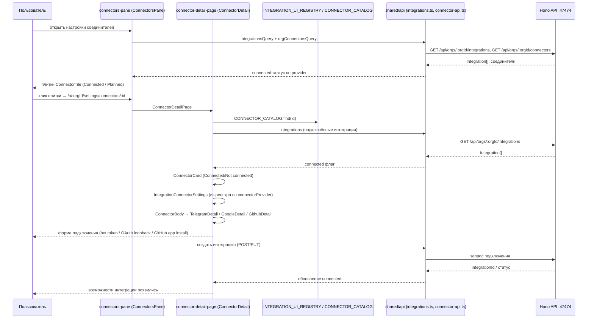

# 63. Интеграции: Telegram, GitHub, Google

## 63.1 Общая модель интеграций

Интеграции — аддоны: устанавливаются today, удаляются tomorrow. Ядро не содержит таблиц под данные интеграций. Каждая интеграция владеет собственным файлом SQLite: `orgDataDir(orgId)/integrations/<id>/data.db`, DDL пишет сама интеграция (`docs/INTEGRATION_ADDON_MODEL.md`).

В ядре нет:
- новых литералов в ядерных объединениях (`ThreadKindSchema`, `RunTriggerKind`, `PlacementTriggerKind`, picker kinds) под интеграции;
- `if (provider === 'x')` / переключателей по провайдеру в ядерном коде;
- ядерных REST-путей и UI-компонентов на каждую интеграцию.

Интеграции повторно используют `kind: 'connector'` и строковые идентификаторы.

### Реестры (единственные ссылки ядра на интеграцию)

| Реестр | Путь | Что содержит |
|--------|------|--------------|
| Серверный реестр установленных интеграций | `apps/server/src/app/infra/integrations/installed-integrations.ts` | `INSTALLED_INTEGRATIONS: IntegrationDefinition[] = [telegramIntegration]` + `installedIntegration(id)` |
| WebUI реестр интеграций | `apps/webui/src/integrations/registry.ts` | `INTEGRATION_UI_REGISTRY: WebuiIntegrationDescriptor[] = [telegramUi]` + `findIntegrationUi(id)` + `automationKindLabel(id, kind)` |

Удаление интеграции = удаление из обоих реестров + удаление каталога данных `integrations/<id>/data.db`.

Все маршруты интеграций находятся под `/orgs/:orgId/integrations/:id/*`. UI рендерится из read-model интеграций/автоматизаций.

Карта интеграции (trigger card) отображается только когда интеграция подключена. Отключённая / не установленная интеграция — не показывает карту. Страница подключения интеграции сама показывает, как подключиться (по способу Google: открыть интеграцию → соединиться → вставить или авторизовать секреты → возможности появляются после этого).

### Дескриптор UI интеграции (`apps/webui/src/integrations/types.ts`)

```ts
export interface AutomationConfigInput {
  integrationId: string;
  kind: string;
  scopeId: string;
  agents: Agent[];
  automation: ClientAutomation | null;
}
export interface AutomationKindDescriptor {
  label: string;
  description: string;
  openConfig(input: AutomationConfigInput): void | Promise<void>;
}
export interface WebuiIntegrationDescriptor {
  id: string;
  title: string;
  icon: ComponentType<{ className?: string }>;
  connectorProvider?: string;
  settings?: ComponentType<{ orgId: string }>;
  automationKinds: Record<string, AutomationKindDescriptor>;
}
```

`AutomationConfigInput = { integrationId, kind, scopeId, agents, automation }` (`integrations/types.ts:5`).

### Реестр webui (`apps/webui/src/integrations/registry.ts`)

```ts
export const INTEGRATION_UI_REGISTRY: WebuiIntegrationDescriptor[] = [telegramUi];
export function findIntegrationUi(integrationId: string): WebuiIntegrationDescriptor | undefined;
export function automationKindLabel(integrationId: string, kind: string): string | undefined;
```

В реестре только одна интеграция — `telegram` (`id: 'telegram'`, `title: 'Telegram'`, `icon: SendIcon`, `connectorProvider: 'telegram'`, `settings: TelegramAccountSettings`, `automationKinds: { 'telegram.feed': { label: 'Telegram feed', description: 'New Telegram posts, filtered', openConfig: openFeedConfig } }`) (`integrations/telegram/index.ts:26`). GitHub и Google не зарегистрированы в webui-реестре (`INTEGRATION_UI_REGISTRY` содержит только `telegramUi`); их настройка ведётся через общую страницу соединителей `manage-connectors` (`ConnectorDetailPage`) и клиент API `shared/api/integrations.ts`.

Серверный реестр (`installed-integrations.ts`) также содержит только `telegramIntegration`. GitHub и Google имеют серверную инфраструктуру (`apps/server/src/app/infra/integration/github/`, `apps/server/src/app/infra/integration/google/`), но не входят в `INSTALLED_INTEGRATIONS` на момент актуализации (не проверено кодом, что они добавляются в реестр).

## 63.2 Каталог соединителей (`packages/contracts/src/integrations.ts`)

`CONNECTOR_CATALOG` — перечень дескрипторов соединителей, источник для UI плиток:

| id | name | auth.kind | content | capabilities | status |
|----|------|-----------|---------|--------------|--------|
| `google` | Google | `oauth-browser` | `drive-folders` | `drive`, `calendar`, `gmail` | `available` |
| `github` | GitHub | `github-app-install` | `github-repos` | `repos`, `issues`, `ci` | `available` |
| `slack` | Slack | `oauth-browser` | `none` | — | `planned` |
| `notion` | Notion | `oauth-browser` | `none` | — | `planned` |
| `linear` | Linear | `oauth-browser` | `none` | — | `planned` |
| `discord` | Discord | `oauth-browser` | `none` | — | `planned` |
| `telegram` | Telegram | `bot-token` | `none` | — | `available` |

`IntegrationProviderSchema = z.enum(['google', 'github'])` — только google/github являются провайдерами интеграций в смысле `Integration` (`id`, `orgId`, `provider`, `status: connected|expired|error`, `accountLabel`, `externalAccountId`, `credRef`, ...). Telegram в этом перечислении не участвует; он моделируется как соединитель через `/api/orgs/:orgId/connectors/telegram/*`.

## 63.3 Поверхность подключения (connect surface)

### Страница соединителей (`features/manage-connectors/connectors-pane.tsx`)

`ConnectorsPane({ orgId })`:
- загружает `integrationsQuery(orgId)` (`GET /api/orgs/:orgId/integrations`) — список подключённых интеграций (`Integration[]`);
- загружает `orgConnectorsQuery(orgId, { provider: 'telegram' })` (`GET /api/orgs/:orgId/connectors?provider=telegram`) — соединители Telegram;
- отображает разделы "Available" и "Planned" из `CONNECTOR_CATALOG`;
- каждая доступная интеграция — плитка `ConnectorTile`: иконка, имя, теглайн, бейдж `Connected` (есть интеграция с тем же `provider` или соединитель Telegram) или `Planned`;
- плитка — ссылка на `studioPath.connector(orgId, connectorId)` = `/o/:orgId/settings/connectors/:connectorId`.

### Деталь соединителя (`features/manage-connectors/connector-detail-page.tsx`)

`ConnectorDetailPage` (`/o/:orgId/settings/connectors/:connectorId`):
- ищет соединитель по `connectorId` в `CONNECTOR_CATALOG`;
- `connected` = для `telegram`: `(orgConnectors.data?.items ?? []).length > 0`; иначе: интеграция с `provider === connector.id` в `integrations.data?.integrations`;
- рендерит `ConnectorCard`: имя, теглайн, описание, бейдж `Planned` если запланирован, `StatusDot` (ok/idle) с `Connected` / `Not connected`;
- мета: Sign-in (метка авторизации), Content (содержимое), Agent tools (чипы возможностей);
- `IntegrationConnectorSettings` — рендерит компонент `settings` из `INTEGRATION_UI_REGISTRY` по `connectorProvider` (для Telegram — `TelegramAccountSettings`; для Google/GitHub — `null`, т.к. не зарегистрированы);
- `ConnectorBody` диспетчеризует по `connector.id`: `telegram` → `TelegramDetail`, `google` → `GoogleDetail`, `github` → `GithubDetail`.

### Карта интеграции (trigger card)

Отображается только когда интеграция подключена. Отключённая / не установленная интеграция — не показывает карту. Страница подключения интеграции сама показывает, как подключиться.

## 63.4 Интеграция Telegram

### Серверная сторона

Пакет `packages/integration-telegram`:
- `src/telegram-integration.ts` — основной модуль (`defineIntegration`).
- `src/telegram/client.ts` — клиент Telegram API.
- `src/telegram/runtime.ts` — рантайм.
- `src/db/schema.ts`, `src/db/store.ts`, `src/db/posts.ts`, `src/db/readers.ts`, `src/db/rules.ts`, `src/db/sources.ts` — собственная SQLite БД интеграции (`orgDataDir(orgId)/integrations/telegram/data.db`).
- `src/feed/filter.ts`, `src/feed/ingest.ts`, `src/feed/normalize.ts` — лента.
- `src/publish.ts` — публикация.
- `src/services.ts`, `src/routes.ts`, `src/readers.ts`, `src/sources.ts`, `src/workers.ts` — сервисы, маршруты, работники.

Серверная инфраструктура соединителя: `apps/server/src/app/infra/connector/` (Telegram API адаптер, опросник, события соединителей), `apps/server/src/app/domain/connector/` (домен соединителя: `inbound-decision.ts`, `lease.ts`, `pair-code.ts`, `thread-kind.ts`, `thread-stats.ts`).

### Поток

1. Пользователь подключает бота/аккаунт Telegram на странице интеграции.
2. Учётные данные сохраняются в own SQLite БД интеграции (`orgDataDir(orgId)/integrations/telegram/data.db`).
3. Фоновый работник опрашивает Telegram API (`src/telegram/client.ts`).
4. Лента: `feed/ingest` → `feed/normalize` → `feed/filter`; посты сохраняются в БД интеграции.
5. Публикация: `publish.ts` отправляет сообщения в каналы/чаты.

Возможности: подключение бота/аккаунта, пары чатов/топиков, публикация, чтение ленты, настройка политик бота и агентов, регистрация чатов.

### WebUI клиент (`apps/webui/src/integrations/telegram/`)

- `api.ts` — клиент к `/api/orgs/:orgId/integrations/telegram/*`: `listReaders`, `createReader`, `authorizeReader`, `deleteReader`, `listSources`, `addSource`, `deleteSource`, `backfillSource`, `listPosts`, `listRules`, `createRule`, `updateRule`, `deleteRule`.
- `index.ts` — `telegramUi` дескриптор: `id: 'telegram'`, `title: 'Telegram'`, `icon: SendIcon`, `settings: TelegramAccountSettings`, `automationKinds['telegram.feed']` (`openFeedConfig`).
- `model/` — диалог настройки ленты (`telegram-feed-dialog`), черновик (`telegram-feed-draft`), запросы (`telegram-queries`), типы.
- `ui/` — карточки ленты, источников, аккаунта, настройки, поля конфигурации.

### UI детали соединителя Telegram

`features/manage-connectors/ui/telegram/`: `telegram-detail.tsx`, `telegram-connect-panel.tsx`, `telegram-setup-steps.tsx`, `telegram-bot-card.tsx`, `telegram-bot-section.tsx`, `telegram-bot-policy.tsx`, `telegram-identity-card.tsx`, `telegram-pair-section.tsx`, `telegram-create-topic.tsx`, `telegram-add-bot-form.tsx`, `telegram-agents-picker.tsx`, `telegram-thread-badge.tsx`, `telegram-thread-picker.tsx`, `telegram-discovery.tsx`, `telegram-register-chat.tsx`, `telegram-chat-row.tsx`. Клиент API соединителя: `features/manage-connectors/model/connector-api.ts` (`createTelegramBot`, `updateTelegramBot`, `removeTelegramBot`, `issueTelegramPairCode`, `pause/resume/unpairTelegramBot`, `patchTelegramPolicy`, `attachChat`, `connectChat`, `disconnectChat`, `createTopic`, `refreshTelegramChats`, `renameChat`, `forgetChat`).

## 63.5 Интеграция GitHub

### Серверная сторона

`apps/server/src/app/infra/integration/github/`:
- `app-jwt.ts` — JWT для GitHub App.
- `github-api.ts` — базовый клиент GitHub API.
- `github-app-config.ts` — конфигурация GitHub App (appId, privateKey, clientId, clientSecret, webhookSecret, appSlug).
- `github-app-store.ts` — хранилище конфигураций.
- `github-content-api.ts` — API контента (репозитории, файлы).
- `github-issues-api.ts` — API проблем.
- `github-manifest.ts` — манифест создания приложения.
- `github-pr-ci-api.ts` — API pull request и CI.
- `github-token.adapter.ts` — адаптер токенов.
- `installation-token.ts` — токены установки.
- `webhook-signature.ts` — проверка подписи вебхука GitHub.

Поток: GitHub App аутентификация через JWT → токены установки → API контента/проблем/PR → вебхуки с проверкой подписи.

### WebUI

WebUI-реестр GitHub не зарегистрирован (`INTEGRATION_UI_REGISTRY` содержит только `telegram`). Настройка через общую страницу соединителей (`ConnectorDetailPage`, `GithubDetail`) и клиент API `shared/api/integrations.ts`:
- `githubAppStatus(orgId)` — `GET /api/orgs/:orgId/integrations/github/app-status`;
- `startGithubInstall(orgId)` — `POST /api/orgs/:orgId/integrations/github/install/start`;
- `startGithubManifest(orgId, name)` — `POST /api/orgs/:orgId/integrations/github/manifest/start`;
- `githubInstallStatus(orgId, sessionId)` — `GET /api/orgs/:orgId/integrations/github/install/status`;
- `listGithubRepos(orgId, integrationId)` — `GET /api/orgs/:orgId/integrations/github/repos`.

UI-карточки: `features/manage-connectors/ui/github-connect.tsx`, `features/manage-connectors/ui/github-accounts.tsx`, `features/manage-connectors/ui/github-detail.tsx`, `features/manage-connectors/ui/git-sources-list.tsx`.

## 63.6 Интеграция Google

### Серверная сторона

`apps/server/src/app/infra/integration/google/`:
- `google-app-config.ts` — конфигурация Google App.
- `google-http.ts` — базовый HTTP клиент.
- `google-oauth-device.ts` — OAuth device flow.
- `google-oauth-sessions.ts` — сессии OAuth.
- `google-service-scopes.ts` — области доступа (scopes).
- `google-token-access.ts` — доступ к токенам.
- `google-token.adapter.ts` — адаптер токенов.
- `calendar-api.ts`, `docs-api.ts`, `gmail-api.ts`, `sheets-api.ts`, `youtube-api.ts`, `youtube-analytics-api.ts`, `searchconsole-api.ts` — API Google сервисов.

Поток подключения:
1. Пользователь открывает страницу интеграции Google.
2. OAuth device flow (`google-oauth-device.ts`): код и авторизация на устройстве Google.
3. Сессия OAuth (`google-oauth-sessions.ts`) и токены (`google-token-access.ts`, `google-token.adapter.ts`).
4. Возможности Google API появляются в интерфейсе.

Контроллер callback: `integrations-google-callback.controller.ts`. WebUI-реестр Google не зарегистрирован (см. 63.1).

### WebUI

Настройка через общую страницу соединителей (`ConnectorDetailPage`, `GoogleDetail`) и клиент API `shared/api/integrations.ts`:
- `startGoogleOAuthLoopback(orgId, body)` — `POST /api/orgs/:orgId/integrations/google/oauth/loopback/start` → `{ flow: 'loopback', sessionId, authUrl, expiresIn }`;
- `googleOAuthStatus(orgId, sessionId)` — `GET /api/orgs/:orgId/integrations/google/oauth/status` → `{ status: 'pending'|'denied'|'expired'|'ready', integrationId? }`;
- `googleAppStatus(orgId)` — `GET /api/orgs/:orgId/integrations/google/app` → `{ configured, redirectUri, clientId, hasClientSecret, hasApiKey, hasAppId }`;
- `saveGoogleAppConfig(orgId, body)` — `PUT /api/orgs/:orgId/integrations/google/app` → `{ clientId, clientSecret, apiKey, appId }`;
- `googlePickerSession(orgId, integrationId)` — `GET /api/orgs/:orgId/integrations/google/picker` → `{ accessToken, apiKey, appId }`.

`GoogleOAuthService = z.enum(['drive','gmail','calendar','youtube','sheets','docs','search_console'])`. YouTube требует отдельного запроса (не комбинируется с другими сервисами, `GoogleOAuthLoopbackStartBodySchema`).

UI-карточки: `features/manage-connectors/ui/google-connect-card.tsx`, `features/manage-connectors/ui/google-signin-card.tsx`, `features/manage-connectors/ui/google-detail.tsx`, `features/manage-connectors/ui/google-accounts.tsx`, `features/manage-connectors/ui/google-app-credentials-dialog.tsx`, `features/manage-connectors/ui/google-service-picker.tsx`, `features/manage-connectors/ui/drive-sources-list.tsx`.

## 63.7 Диаграмма: модели интеграций и connect surface

```mermaid
graph TD
    Core[Ядро сервера]
    RegSrv[apps/server/.../installed-integrations.ts — INSTALLED_INTEGRATIONS = [telegram]]
    RegWeb[apps/webui/src/integrations/registry.ts — INTEGRATION_UI_REGISTRY = [telegramUi]]
    Catalog[packages/contracts/src/integrations.ts — CONNECTOR_CATALOG: google, github, telegram (available); slack, notion, linear, discord (planned)]
    TG[Telegram — packages/integration-telegram, own SQLite data.db]
    GH[GitHub — apps/server/.../integration/github]
    GG[Google — apps/server/.../integration/google]
    WebUI[WebUI: connectors-pane → connector-detail-page → IntegrationConnectorSettings]
    API[shared/api: integrations.ts, connector-api.ts, telegram/api.ts]

    Core -.->|ссылка только в реестрах| RegSrv
    Core -.->|ссылка только в реестрах| RegWeb
    RegSrv --> TG
    RegSrv -.-> GH
    RegSrv -.-> GG
    RegWeb --> TG
    Catalog --> WebUI
    TG -->|own SQLite| TG
    GH -.->|без ядерных таблиц| GH
    GG -.->|без ядерных таблиц| GG
    WebUI --> API
    API -->|GET /api/orgs/:orgId/integrations …| Core
```

### Диаграмма: connect surface (подключение интеграции)



## Связанные разделы

- [22-интеграции-общая-модель.md](./22-интеграции-общая-модель.md)
- [23-интеграция-telegram.md](./23-интеграция-telegram.md)
- [24-интеграция-github.md](./24-интеграция-github.md)
- [25-интеграция-google.md](./25-интеграция-google.md)
- [42-frontend-страницы-и-виджеты.md](./42-frontend-страницы-и-виджеты.md) (manage-connectors, ConnectorDetailPage)
- [docs/INTEGRATION_ADDON_MODEL.md](../INTEGRATION_ADDON_MODEL.md) (модель аддонов, если существует)
